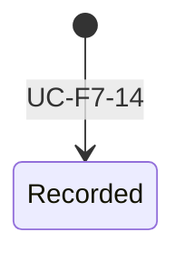

🏠 [Specs](../../../README.md) › 🧩 [Functional capabilities](../../README.md) ›
📦 [F7 Purchasing and stock](../README.md) › 🗃️ [Data](README.md) › 🗃️ E-F7-13 Call for tenders

# 🗃️ E-F7-13 Call for tenders

**Status:** ✅ specified

## Purpose

Alternative quotes compared.

## Fields

| Name | Type | Required | Validation | Default | Example | Personal data | Custom fields |
|---|---|---|---|---|---|---|---|
| request | purchase request | yes | - | - | Laptops x 20 | no | no |
| answers | supplier quotes | yes | - | - | 3 | no | no |
| winner | supplier | no | - | - | Supplier B | no | no |

## Relations

As its use cases.

## Lifecycle

## Indexes and search

By name, date, owner.

## Retention

Kept for the period of its kind of record in the country pack (D293), or else its kind's default in the
[retention schedule](../../../05-non-functional/data-retention.md). See
[CR-FR-002 Accounting records kept 10 years](../../../10-country-packs/france/accounting/cr-fr-002-accounting-records-kept-ten-years.md).

## Audit

Every change.

## Import and export

CSV.

## Used by

- [UC-F7-14](../use-cases/06-benchmark-additions/uc-f07-14-run-a-call-for-tenders-and-rate-suppliers.md)

## Open questions

None.

---

⬅️ [E-F7-12 Landed cost](e-f07-12-landed-cost.md) · ⬆️ [Up](README.md) ·
➡️ [E-F7-14 Repair order](e-f07-14-repair-order.md)
