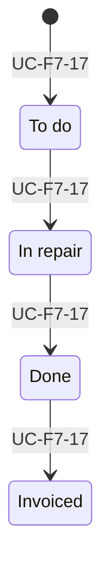

🏠 [Specs](../../../README.md) › 🧩 [Functional capabilities](../../README.md) ›
📦 [F7 Purchasing and stock](../README.md) › 🗃️ [Data](README.md) › 🗃️ E-F7-14 Repair order

# 🗃️ E-F7-14 Repair order

**Status:** ✅ specified

## Purpose

A repair of a product.

## Fields

| Name | Type | Required | Validation | Default | Example | Personal data | Custom fields |
|---|---|---|---|---|---|---|---|
| product, serial | records | yes | - | - | Drill D-44 | no | no |
| parts, labour | lines | no | - | - | Motor, 1 h | no | no |
| under warranty | yes, no | yes | - | no | yes | no | no |
| state | to do, in repair, done, invoiced | yes | - | to do | done | no | no |

## Relations

As its use cases.

## Lifecycle

## Indexes and search

By name, date, owner.

## Retention

Kept for the period of its kind of record in the country pack (D293), or else its kind's default in the
[retention schedule](../../../05-non-functional/data-retention.md). See
[CR-FR-002 Accounting records kept 10 years](../../../10-country-packs/france/accounting/cr-fr-002-accounting-records-kept-ten-years.md).

## Audit

Every change.

## Import and export

CSV.

## Used by

- [UC-F7-17](../use-cases/06-benchmark-additions/uc-f07-17-repair-products.md)

## Open questions

None.

---

⬅️ [E-F7-13 Call for tenders](e-f07-13-call-for-tenders.md) · ⬆️ [Up](README.md) ·
➡️ [E-F7-15 Supplier contract](e-f07-15-supplier-contract.md)
