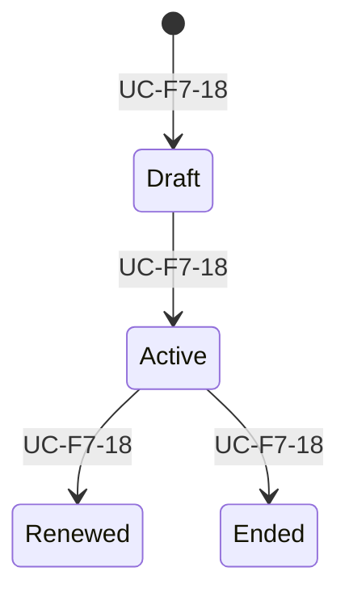

🏠 [Specs](../../../README.md) › 🧩 [Functional capabilities](../../README.md) ›
📦 [F7 Purchasing and stock](../README.md) › 🗃️ [Data](README.md) › 🗃️ E-F7-15 Supplier contract

# 🗃️ E-F7-15 Supplier contract

**Status:** ✅ specified

## Purpose

A supplier agreement with its prices, rebates, validity and notice.

## Fields

| Name | Type | Required | Validation | Default | Example | Personal data | Custom fields |
|---|---|---|---|---|---|---|---|
| supplier | supplier | yes | - | - | Brasseries Rhône | no | - |
| validity | dates | yes | - | - | 2027-01-01 to 2027-12-31 | no | - |
| notice | months | no | - | - | 3 | no | - |
| prices | per item or category | yes | - | - | -6 % on beers | no | - |
| rebate tiers | list | no | - | - | 2 % over 200,000 EUR | no | - |
| file | document | no | - | - | contract-2027.pdf | no | - |

## Relations

One supplier has several over time; Purchase orders take its prices.

## Lifecycle

## Indexes and search

By supplier and validity.

## Retention

10 years after its end, as a supporting document of the purchases
([CR-FR-002 Accounting records kept 10 years](../../../10-country-packs/france/accounting/cr-fr-002-accounting-records-kept-ten-years.md)).

## Audit

Created, changed, renewed, ended.

## Import and export

None.

## Used by

- [UC-F7-18 Manage supplier contracts and price agreements](../use-cases/07-supplier-agreements-and-performance/uc-f07-18-manage-supplier-contracts-and-price-agreements.md)

## Open questions

None.

---

⬅️ [E-F7-14 Repair order](e-f07-14-repair-order.md) · ⬆️ [Up](README.md) ·
➡️ [E-F7-16 Supplier score](e-f07-16-supplier-score.md)
