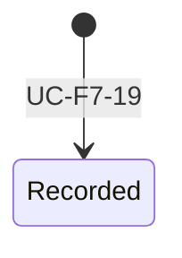

🏠 [Specs](../../../README.md) › 🧩 [Functional capabilities](../../README.md) ›
📦 [F7 Purchasing and stock](../README.md) › 🗃️ [Data](README.md) › 🗃️ E-F7-16 Supplier score

# 🗃️ E-F7-16 Supplier score

**Status:** 🔄 waiting for the owner

## Purpose

A supplier's performance over a period.

## Fields

| Name | Type | Required | Validation | Default | Example | Personal data | Custom fields |
|---|---|---|---|---|---|---|---|
| supplier | supplier | yes | - | - | Supplier X | no | - |
| period | dates | yes | - | - | last 12 months | no | - |
| on time in full | percent | yes | - | - | 78 | no | - |
| rejects, price variance, lead-time drift | percent, percent, days | yes | - | - | 4 %, +3 %, +2 days | no | - |
| score | 0 to 100 | no | enough receipts | - | 71 | no | - |

## Relations

Computed from Receipts, quality checks and Supplier invoices.

## Lifecycle

Recomputed monthly.

## Indexes and search

By supplier and score.

## Retention

5 years (Proposed).

## Audit

Weights changed; reviews.

## Import and export

None.

## Used by

- [UC-F7-19 Follow supplier performance](../use-cases/07-supplier-agreements-and-performance/uc-f07-19-follow-supplier-performance.md)

## Open questions

None.

---

⬅️ [E-F7-15 Supplier contract](e-f07-15-supplier-contract.md) · ⬆️ [Up](README.md) ·
➡️ [E-F7-17 Approved catalogue](e-f07-17-approved-catalogue.md)
