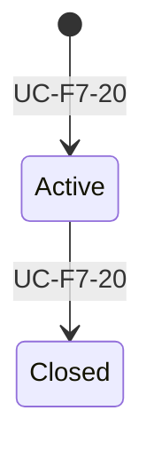

🏠 [Specs](../../../README.md) › 🧩 [Functional capabilities](../../README.md) ›
📦 [F7 Purchasing and stock](../README.md) › 🗃️ [Data](README.md) › 🗃️ E-F7-17 Approved catalogue

# 🗃️ E-F7-17 Approved catalogue

**Status:** ✅ specified

## Purpose

Items employees may order directly, or a supplier's punch-out connection.

## Fields

| Name | Type | Required | Validation | Default | Example | Personal data | Custom fields |
|---|---|---|---|---|---|---|---|
| kind | catalogue, punch-out | yes | - | - | punch-out | no | - |
| supplier | supplier | yes | - | - | Office supplier | no | - |
| items or address | items at contract prices, or the punch-out address | yes | - | - | https://punchout... | no | - |
| who may use | departments or roles | yes | - | - | all employees | no | - |

## Relations

Linked to a Supplier contract; carts become Purchase requests.

## Lifecycle

Active, closed.

## Indexes and search

By supplier and department.

## Retention

While used.

## Audit

Changed.

## Import and export

None.

## Used by

- [UC-F7-20 Order from an approved catalogue or punch-out](../use-cases/08-catalogues-and-stock-levels/uc-f07-20-order-from-an-approved-catalogue-or-punch-out.md)

## Open questions

None.

---

⬅️ [E-F7-16 Supplier score](e-f07-16-supplier-score.md) · ⬆️ [Up](README.md) ·
➡️ [E-F7-18 Eco-contribution scale](e-f07-18-eco-contribution-scale.md)
