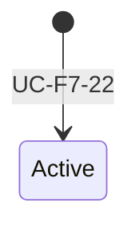

🏠 [Specs](../../../README.md) › 🧩 [Functional capabilities](../../README.md) ›
📦 [F7 Purchasing and stock](../README.md) › 🗃️ [Data](README.md) › 🗃️ E-F7-18 Eco-contribution scale

# 🗃️ E-F7-18 Eco-contribution scale

**Status:** 🔄 waiting for the owner

## Purpose

An eco-organisation's scale per material or category, and items' packaging.

## Fields

| Name | Type | Required | Validation | Default | Example | Personal data | Custom fields |
|---|---|---|---|---|---|---|---|
| sector | packaging, electrical, furniture... | yes | - | - | packaging | no | - |
| rates | per material or category | yes | - | - | cardboard 0.20 EUR/kg | no | - |
| year | year | yes | - | - | 2027 | no | - |

## Relations

Applied to Items with their packaging weights.

## Lifecycle

One per year and sector.

## Indexes and search

By sector and year.

## Retention

10 years (Proposed).

## Audit

Rates changed; declarations.

## Import and export

None.

## Used by

- [UC-F7-22 Charge and declare packaging eco-contributions](../use-cases/09-compliance-and-carbon/uc-f07-22-charge-and-declare-packaging-eco-contributions.md)

## Open questions

None.

---

⬅️ [E-F7-17 Approved catalogue](e-f07-17-approved-catalogue.md) · ⬆️ [Up](README.md) ·
➡️ [E-F7-19 Safety data sheet](e-f07-19-safety-data-sheet.md)
