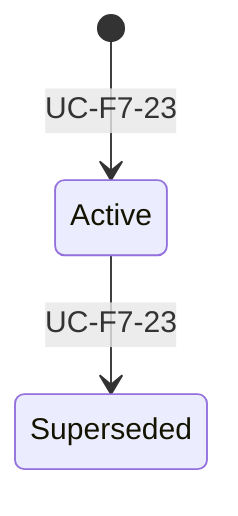

🏠 [Specs](../../../README.md) › 🧩 [Functional capabilities](../../README.md) ›
📦 [F7 Purchasing and stock](../README.md) › 🗃️ [Data](README.md) › 🗃️ E-F7-19 Safety data sheet

# 🗃️ E-F7-19 Safety data sheet

**Status:** ✅ specified, ⚖️ lawyer review before launch (D574)

## Purpose

A hazardous item's safety data sheet and storage class.

## Fields

| Name | Type | Required | Validation | Default | Example | Personal data | Custom fields |
|---|---|---|---|---|---|---|---|
| item | item | yes | - | - | Fungicide 20 L | no | - |
| version, date | text, date | yes | current | - | v4, 2026-03-10 | no | - |
| hazard classes | list | yes | - | - | 6.1 | no | - |
| storage class and limit | class, quantity | yes | - | - | toxics, 500 L | no | - |
| file | document | yes | - | - | fds-v4.pdf | no | - |

## Relations

One current per Item; Locations carry storage classes.

## Lifecycle

Current, superseded.

## Indexes and search

By item and class; the hazardous stock register.

## Retention

10 years after the item's last use (⚖️ lawyer review before launch, D574: Regulation (EC) 1907/2006 (REACH), article 36;
no France-pack rule reads it).

## Audit

Added, superseded.

## Import and export

None.

## Used by

- [UC-F7-23 Store dangerous goods with their safety data sheets](../use-cases/02-receive-and-store/uc-f07-23-store-dangerous-goods-with-their-safety-data-sheets.md)

## Open questions

None.

---

⬅️ [E-F7-18 Eco-contribution scale](e-f07-18-eco-contribution-scale.md) · ⬆️ [Up](README.md) ·
➡️ [E-F7-20 Emission factor](e-f07-20-emission-factor.md)
