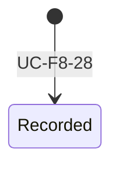

🏠 [Specs](../../../README.md) › 🧩 [Functional capabilities](../../README.md) ›
📦 [F7 Purchasing and stock](../README.md) › 🗃️ [Data](README.md) › 🗃️ E-F7-20 Emission factor

# 🗃️ E-F7-20 Emission factor

**Status:** ✅ specified

## Purpose

A factor turning spend or quantity into emissions, or a supplier's own figure.

## Fields

| Name | Type | Required | Validation | Default | Example | Personal data | Custom fields |
|---|---|---|---|---|---|---|---|
| category or item | category or item | yes | - | - | Food and drinks | no | - |
| factor | kg CO2e per EUR or per unit | yes | - | - | 0.45 per EUR | no | - |
| source | text | yes | - | - | national factor base 2026 | no | - |
| method | factor, supplier data | yes | - | factor | factor | no | - |

## Relations

Applied to Supplier invoice lines.

## Lifecycle

Versioned per year.

## Indexes and search

By category.

## Retention

10 years.

## Audit

Changed.

## Import and export

None.

## Used by

- [UC-F7-24 Measure the carbon of purchases](../use-cases/09-compliance-and-carbon/uc-f07-24-measure-the-carbon-of-purchases.md)
- [UC-F8-28 Prepare the sustainability report](../../f08-accounting/use-cases/09-pay-analyse-and-report/uc-f08-28-prepare-the-sustainability-report.md)

## Open questions

None.

---

⬅️ [E-F7-19 Safety data sheet](e-f07-19-safety-data-sheet.md) · ⬆️ [Up](README.md) ·
➡️ [E-F7-21 Demand forecast](e-f07-21-demand-forecast.md)
