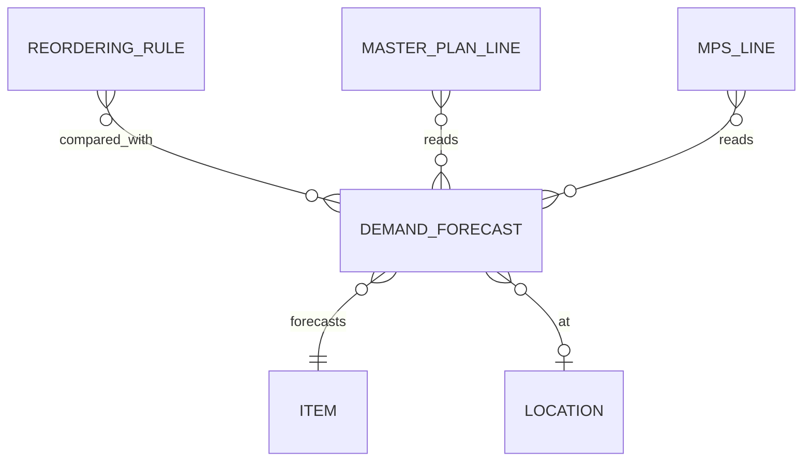
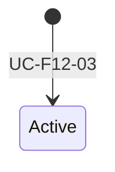

🏠 [Specs](../../../README.md) › 🧩 [Functional capabilities](../../README.md) ›
📦 [F7 Purchasing and stock](../README.md) › 🗃️ [Data](README.md) › 🗃️ E-F7-21 Demand forecast

# 🗃️ E-F7-21 Demand forecast

**Status:** ✅ specified

## Purpose

The demand forecast the flow charts name with the words "Forecast", "Forecasts"
([FL-F12-02](../../f12-manufacturing/flows/fl-f12-02-plan-production.md), [FL-F7-03](../flows/fl-f07-03-replenish.md),
[FL-F7-08](../flows/fl-f07-08-catalogues-and-stock-levels.md)). The owner decided to create it
([D516](../../../06-decisions/foundations/d516-naming-rules-and-the-seven-classes-of-names.md)); its fields are derived
from the specifications and confirmed by the owner (D572).

## Fields

| Name | Type | Required | Validation | Default | Example | Personal data | Custom fields |
|---|---|---|---|---|---|---|---|
| item | item (E-F7-06) | yes | an item of the company | - | Cable 3G2.5 | no | no |
| location | location (E-F7-07) | no | a stock location of the company | - | Lyon/Stock | no | no |
| period | week, month, quarter or season | yes | - | - | Q1 2027 | no | no |
| forecast quantity | number | yes | 0 or more, in the item's unit | - | 600 | no | no |
| forecast stock-out date | date | no | computed from the stock on hand and the forecast | computed | 2026-11-18 | no | no |
| method | AI model, rules only | yes | rules only when the history is too short | - | AI model | no | no |
| explanation | text | no | what the forecast is based on | - | sales, season, open orders | no | no |
| state | Active | yes | the lifecycle below | Active | Active | no | no |

The title shown in the list is the item and the period: "Cable 3G2.5, Q1 2027"
([S-F7-L21](../screens/00-lists/s-f07-l21-demand-forecasts.md)). The forecast comes from sales, seasons and open orders
([FL-F7-03](../flows/fl-f07-03-replenish.md)); it is made by the AI model and explained, or by the rules only when the
history is too short ([UC-F7-05](../use-cases/03-replenish/uc-f07-05-replenish-stock.md), error flow 1e and acceptance
criterion 3). Its forecast stock and stock-out date drive the suggestion of
[BR-F7-14](../business-rules/br-f07-14-safety-stock-triggers-a-suggestion.md), shown per item and location on
[S-F7-21](../screens/03-replenish/s-f07-21-stock-levels.md) and [S-F7-05](../screens/03-replenish/s-f07-05-replenishment.md)
([UC-F7-21](../use-cases/03-replenish/uc-f07-21-set-safety-stock-and-min-max-per-item.md)); the master plan reads it per
product and week ([UC-F12-03](../../f12-manufacturing/use-cases/02-plan-production/uc-f12-03-plan-production.md),
[S-F12-03](../../f12-manufacturing/screens/02-plan-production/s-f12-03-master-plan.md)).

## Relations

- [E-F7-06 Item](e-f07-06-item.md)
- [E-F7-07 Location](e-f07-07-location.md)
- [E-F7-09 Reordering rule](e-f07-09-reordering-rule.md): its safety stock, minimum and maximum.
- [E-F12-12 Master plan line](../../f12-manufacturing/data/e-f12-12-master-plan-line.md)
- [E-F12-32 MPS line](../../f12-manufacturing/data/e-f12-32-mps-line.md): its forecast per week.

## Lifecycle

## Indexes and search

Searched by item; filtered by location, period, method and state
([S-F7-L21](../screens/00-lists/s-f07-l21-demand-forecasts.md), [S-F7-21](../screens/03-replenish/s-f07-21-stock-levels.md)).

## Retention

As the other records of its capability.

## Audit

Every change, as the other records of its capability.

## Import and export

No import: forecasts are computed. CSV or XLSX export of the fields the user may see (T3).

## Used by

- [UC-F12-03 Plan production](../../f12-manufacturing/use-cases/02-plan-production/uc-f12-03-plan-production.md)
- [UC-F7-21 Set safety stock and min/max per item](../use-cases/03-replenish/uc-f07-21-set-safety-stock-and-min-max-per-item.md)

## Open questions

None.

---

⬅️ [E-F7-20 Emission factor](e-f07-20-emission-factor.md) · ⬆️ [Up](README.md) ·
➡️ [E-F7-22 Delivery note](e-f07-22-delivery-note.md)
