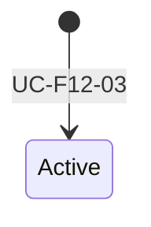

🏠 [Specs](../../../README.md) › 🧩 [Functional capabilities](../../README.md) ›
📦 [F7 Purchasing and stock](../README.md) › 🗃️ [Data](README.md) › 🗃️ E-F7-21 Demand forecast

# 🗃️ E-F7-21 Demand forecast

**Status:** 🔄 waiting for the owner

## Purpose

(Proposed) The demand forecast the flow charts name with the words "Forecast", "Forecasts"
([FL-F12-02](../../f12-manufacturing/flows/fl-f12-02-plan-production.md), [FL-F7-03](../flows/fl-f07-03-replenish.md),
[FL-F7-08](../flows/fl-f07-08-catalogues-and-stock-levels.md)). The owner decided to create it
([D516](../../../06-decisions/foundations/d516-naming-rules-and-the-seven-classes-of-names.md)); what it holds waits for
the owner's confirmation.

## Fields

(Proposed) To define with the owner: the flow charts name the record, not its fields.

## Relations

(Proposed) To define with the owner, from the use cases below.

## Lifecycle

## Indexes and search

(Proposed) To define with the owner.

## Retention

(Proposed) As the other records of its capability, to confirm with the owner.

## Audit

(Proposed) Every change, as the other records of its capability.

## Import and export

(Proposed) To define with the owner.

## Used by

- [UC-F12-03 Plan production](../../f12-manufacturing/use-cases/02-plan-production/uc-f12-03-plan-production.md)
- [UC-F7-21 Set safety stock and min/max per item](../use-cases/03-replenish/uc-f07-21-set-safety-stock-and-min-max-per-item.md)

## Open questions

(Proposed) Its fields, relations and states wait for the owner (waiting list, step 36e).

---

⬅️ [E-F7-20 Emission factor](e-f07-20-emission-factor.md) · ⬆️ [Up](README.md) ·
➡️ [E-F7-22 Delivery note](e-f07-22-delivery-note.md)
