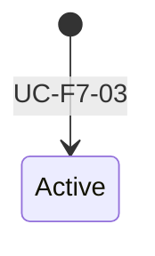

🏠 [Specs](../../../README.md) › 🧩 [Functional capabilities](../../README.md) ›
📦 [F7 Purchasing and stock](../README.md) › 🗃️ [Data](README.md) › 🗃️ E-F7-22 Delivery note

# 🗃️ E-F7-22 Delivery note

**Status:** 🔄 waiting for the owner

## Purpose

(Proposed) The delivery note the flow charts name with the words "delivery note"
([FL-F7-02](../flows/fl-f07-02-receive-and-store.md)). The owner decided to create it
([D516](../../../06-decisions/foundations/d516-naming-rules-and-the-seven-classes-of-names.md)); what it holds waits for
the owner's confirmation.

## Fields

(Proposed) To define with the owner: the flow charts name the record, not its fields.

## Relations

(Proposed) To define with the owner, from the use cases below.

## Lifecycle

## Indexes and search

(Proposed) To define with the owner.

## Retention

(Proposed) As the other records of its capability, to confirm with the owner.

## Audit

(Proposed) Every change, as the other records of its capability.

## Import and export

(Proposed) To define with the owner.

## Used by

- [UC-F7-03 Receive goods](../use-cases/02-receive-and-store/uc-f07-03-receive-goods.md)

## Open questions

(Proposed) Its fields, relations and states wait for the owner (waiting list, step 36e).

---

⬅️ [E-F7-21 Demand forecast](e-f07-21-demand-forecast.md) · ⬆️ [Up](README.md) ·
➡️ [E-F7-23 Stock owner](e-f07-23-stock-owner.md)
