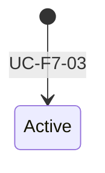

🏠 [Specs](../../../README.md) › 🧩 [Functional capabilities](../../README.md) ›
📦 [F7 Purchasing and stock](../README.md) › 🗃️ [Data](README.md) › 🗃️ E-F7-22 Delivery note

# 🗃️ E-F7-22 Delivery note

**Status:** ✅ specified

## Purpose

The delivery note the flow charts name with the words "delivery note"
([FL-F7-02](../flows/fl-f07-02-receive-and-store.md)). The owner decided to create it
([D516](../../../06-decisions/foundations/d516-naming-rules-and-the-seven-classes-of-names.md)); its fields are derived
from the specifications and confirmed by the owner (D572).

## Fields

| Name | Type | Required | Validation | Default | Example | Personal data | Custom fields |
|---|---|---|---|---|---|---|---|
| number | text | yes | - | - | BL-2026-0912 | no | no |
| direction | incoming, outgoing | yes | one of the two | - | incoming | no | no |
| partner | supplier (E-F7-01) or customer (E-F6-01) | yes | a supplier for an incoming note, a customer for an outgoing one | - | Rexel | no | no |
| order | purchase order (E-F7-03) or order (E-F6-04) | no | an order of the same partner | - | PO-2026-077 | no | no |
| lines | list of item, quantity expected, quantity scanned, lot or serial, expiry date | yes | items of the order; lots and serials as BR-F7-05 | - | Socket boxes, 400 expected, 380 scanned | no | no |
| delivery date | date | no | not in the future | - | 2026-11-18 | no | no |
| despatch advice | EDI message (E-F7-26) | no | a despatch advice of the same supplier | - | DESADV 2 pallets | no | no |
| state | Active | yes | the lifecycle below | Active | Active | no | no |

The title shown in the list is the number and the partner: "BL-2026-0912 Rexel"
([S-F7-L22](../screens/00-lists/s-f07-l22-delivery-notes.md)). The incoming note is scanned at the receipt with its
quantities, lots, serials and expiry dates, and a partial receipt keeps the rest expected
([UC-F7-03](../use-cases/02-receive-and-store/uc-f07-03-receive-goods.md),
[FL-F7-02](../flows/fl-f07-02-receive-and-store.md), and the receipt mock-up of
[S-F7-03](../screens/02-receive-and-store/s-f07-03-receipt.md): item, expected, scanned, lot); an EDI despatch advice
prepares it as an expected receipt
([UC-F7-29](../use-cases/10-consignment-scanning-and-edi/uc-f07-29-exchange-orders-and-invoices-by-edi-with-suppliers.md)).
The outgoing note carries the picked and packed lines
([UC-F7-26](../use-cases/10-consignment-scanning-and-edi/uc-f07-26-scan-in-the-warehouse-app.md)), the returnable
packaging ([UC-F7-28](../use-cases/10-consignment-scanning-and-edi/uc-f07-28-track-returnable-packaging-and-deposits.md))
and the delivery date a warranty starts from
([UC-F6-31](../../f06-customers-and-sales/use-cases/10-partners-contracts-and-warranties/uc-f06-31-handle-a-warranty-claim.md)).

## Relations

```mermaid
erDiagram
  DELIVERY_NOTE }o--o| SUPPLIER_RECORD : from
  DELIVERY_NOTE }o--o| CUSTOMER_RECORD : to
  DELIVERY_NOTE }o--o| PURCHASE_ORDER : receives
  DELIVERY_NOTE }o--o| ORDER : delivers
  DELIVERY_NOTE ||--o{ TRANSFER : moves
  DELIVERY_NOTE }o--o{ LOT_OR_SERIAL : traces
  DELIVERY_NOTE }o--o| EDI_MESSAGE : announced_by
  PACKAGING_DEPOSIT }o--o{ DELIVERY_NOTE : moves_on
```

- [E-F7-01 Supplier record](e-f07-01-supplier-record.md)
- [E-F6-01 Customer record](../../f06-customers-and-sales/data/e-f06-01-customer-record.md)
- [E-F7-03 Purchase order](e-f07-03-purchase-order.md)
- [E-F6-04 Order](../../f06-customers-and-sales/data/e-f06-04-order.md)
- [E-F7-04 Transfer](e-f07-04-transfer.md): the receipt or delivery steps that move the stock.
- [E-F7-06 Item](e-f07-06-item.md)
- [E-F7-10 Lot or serial](e-f07-10-lot-or-serial.md)
- [E-F7-26 EDI message](e-f07-26-edi-message.md)
- [E-F7-25 Packaging deposit](e-f07-25-packaging-deposit.md)

## Lifecycle



## Indexes and search

Found by scanning its number or its order at the receipt
([UC-F7-03](../use-cases/02-receive-and-store/uc-f07-03-receive-goods.md)). Searched by number, partner and order;
filtered by direction and state ([S-F7-L22](../screens/00-lists/s-f07-l22-delivery-notes.md)).

## Retention

As the other records of its capability.

## Audit

Every change, as the other records of its capability.

## Import and export

An incoming note is created from a supplier's EDI despatch advice
([UC-F7-29](../use-cases/10-consignment-scanning-and-edi/uc-f07-29-exchange-orders-and-invoices-by-edi-with-suppliers.md));
no file import. CSV or XLSX export of the fields the user may see (T3).

## Used by

- [UC-F7-03 Receive goods](../use-cases/02-receive-and-store/uc-f07-03-receive-goods.md)

## Open questions

None.

---

⬅️ [E-F7-21 Demand forecast](e-f07-21-demand-forecast.md) · ⬆️ [Up](README.md) ·
➡️ [E-F7-23 Stock owner](e-f07-23-stock-owner.md)
