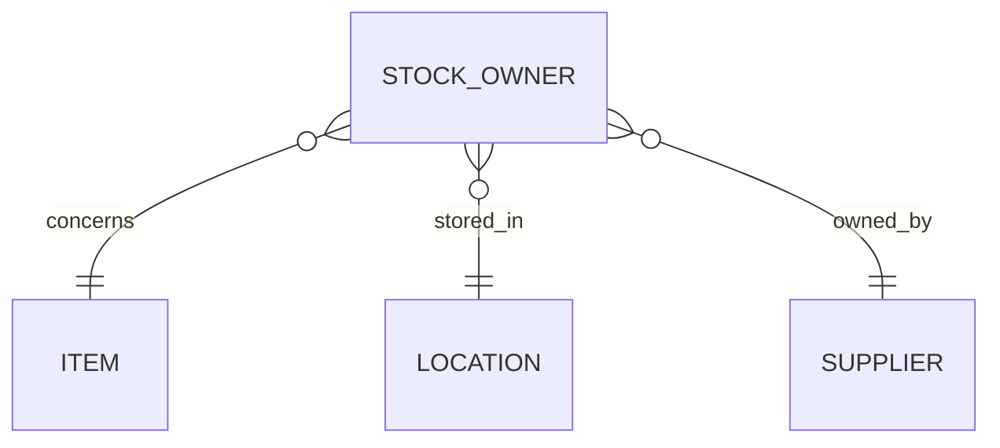
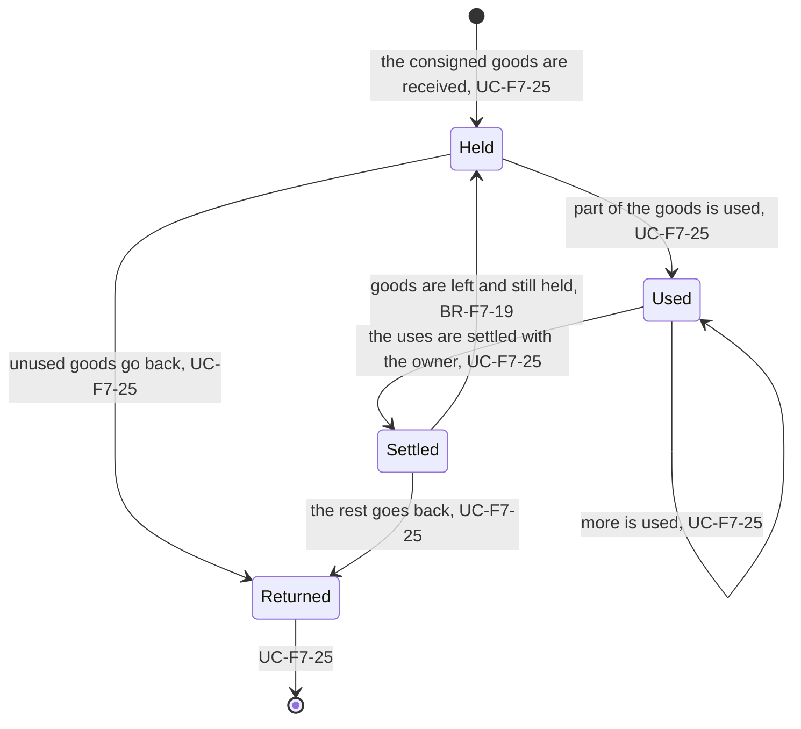

🏠 [Specs](../../../README.md) › 🧩 [Functional capabilities](../../README.md) ›
📦 [F7 Purchasing and stock](../README.md) › 🗃️ [Data](README.md) › 🗃️ E-F7-23 Stock owner

# 🗃️ E-F7-23 Stock owner

**Status:** ✅ specified

## Purpose

The owner of a quantity of an item in a location, when it is not only the company: consigned in or out
([D526](../../../06-decisions/f07-purchasing-and-stock/d526-benchmark-gaps-f07-purchasing-and-stock.md)).

## Fields

| Name | Type | Required | Validation | Default | Example | Personal data | Custom fields |
|---|---|---|---|---|---|---|---|
| item | item (E-F7-06) | yes | an item of the catalogue | - | Oak plank 30mm | no | no |
| lot | lot or serial (E-F7-10) | no | a lot of the item | - | L-4412 | no | no |
| location | location (E-F7-07) | yes | a consignment location | - | CONS-A | no | no |
| owned by | supplier, customer or company | yes | one of the three | supplier | supplier | no | no |
| owner record | supplier or customer | yes | the owner's record | - | Menuiserie Dupont | no | no |
| quantity received | number | yes | more than 0 | - | 500 | no | no |
| quantity used | number | no | 0 up to received | 0 | 120 | no | no |
| agreed price | amount with currency | no | within the agreement | from the agreement | 12.00 EUR | no | no |
| received on | date | yes | not in the future | today | 2026-11-03 | no | no |
| state | Held, Used, Settled, Returned | yes | the lifecycle below | Held | Used | no | no |
| owner | user | yes | a user of the company | the creator | Claire P. | yes | no |

## Relations

- [E-F7-06 Item](e-f07-06-item.md)
- [E-F7-07 Location](e-f07-07-location.md)
- [E-F7-01 Supplier record](e-f07-01-supplier-record.md)

## Lifecycle

## Indexes and search

By item, lot, location, owner, state and received date.

## Retention

Kept 10 years after settlement with the movements
([CR-FR-002](../../../10-country-packs/france/accounting/cr-fr-002-accounting-records-kept-ten-years.md)).

## Audit

Every receipt, use, return and settlement, with who, when, the quantity and the owner.

## Import and export

Import the supplier's delivery list from a CSV; export the statement of use as a CSV or a PDF.

## Used by

- [UC-F7-25](../use-cases/10-consignment-scanning-and-edi/uc-f07-25-keep-consignment-stock.md)

## Open questions

None.

---

⬅️ [E-F7-22 Delivery note](e-f07-22-delivery-note.md) · ⬆️ [Up](README.md) ·
➡️ [E-F7-24 Periodic count](e-f07-24-periodic-count.md)
