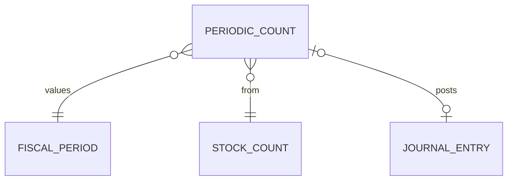
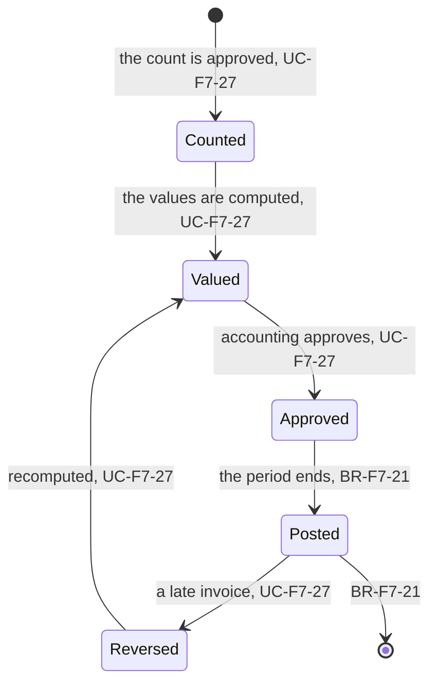

🏠 [Specs](../../../README.md) › 🧩 [Functional capabilities](../../README.md) ›
📦 [F7 Purchasing and stock](../README.md) › 🗃️ [Data](README.md) › 🗃️ E-F7-24 Periodic count

# 🗃️ E-F7-24 Periodic count

**Status:** ✅ specified

## Purpose

The valuation of one period's count under the periodic method: the quantities, the values and the stock variation
([D526](../../../06-decisions/f07-purchasing-and-stock/d526-benchmark-gaps-f07-purchasing-and-stock.md)).

## Fields

| Name | Type | Required | Validation | Default | Example | Personal data | Custom fields |
|---|---|---|---|---|---|---|---|
| period | fiscal period (E-F8-10) | yes | an open or closing period | - | October 2026 | no | no |
| stock count | stock count (E-F7-11) | yes | an approved count | - | Count 2026-10-30 | no | no |
| opening value | amount with currency | yes | the previous closing value | computed | 55,100 EUR | no | no |
| purchases | amount with currency | yes | from posted supplier invoices | computed | 20,400 EUR | no | no |
| closing value | amount with currency | yes | from the count and the costs | computed | 61,300 EUR | no | no |
| stock variation | amount with sign | yes | opening plus purchases minus closing | computed | +6,200 EUR | no | no |
| entry | journal entry (E-F8-03) | no | set when posted | - | JE-2026-1031 | no | no |
| approved by | user | no | accounting | - | Claire P. | yes | no |
| state | Counted, Valued, Approved, Posted, Reversed | yes | the lifecycle below | Counted | Valued | no | no |
| owner | user | yes | a user of the company | the creator | Claire P. | yes | no |

## Relations

- [E-F8-10 Fiscal period](../../f08-accounting/data/e-f08-10-fiscal-period.md)
- [E-F7-11 Stock count](e-f07-11-stock-count.md)
- [E-F8-03 Journal entry](../../f08-accounting/data/e-f08-03-journal-entry.md)

## Lifecycle

## Indexes and search

By period, state and closing value.

## Retention

Kept 10 years with the entry
([CR-FR-002](../../../10-country-packs/france/accounting/cr-fr-002-accounting-records-kept-ten-years.md)).

## Audit

Every valuation, correction, approval, posting and reversal, with who, when and the amounts.

## Import and export

No import. Export the valuation per category as a CSV or a PDF for the accountant.

## Used by

- [UC-F7-27](../use-cases/10-consignment-scanning-and-edi/uc-f07-27-value-stock-periodically.md)

## Open questions

None.

---

⬅️ [E-F7-23 Stock owner](e-f07-23-stock-owner.md) · ⬆️ [Up](README.md) ·
➡️ [E-F7-25 Packaging deposit](e-f07-25-packaging-deposit.md)
