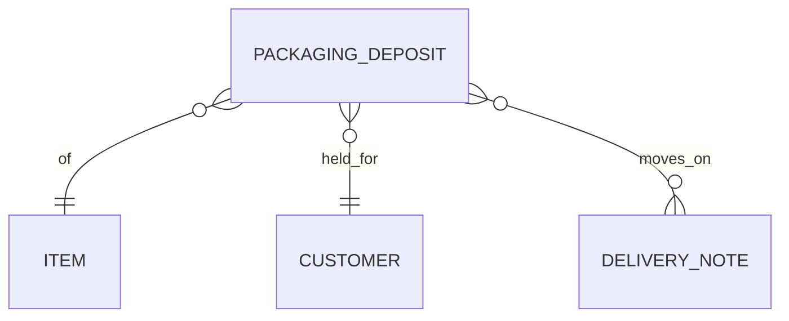
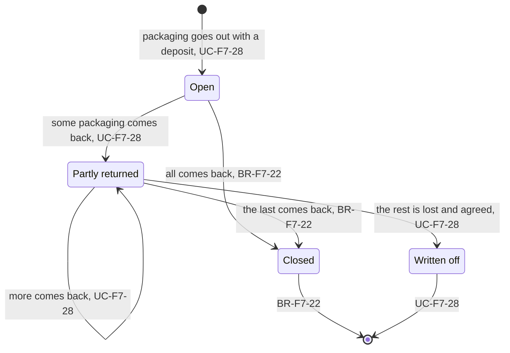

🏠 [Specs](../../../README.md) › 🧩 [Functional capabilities](../../README.md) ›
📦 [F7 Purchasing and stock](../README.md) › 🗃️ [Data](README.md) › 🗃️ E-F7-25 Packaging deposit

# 🗃️ E-F7-25 Packaging deposit

**Status:** ✅ specified

## Purpose

A deposit on returnable packaging for one party: what went out, what came back, and the money held or owed
([D526](../../../06-decisions/f07-purchasing-and-stock/d526-benchmark-gaps-f07-purchasing-and-stock.md)).

## Fields

| Name | Type | Required | Validation | Default | Example | Personal data | Custom fields |
|---|---|---|---|---|---|---|---|
| party | customer or supplier | yes | an active customer or supplier | - | Bois et Fils | no | no |
| packaging type | item (E-F7-06) | yes | an item marked returnable | - | Crate 40 L | no | no |
| unit deposit | amount with currency | yes | 0 or more | from the packaging type | 5.00 EUR | no | no |
| quantity out | number | yes | 0 or more | 0 | 40 | no | no |
| quantity returned | number | no | 0 up to out | 0 | 30 | no | no |
| deposit held | amount with currency | no | computed | computed | 50.00 EUR | no | no |
| deposit refunded | amount with currency | no | computed | 0 | 150.00 EUR | no | no |
| direction | customer deposit or supplier deposit | yes | one of the two | customer deposit | customer deposit | no | no |
| state | Open, Partly returned, Closed, Written off | yes | the lifecycle below | Open | Partly returned | no | no |
| owner | user | yes | a user of the company | the creator | Claire P. | yes | no |

## Relations

- [E-F7-06 Item](e-f07-06-item.md)
- [E-F6-01 Customer record](../../f06-customers-and-sales/data/e-f06-01-customer-record.md)
- [E-F7-22 Delivery note](e-f07-22-delivery-note.md)

## Lifecycle

## Indexes and search

By party, packaging type, state and quantity still out.

## Retention

Kept 10 years after it closes, with the invoices
([CR-FR-002](../../../10-country-packs/france/accounting/cr-fr-002-accounting-records-kept-ten-years.md)).

## Audit

Every packaging out, return and write-off with the party, quantity, state, amount, who and when.

## Import and export

Export the deposit statement per party as a CSV or a PDF; no import.

## Used by

- [UC-F7-28](../use-cases/10-consignment-scanning-and-edi/uc-f07-28-track-returnable-packaging-and-deposits.md)

## Open questions

None.

---

⬅️ [E-F7-24 Periodic count](e-f07-24-periodic-count.md) · ⬆️ [Up](README.md) ·
➡️ [E-F7-26 EDI message](e-f07-26-edi-message.md)
