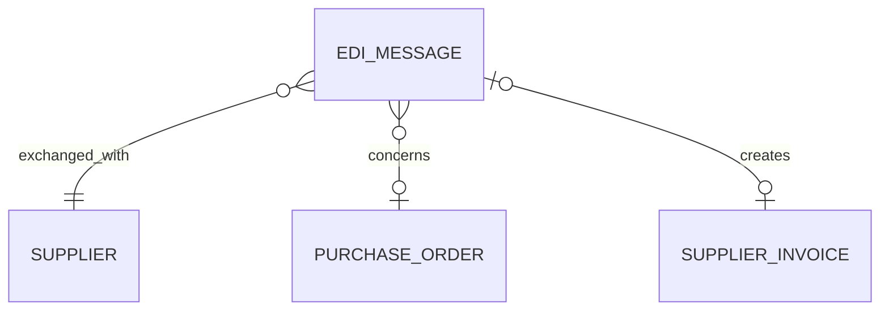
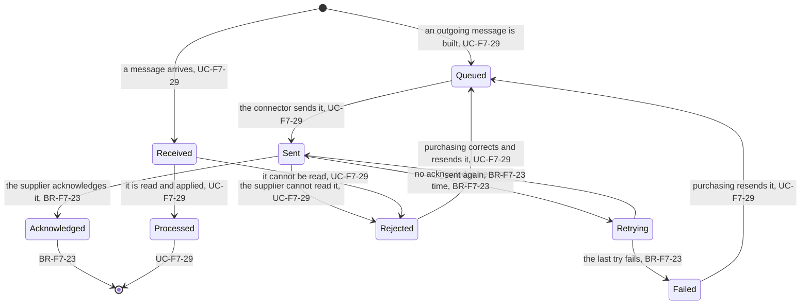

🏠 [Specs](../../../README.md) › 🧩 [Functional capabilities](../../README.md) ›
📦 [F7 Purchasing and stock](../README.md) › 🗃️ [Data](README.md) › 🗃️ E-F7-26 EDI message

# 🗃️ E-F7-26 EDI message

**Status:** ✅ specified

## Purpose

One EDI message exchanged with a supplier: its type, direction, content and delivery state
([D526](../../../06-decisions/f07-purchasing-and-stock/d526-benchmark-gaps-f07-purchasing-and-stock.md)).

## Fields

| Name | Type | Required | Validation | Default | Example | Personal data | Custom fields |
|---|---|---|---|---|---|---|---|
| supplier | supplier (E-F7-01) | yes | a supplier with an EDI agreement | - | Menuiserie Dupont | no | no |
| direction | out or in | yes | one of the two | out | out | no | no |
| type | order, order response, despatch advice or invoice | yes | one of the four | - | order | no | no |
| reference | text | yes | unique per supplier and direction | - | PO-2310 | no | no |
| order | purchase order (E-F7-03) | no | an order of the supplier | - | PO-2310 | no | no |
| content | message body | yes | valid for its format | - | order, 2 lines | no | no |
| tries | number | no | 0 to the agreed maximum | 0 | 1 | no | no |
| failure reason | text | no | set when Failed or Rejected | - | unknown item code | no | no |
| sent or received at | date and time | no | - | now | 2026-11-14 10:02 | no | no |
| state | Queued, Sent, Acknowledged, Retrying, Failed, Rejected, Received, Processed | yes | the lifecycle below | Queued | Sent | no | no |
| owner | user | yes | a user of the company | the creator | Claire P. | yes | no |

## Relations

- [E-F7-01 Supplier record](e-f07-01-supplier-record.md)
- [E-F7-03 Purchase order](e-f07-03-purchase-order.md)
- [E-F7-05 Supplier invoice](e-f07-05-supplier-invoice.md)

## Lifecycle

## Indexes and search

By supplier, type, direction, reference, state and date.

## Retention

Kept 10 years for orders and invoices, 2 years for the other messages
([CR-FR-002](../../../10-country-packs/france/accounting/cr-fr-002-accounting-records-kept-ten-years.md)).

## Audit

Every state change, retry and resend with who or what, when and the reason.

## Import and export

Export the messages of a period as a CSV; the content is kept as received.

## Used by

- [UC-F7-29](../use-cases/10-consignment-scanning-and-edi/uc-f07-29-exchange-orders-and-invoices-by-edi-with-suppliers.md)

## Open questions

None.

---

⬅️ [E-F7-25 Packaging deposit](e-f07-25-packaging-deposit.md) · ⬆️ [Up](README.md) ·
➡️ [E-F7-27 Slotting proposal](e-f07-27-slotting-proposal.md)
