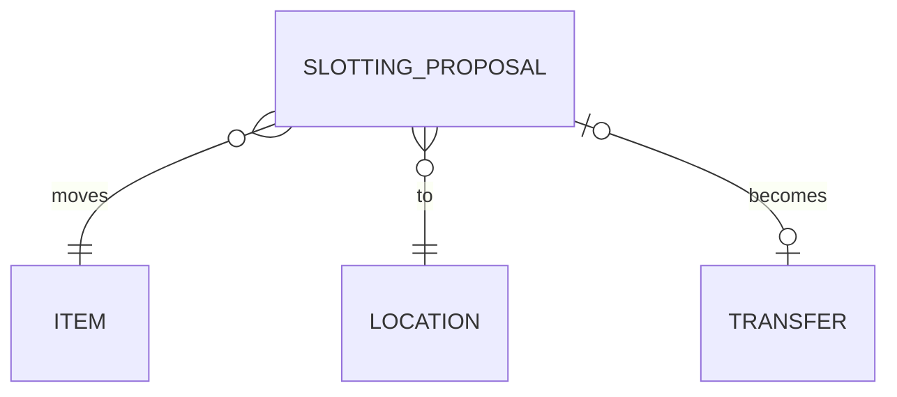
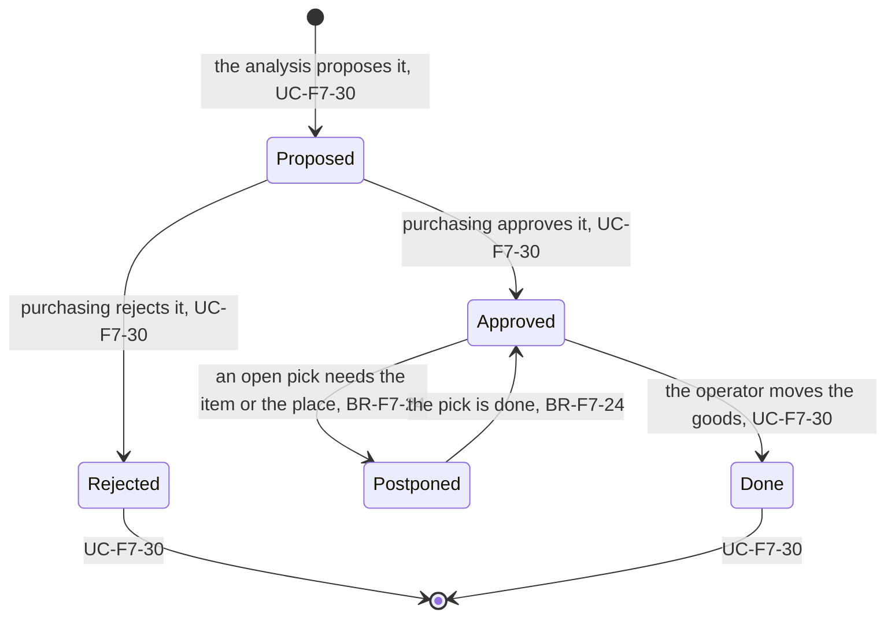

🏠 [Specs](../../../README.md) › 🧩 [Functional capabilities](../../README.md) ›
📦 [F7 Purchasing and stock](../README.md) › 🗃️ [Data](README.md) › 🗃️ E-F7-27 Slotting proposal

# 🗃️ E-F7-27 Slotting proposal

**Status:** ✅ specified

## Purpose

A proposal to move an item to a better storage location, with its reason and expected gain
([D526](../../../06-decisions/f07-purchasing-and-stock/d526-benchmark-gaps-f07-purchasing-and-stock.md)).

## Fields

| Name | Type | Required | Validation | Default | Example | Personal data | Custom fields |
|---|---|---|---|---|---|---|---|
| item | item (E-F7-06) | yes | an item in stock | - | Oak plank 30mm | no | no |
| from location | location (E-F7-07) | yes | where the item is now | - | C-14-4 | no | no |
| to location | location (E-F7-07) | yes | a location with capacity | - | A-02-1 | no | no |
| reason | text | yes | from the analysis | - | 300 picks a month | no | no |
| expected gain | metres per pick | no | 0 or more | computed | 9 | no | no |
| move task | transfer (E-F7-04) | no | set when approved | - | TR-5521 | no | no |
| analysed on | date | yes | not in the future | today | 2026-11-14 | no | no |
| state | Proposed, Approved, Rejected, Postponed, Done | yes | the lifecycle below | Proposed | Approved | no | no |
| owner | user | yes | a user of the company | the creator | Claire P. | yes | no |

## Relations

- [E-F7-06 Item](e-f07-06-item.md)
- [E-F7-07 Location](e-f07-07-location.md)
- [E-F7-04 Transfer](e-f07-04-transfer.md)

## Lifecycle

## Indexes and search

By item, from and to location, state and date of analysis.

## Retention

Kept 2 years; a rejected proposal is kept 3 months so that it is not offered again.

## Audit

Every analysis run, decision, postponement and move, with who or what, when and the reason.

## Import and export

Export the proposals as a CSV; no import.

## Used by

- [UC-F7-30](../use-cases/10-consignment-scanning-and-edi/uc-f07-30-optimise-storage-locations.md)

## Open questions

None.

---

⬅️ [E-F7-26 EDI message](e-f07-26-edi-message.md) · ⬆️ [Up](README.md)
