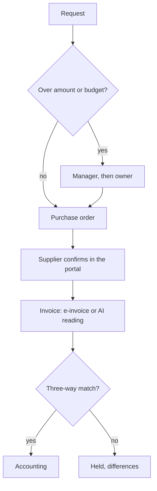

🏠 [Specs](../../../README.md) › 🧩 [Functional capabilities](../../README.md) ›
📦 [F7 Purchasing and stock](../README.md) › 🔀 [Flows](README.md) › 🔀 FL-F7-01 Procure

# 🔀 FL-F7-01 Procure

**Status:** ✅ specified

## Summary

Covers UC-F7-01, UC-F7-02, UC-F7-04, UC-F7-12.

## Personas

See each use case.

- [U10 Supplier](../../../01-users/personas/u10-supplier.md), acting in the chart, step 36i

## Flowchart

## Sequence diagram

See each use case.

## Steps

| Step | Persona | Screen | Use case | What happens |
|---|---|---|---|---|
| 1 | See [UC-F7-01](../use-cases/01-procure/uc-f07-01-request-and-approve-a-purchase.md) | [S-F7-01](../screens/01-procure/s-f07-01-purchase-request.md) | [UC-F7-01](../use-cases/01-procure/uc-f07-01-request-and-approve-a-purchase.md) | Request and approve a purchase |
| 2 | See [UC-F7-02](../use-cases/01-procure/uc-f07-02-order-from-a-supplier.md) | [S-F7-02](../screens/01-procure/s-f07-02-purchase-order.md) | [UC-F7-02](../use-cases/01-procure/uc-f07-02-order-from-a-supplier.md) | Order from a supplier |
| 3 | See [UC-F7-04](../use-cases/01-procure/uc-f07-04-capture-and-match-supplier-invoices.md) | [S-F7-04](../screens/01-procure/s-f07-04-supplier-invoice-matching.md) | [UC-F7-04](../use-cases/01-procure/uc-f07-04-capture-and-match-supplier-invoices.md) | Capture and match supplier invoices |
| 4 | See [UC-F7-12](../use-cases/01-procure/uc-f07-12-use-the-supplier-portal.md) | [S-F7-12](../screens/01-procure/s-f07-12-supplier-portal.md) | [UC-F7-12](../use-cases/01-procure/uc-f07-12-use-the-supplier-portal.md) | Use the supplier portal |

### Entities and screens

| Entity | States in this flow | Shown at step and screen | Aggregated view |
|---|---|---|---|
| [E-F7-02 Purchase request](../data/e-f07-02-purchase-request.md) | Draft, To approve, Refused, Approved, Ordered | 1 [S-F7-01](../screens/01-procure/s-f07-01-purchase-request.md) | Purchase requests |
| [E-F8-08 Accounting budget](../../f08-accounting/data/e-f08-08-accounting-budget.md) | Active | Shown elsewhere: [S-F8-09 Analytics and budgets](../../f08-accounting/screens/04-tax-assets-and-analytics/s-f08-09-analytics-and-budgets.md) | Accounting budgets |
| [E-F7-03 Purchase order](../data/e-f07-03-purchase-order.md) | Draft, Sent, Confirmed, Received, Billed | 1 [S-F7-01](../screens/01-procure/s-f07-01-purchase-request.md); 2 [S-F7-02](../screens/01-procure/s-f07-02-purchase-order.md); 3 [S-F7-04](../screens/01-procure/s-f07-04-supplier-invoice-matching.md); 4 [S-F7-12](../screens/01-procure/s-f07-12-supplier-portal.md) | Purchase orders |
| [E-F1-17 Portal account](../../f01-administration/data/e-f01-17-portal-account.md) | Invited, Active, Blocked, Deactivated | Shown elsewhere: [S-F1-19 Portal accounts](../../f01-administration/screens/12-portal-accounts-and-integrations/s-f01-19-portal-accounts.md) | Portal accounts |
| [E-F7-05 Supplier invoice](../data/e-f07-05-supplier-invoice.md) | Received, Matched, Held | 3 [S-F7-04](../screens/01-procure/s-f07-04-supplier-invoice-matching.md) | Supplier invoices |

## Errors

As each use case.

## Images

Every step and error, for each persona taking part, in light and dark mode (D120). Steps are numbered as in the Steps
table; E rows are the error cases.

| Step | Persona | Device | Light | Dark |
|---|---|---|---|---|
| 1 | U01 | desktop | [light](../images/01-procure/u01-employee/1-request-and-approve-desktop-light.png) | [dark](../images/01-procure/u01-employee/1-request-and-approve-desktop-dark.png) |
| 2 | U04 | desktop | [light](../images/01-procure/u04-purchasing/2-purchase-order-desktop-light.png) | [dark](../images/01-procure/u04-purchasing/2-purchase-order-desktop-dark.png) |
| 3 | U05 | desktop | [light](../images/01-procure/u05-accounting/3-match-invoice-desktop-light.png) | [dark](../images/01-procure/u05-accounting/3-match-invoice-desktop-dark.png) |
| 4 | U10 | phone | [light](../images/01-procure/u10-supplier/4-supplier-portal-phone-light.png) | [dark](../images/01-procure/u10-supplier/4-supplier-portal-phone-dark.png) |
| E1 | U01 | desktop | [light](../images/01-procure/u01-employee/e1-budget-exceeded-desktop-light.png) | [dark](../images/01-procure/u01-employee/e1-budget-exceeded-desktop-dark.png) |
| E1 | U01 | phone | [light](../images/01-procure/u01-employee/e1-budget-exceeded-phone-light.png) | [dark](../images/01-procure/u01-employee/e1-budget-exceeded-phone-dark.png) |

## Open questions

None.

---

⬆️ [Up](README.md) · ➡️ [FL-F7-02 Receive and store](fl-f07-02-receive-and-store.md)
