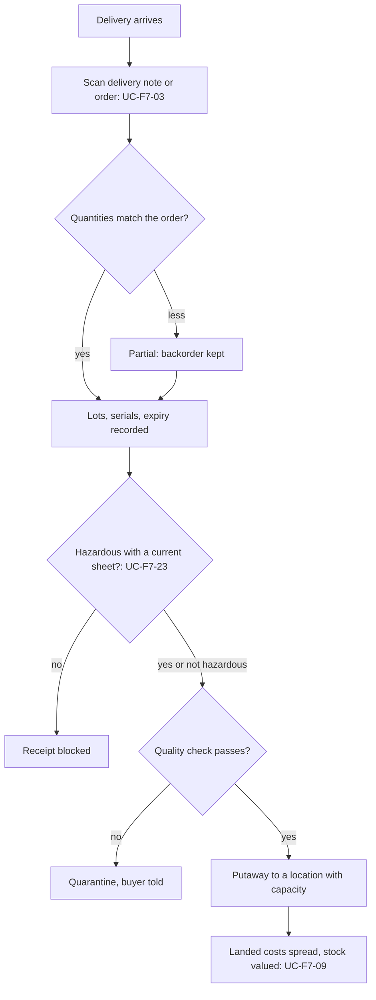

🏠 [Specs](../../../README.md) › 🧩 [Functional capabilities](../../README.md) ›
📦 [F7 Purchasing and stock](../README.md) › 🔀 [Flows](README.md) › 🔀 FL-F7-02 Receive and store

# 🔀 FL-F7-02 Receive and store

**Status:** ✅ specified

## Summary

Goods arrive, are checked, put away and valued: the delivery note is scanned, quantities, lots and expiry dates
recorded, quality checked, a compatible location proposed, then landed costs spread and stock valued.

## Personas

- [U05 Accounting](../../../01-users/personas/u05-accounting.md)
- [U15 Warehouse operator](../../../01-users/personas/u15-warehouse-operator.md)

## Flowchart

## Sequence diagram

See each use case.

## Steps

| Step | Persona | Screen | Use case | What happens |
|---|---|---|---|---|
| 1 | [U15](../../../01-users/personas/u15-warehouse-operator.md) | [S-F7-03](../screens/02-receive-and-store/s-f07-03-receipt.md) | [UC-F7-03](../use-cases/02-receive-and-store/uc-f07-03-receive-goods.md) | Scan the delivery and record quantities and lots |
| 2 | [U15](../../../01-users/personas/u15-warehouse-operator.md) | [S-F7-03](../screens/02-receive-and-store/s-f07-03-receipt.md) | [UC-F7-03](../use-cases/02-receive-and-store/uc-f07-03-receive-goods.md) | Run the quality check and put away |
| 3 | [U15](../../../01-users/personas/u15-warehouse-operator.md) | [S-F7-23](../screens/02-receive-and-store/s-f07-23-dangerous-goods.md) | [UC-F7-23](../use-cases/02-receive-and-store/uc-f07-23-store-dangerous-goods-with-their-safety-data-sheets.md) | A hazardous item is checked for its safety data sheet |
| 4 | [U05](../../../01-users/personas/u05-accounting.md) | [S-F7-09](../screens/02-receive-and-store/s-f07-09-stock-valuation.md) | [UC-F7-09](../use-cases/02-receive-and-store/uc-f07-09-value-stock-and-landed-costs.md) | Spread landed costs and value the stock |

### Entities and screens

| Entity | States in this flow | Shown at step and screen | Aggregated view |
|---|---|---|---|
| [E-F7-04 Transfer](../data/e-f07-04-transfer.md) | Sent, Received, Lost, Reserved, Flagged | 1, 2 [S-F7-03](../screens/02-receive-and-store/s-f07-03-receipt.md) | Transfers |
| [E-F7-22 Delivery note](../data/e-f07-22-delivery-note.md) | Active | 1, 2 [S-F7-03](../screens/02-receive-and-store/s-f07-03-receipt.md) | Delivery notes |
| [E-F7-03 Purchase order](../data/e-f07-03-purchase-order.md) | Draft, Sent, Confirmed, Received, Billed | Shown elsewhere: [S-F7-02 Purchase order](../screens/01-procure/s-f07-02-purchase-order.md) | Purchase orders |
| [E-F7-10 Lot or serial](../data/e-f07-10-lot-or-serial.md) | Active | 1, 2 [S-F7-03](../screens/02-receive-and-store/s-f07-03-receipt.md) | Lot or serials |
| [E-F7-19 Safety data sheet](../data/e-f07-19-safety-data-sheet.md) | Active, Superseded | 1, 2 [S-F7-03](../screens/02-receive-and-store/s-f07-03-receipt.md); 3 [S-F7-23](../screens/02-receive-and-store/s-f07-23-dangerous-goods.md) | Safety data sheets |
| [E-F12-07 Quality control point](../../f12-manufacturing/data/e-f12-07-quality-control-point.md) | Active | Shown elsewhere: [S-F12-07 Quality checks](../../f12-manufacturing/screens/04-quality-and-maintenance/s-f12-07-quality-checks.md) | Quality control points |
| [E-F7-07 Location](../data/e-f07-07-location.md) | Active | 1, 2 [S-F7-03](../screens/02-receive-and-store/s-f07-03-receipt.md); 3 [S-F7-23](../screens/02-receive-and-store/s-f07-23-dangerous-goods.md) | Locations |
| [E-F7-12 Landed cost](../data/e-f07-12-landed-cost.md) | Active | 4 [S-F7-09](../screens/02-receive-and-store/s-f07-09-stock-valuation.md) | Landed costs |

## Errors

A short delivery, a failed quality check, no location with capacity, a safety data sheet out of date (BR-F7-05,
BR-F7-16).

## Images

Every step and error, for each persona taking part, in light and dark mode (D120). Steps are numbered as in the Steps
table; E rows are the error cases.

| Step | Persona | Device | Light | Dark |
|---|---|---|---|---|
| 1 | U15 | phone | [light](../images/02-receive-and-store/u15-warehouse-operator/1-receive-phone-light.png) | [dark](../images/02-receive-and-store/u15-warehouse-operator/1-receive-phone-dark.png) |
| 1 | U15 | tablet | [light](../images/02-receive-and-store/u15-warehouse-operator/1-receive-tablet-light.png) | [dark](../images/02-receive-and-store/u15-warehouse-operator/1-receive-tablet-dark.png) |
| 2 | U05 | desktop | [light](../images/02-receive-and-store/u05-accounting/2-valuation-desktop-light.png) | [dark](../images/02-receive-and-store/u05-accounting/2-valuation-desktop-dark.png) |
| 2 | U15 | phone | [light](../images/02-receive-and-store/u15-warehouse-operator/2-valuation-phone-light.png) | [dark](../images/02-receive-and-store/u15-warehouse-operator/2-valuation-phone-dark.png) |
| 2 | U15 | tablet | [light](../images/02-receive-and-store/u15-warehouse-operator/2-valuation-tablet-light.png) | [dark](../images/02-receive-and-store/u15-warehouse-operator/2-valuation-tablet-dark.png) |
| E1 | U15 | phone | [light](../images/02-receive-and-store/u15-warehouse-operator/e1-quality-failed-phone-light.png) | [dark](../images/02-receive-and-store/u15-warehouse-operator/e1-quality-failed-phone-dark.png) |
| E1 | U15 | tablet | [light](../images/02-receive-and-store/u15-warehouse-operator/e1-quality-failed-tablet-light.png) | [dark](../images/02-receive-and-store/u15-warehouse-operator/e1-quality-failed-tablet-dark.png) |
| 3 | U15 | phone | [light](../images/02-receive-and-store/u15-warehouse-operator/3-dangerous-goods-phone-light.png) | [dark](../images/02-receive-and-store/u15-warehouse-operator/3-dangerous-goods-phone-dark.png) |
| 3 | U15 | tablet | [light](../images/02-receive-and-store/u15-warehouse-operator/3-dangerous-goods-tablet-light.png) | [dark](../images/02-receive-and-store/u15-warehouse-operator/3-dangerous-goods-tablet-dark.png) |
| 4 | U05 | desktop | [light](../images/02-receive-and-store/u05-accounting/4-stock-valuation-desktop-light.png) | [dark](../images/02-receive-and-store/u05-accounting/4-stock-valuation-desktop-dark.png) |

## Open questions

None.

---

⬅️ [FL-F7-01 Procure](fl-f07-01-procure.md) · ⬆️ [Up](README.md) · ➡️ [FL-F7-03 Replenish](fl-f07-03-replenish.md)
