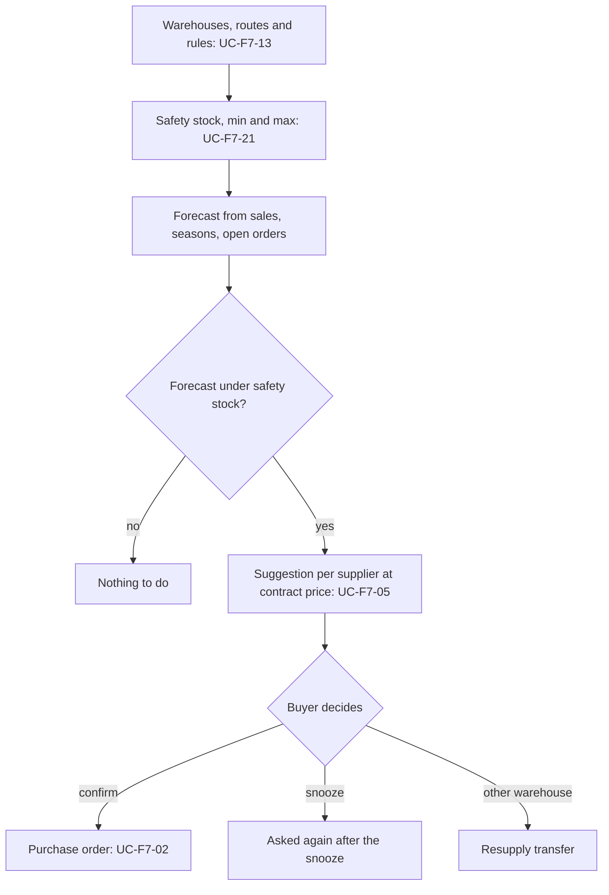

🏠 [Specs](../../../README.md) › 🧩 [Functional capabilities](../../README.md) ›
📦 [F7 Purchasing and stock](../README.md) › 🔀 [Flows](README.md) › 🔀 FL-F7-03 Replenish

# 🔀 FL-F7-03 Replenish

**Status:** ✅ specified

## Summary

Stock stays between its safety level and its maximum: rules, forecast and lead times give suggestions grouped per
supplier at contract prices, which the buyer confirms, snoozes or orders.

## Personas

- [U04 Purchasing and stock](../../../01-users/personas/u04-purchasing.md)
- [U07 Administrator](../../../01-users/personas/u07-administrator.md)

## Flowchart

## Sequence diagram

See each use case.

## Steps

| Step | Persona | Screen | Use case | What happens |
|---|---|---|---|---|
| 1 | [U07](../../../01-users/personas/u07-administrator.md) | [S-F7-13](../screens/03-replenish/s-f07-13-warehouse-setup.md) | [UC-F7-13](../use-cases/03-replenish/uc-f07-13-set-up-warehouses-routes-and-rules.md) | Set warehouses, routes and reordering rules |
| 2 | [U04](../../../01-users/personas/u04-purchasing.md) | [S-F7-21](../screens/03-replenish/s-f07-21-stock-levels.md) | [UC-F7-21](../use-cases/03-replenish/uc-f07-21-set-safety-stock-and-min-max-per-item.md) | Set safety stock and min/max |
| 3 | [U04](../../../01-users/personas/u04-purchasing.md) | [S-F7-05](../screens/03-replenish/s-f07-05-replenishment.md) | [UC-F7-05](../use-cases/03-replenish/uc-f07-05-replenish-stock.md) | Read the suggestions grouped per supplier |
| 4 | [U04](../../../01-users/personas/u04-purchasing.md) | [S-F7-05](../screens/03-replenish/s-f07-05-replenishment.md) | [UC-F7-05](../use-cases/03-replenish/uc-f07-05-replenish-stock.md) | Confirm, snooze or resupply from another warehouse |

### Entities and screens

| Entity | States in this flow | Shown at step and screen | Aggregated view |
|---|---|---|---|
| [E-F7-07 Location](../data/e-f07-07-location.md) | Active | 1 [S-F7-13](../screens/03-replenish/s-f07-13-warehouse-setup.md) | Locations |
| [E-F7-08 Route](../data/e-f07-08-route.md) | Active | 1 [S-F7-13](../screens/03-replenish/s-f07-13-warehouse-setup.md) | Routes |
| [E-F7-09 Reordering rule](../data/e-f07-09-reordering-rule.md) | Active | 1 [S-F7-13](../screens/03-replenish/s-f07-13-warehouse-setup.md); 2 [S-F7-21](../screens/03-replenish/s-f07-21-stock-levels.md); 3, 4 [S-F7-05](../screens/03-replenish/s-f07-05-replenishment.md) | Reordering rules |
| [E-F7-21 Demand forecast](../data/e-f07-21-demand-forecast.md) | Active | 2 [S-F7-21](../screens/03-replenish/s-f07-21-stock-levels.md); 3, 4 [S-F7-05](../screens/03-replenish/s-f07-05-replenishment.md) | Demand forecasts |
| [E-F6-04 Order](../../f06-customers-and-sales/data/e-f06-04-order.md) | Open | Shown elsewhere: [S-F6-05 Order](../../f06-customers-and-sales/screens/02-quote-to-order/s-f06-05-order.md) | Orders |
| [E-SC15-06 Purchase proposal](../../../08-sectors/sc15-wholesale-and-distribution/data/e-sc15-06-purchase-proposal.md) | Active | Shown elsewhere: [S-SC15-07 Drop-shipping](../../../08-sectors/sc15-wholesale-and-distribution/screens/02-orders/s-sc15-07-drop-shipping.md) | Purchase proposals |
| [E-F7-15 Supplier contract](../data/e-f07-15-supplier-contract.md) | Draft, Active, Renewed, Ended | Shown elsewhere: [S-F7-18 Supplier contracts](../screens/07-supplier-agreements-and-performance/s-f07-18-supplier-contracts.md) | Supplier contracts |
| [E-F7-03 Purchase order](../data/e-f07-03-purchase-order.md) | Draft, Sent, Confirmed, Received, Billed | 3, 4 [S-F7-05](../screens/03-replenish/s-f07-05-replenishment.md) | Purchase orders |
| [E-F7-04 Transfer](../data/e-f07-04-transfer.md) | Sent, Received, Lost, Reserved, Flagged | Shown elsewhere: [S-F10-25 Store stock and transfers](../../f10-point-of-sale/screens/10-clienteling-transfers-and-tax-free/s-f10-25-store-stock-and-transfers.md) | Transfers |

## Errors

A forecast with too little history, a supplier without a price, a minimum above the maximum (BR-F7-02, BR-F7-14).

## Images

Every step and error, for each persona taking part, in light and dark mode (D120). Steps are numbered as in the Steps
table; E rows are the error cases.

| Step | Persona | Device | Light | Dark |
|---|---|---|---|---|
| 1 | U04 | desktop | [light](../images/03-replenish/u04-purchasing/1-replenishment-report-desktop-light.png) | [dark](../images/03-replenish/u04-purchasing/1-replenishment-report-desktop-dark.png) |
| 1 | U07 | desktop | [light](../images/03-replenish/u07-administrator/1-replenishment-report-desktop-light.png) | [dark](../images/03-replenish/u07-administrator/1-replenishment-report-desktop-dark.png) |
| 2 | U07 | desktop | [light](../images/03-replenish/u07-administrator/2-warehouse-setup-desktop-light.png) | [dark](../images/03-replenish/u07-administrator/2-warehouse-setup-desktop-dark.png) |
| 2 | U04 | desktop | [light](../images/03-replenish/u04-purchasing/2-warehouse-setup-desktop-light.png) | [dark](../images/03-replenish/u04-purchasing/2-warehouse-setup-desktop-dark.png) |
| E1 | U07 | desktop | [light](../images/03-replenish/u07-administrator/e1-route-loop-desktop-light.png) | [dark](../images/03-replenish/u07-administrator/e1-route-loop-desktop-dark.png) |
| 3 | U04 | desktop | [light](../images/03-replenish/u04-purchasing/3-replenishment-desktop-light.png) | [dark](../images/03-replenish/u04-purchasing/3-replenishment-desktop-dark.png) |
| 4 | U04 | desktop | [light](../images/03-replenish/u04-purchasing/4-replenishment-desktop-light.png) | [dark](../images/03-replenish/u04-purchasing/4-replenishment-desktop-dark.png) |

## Open questions

None.

---

⬅️ [FL-F7-02 Receive and store](fl-f07-02-receive-and-store.md) · ⬆️ [Up](README.md) ·
➡️ [FL-F7-04 Pick, pack and ship](fl-f07-04-pick-pack-and-ship.md)
