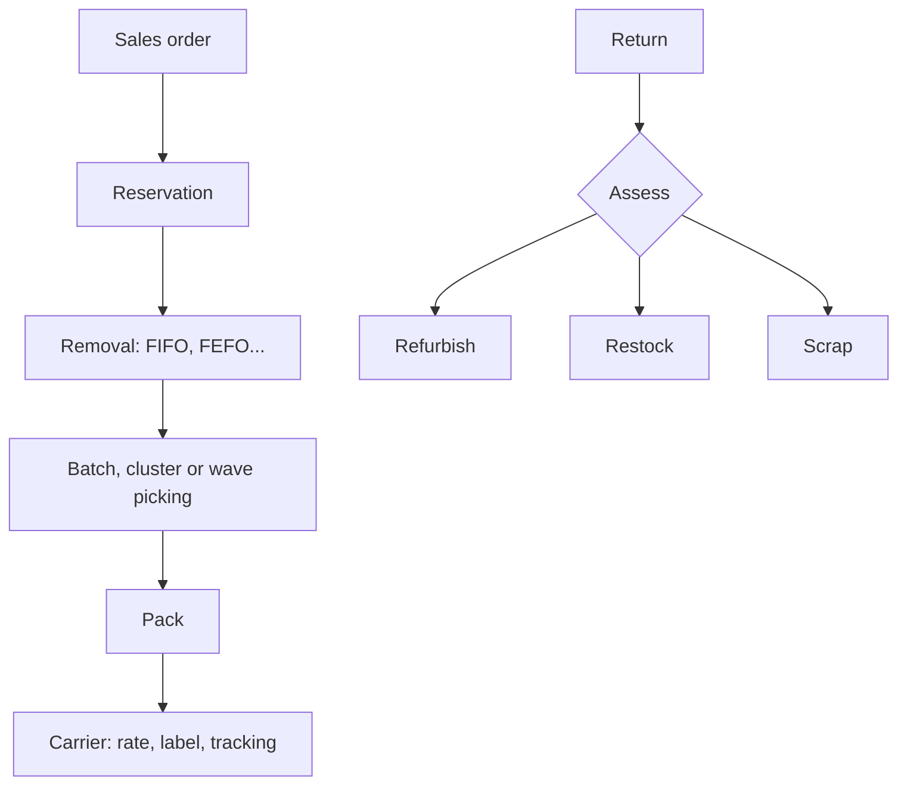

🏠 [Specs](../../../README.md) › 🧩 [Functional capabilities](../../README.md) ›
📦 [F7 Purchasing and stock](../README.md) › 🔀 [Flows](README.md) › 🔀 FL-F7-04 Pick, pack and ship

# 🔀 FL-F7-04 Pick, pack and ship

**Status:** ✅ specified

## Summary

Covers UC-F7-06, UC-F7-10.

## Personas

See each use case.

## Flowchart

## Sequence diagram

See each use case.

## Steps

| Step | Persona | Screen | Use case | What happens |
|---|---|---|---|---|
| 1 | See [UC-F7-06](../use-cases/04-pick-pack-and-ship/uc-f07-06-pick-pack-and-ship.md) | [S-F7-06](../screens/04-pick-pack-and-ship/s-f07-06-pick-pack-and-ship.md) | [UC-F7-06](../use-cases/04-pick-pack-and-ship/uc-f07-06-pick-pack-and-ship.md) | Pick, pack and ship |
| 2 | See [UC-F7-10](../use-cases/04-pick-pack-and-ship/uc-f07-10-handle-returns-and-scrap.md) | [S-F7-10](../screens/04-pick-pack-and-ship/s-f07-10-returns-and-scrap.md) | [UC-F7-10](../use-cases/04-pick-pack-and-ship/uc-f07-10-handle-returns-and-scrap.md) | Handle returns and scrap |

### Entities and screens

| Entity | States in this flow | Shown at step and screen | Aggregated view |
|---|---|---|---|
| [E-SC15-04 Sales order](../../../08-sectors/sc15-wholesale-and-distribution/data/e-sc15-04-sales-order.md) | Confirmed, Partly shipped, Held, Shipped | Shown elsewhere: [S-SC15-04 EDI orders](../../../08-sectors/sc15-wholesale-and-distribution/screens/02-orders/s-sc15-04-edi-orders.md) | Sales orders |
| [E-F6-04 Order](../../f06-customers-and-sales/data/e-f06-04-order.md) | Open, In progress, Cancelled, Done | Shown elsewhere: [S-F6-05 Order](../../f06-customers-and-sales/screens/02-quote-to-order/s-f06-05-order.md) | Orders |
| [E-F7-04 Transfer](../data/e-f07-04-transfer.md) | Sent, Received, Lost, Reserved, Flagged | 1 [S-F7-06](../screens/04-pick-pack-and-ship/s-f07-06-pick-pack-and-ship.md); 2 [S-F7-10](../screens/04-pick-pack-and-ship/s-f07-10-returns-and-scrap.md) | Transfers |

## Errors

As each use case.

## Images

Every step and error, for each persona taking part, in light and dark mode (D120). Steps are numbered as in the Steps
table; E rows are the error cases.

| Step | Persona | Device | Light | Dark |
|---|---|---|---|---|
| 1 | U15 | phone | [light](../images/04-pick-pack-and-ship/u15-warehouse-operator/1-pick-and-ship-phone-light.png) | [dark](../images/04-pick-pack-and-ship/u15-warehouse-operator/1-pick-and-ship-phone-dark.png) |
| 2 | U15 | phone | [light](../images/04-pick-pack-and-ship/u15-warehouse-operator/2-returns-and-scrap-phone-light.png) | [dark](../images/04-pick-pack-and-ship/u15-warehouse-operator/2-returns-and-scrap-phone-dark.png) |
| 2 | U15 | tablet | [light](../images/04-pick-pack-and-ship/u15-warehouse-operator/2-returns-and-scrap-tablet-light.png) | [dark](../images/04-pick-pack-and-ship/u15-warehouse-operator/2-returns-and-scrap-tablet-dark.png) |
| E1 | U15 | phone | [light](../images/04-pick-pack-and-ship/u15-warehouse-operator/e1-short-at-picking-phone-light.png) | [dark](../images/04-pick-pack-and-ship/u15-warehouse-operator/e1-short-at-picking-phone-dark.png) |
| E1 | U15 | tablet | [light](../images/04-pick-pack-and-ship/u15-warehouse-operator/e1-short-at-picking-tablet-light.png) | [dark](../images/04-pick-pack-and-ship/u15-warehouse-operator/e1-short-at-picking-tablet-dark.png) |

## Open questions

None.

---

⬅️ [FL-F7-03 Replenish](fl-f07-03-replenish.md) · ⬆️ [Up](README.md) ·
➡️ [FL-F7-05 Count, trace and analyse](fl-f07-05-count-trace-and-analyse.md)
