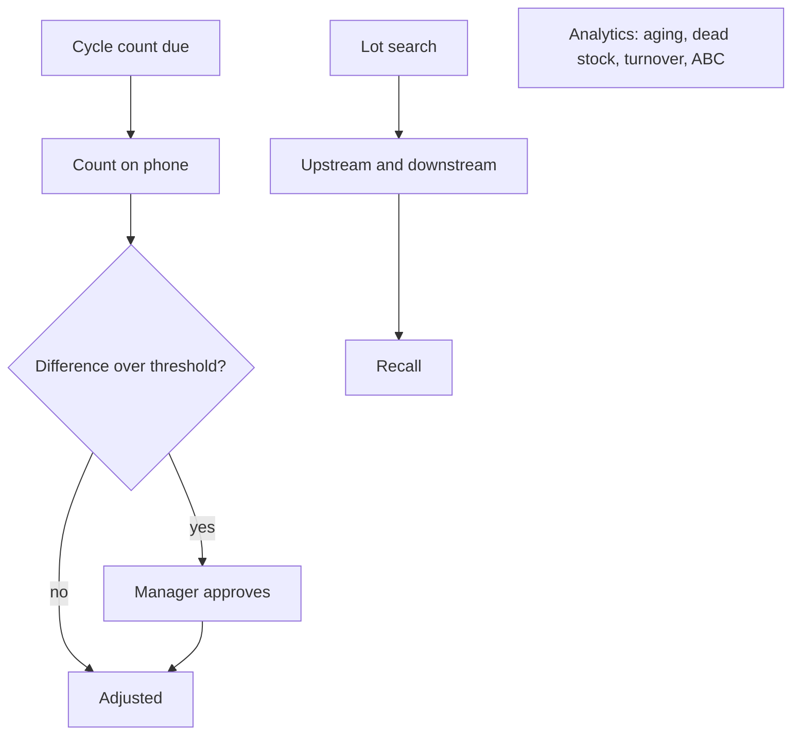

🏠 [Specs](../../../README.md) › 🧩 [Functional capabilities](../../README.md) ›
📦 [F7 Purchasing and stock](../README.md) › 🔀 [Flows](README.md) › 🔀 FL-F7-05 Count, trace and analyse

# 🔀 FL-F7-05 Count, trace and analyse

**Status:** ✅ specified

## Summary

Covers UC-F7-07, UC-F7-08, UC-F7-11.

## Personas

See each use case.

- [U02 Manager](../../../01-users/personas/u02-manager.md), acting in the chart, step 36i (Proposed)

## Flowchart

## Sequence diagram

See each use case.

## Steps

| Step | Persona | Screen | Use case | What happens |
|---|---|---|---|---|
| 1 | See [UC-F7-07](../use-cases/05-count-trace-and-analyse/uc-f07-07-count-stock.md) | [S-F7-07](../screens/05-count-trace-and-analyse/s-f07-07-stock-count.md) | [UC-F7-07](../use-cases/05-count-trace-and-analyse/uc-f07-07-count-stock.md) | Count stock |
| 2 | See [UC-F7-08](../use-cases/05-count-trace-and-analyse/uc-f07-08-trace-lots-and-serials-recall.md) | [S-F7-08](../screens/05-count-trace-and-analyse/s-f07-08-traceability.md) | [UC-F7-08](../use-cases/05-count-trace-and-analyse/uc-f07-08-trace-lots-and-serials-recall.md) | Trace lots and serials, recall |
| 3 | See [UC-F7-11](../use-cases/05-count-trace-and-analyse/uc-f07-11-analyse-stock.md) | [S-F7-11](../screens/05-count-trace-and-analyse/s-f07-11-stock-analytics.md) | [UC-F7-11](../use-cases/05-count-trace-and-analyse/uc-f07-11-analyse-stock.md) | Analyse stock |

### Entities and screens

| Entity | States in this flow | Shown at step and screen | Aggregated view |
|---|---|---|---|
| [E-F7-11 Stock count](../data/e-f07-11-stock-count.md) | To count, Counted, To approve, Applied | 1 [S-F7-07](../screens/05-count-trace-and-analyse/s-f07-07-stock-count.md); 3 [S-F7-11](../screens/05-count-trace-and-analyse/s-f07-11-stock-analytics.md) | Stock counts |
| [E-F7-10 Lot or serial](../data/e-f07-10-lot-or-serial.md) | Active | 2 [S-F7-08](../screens/05-count-trace-and-analyse/s-f07-08-traceability.md) | Lot or serials |
| [E-SC13-15 Recall](../../../08-sectors/sc13-agriculture-and-food/data/e-sc13-15-recall.md) | Active | Shown elsewhere: [S-SC13-17 Shelf life](../../../08-sectors/sc13-agriculture-and-food/screens/05-food-processing/s-sc13-17-shelf-life.md) | Recalls |

## Errors

As each use case.

## Images

Every step and error, for each persona taking part, in light and dark mode (D120). Steps are numbered as in the Steps
table; E rows are the error cases.

| Step | Persona | Device | Light | Dark |
|---|---|---|---|---|
| 1 | U15 | phone | [light](../images/05-count-trace-and-analyse/u15-warehouse-operator/1-cycle-count-phone-light.png) | [dark](../images/05-count-trace-and-analyse/u15-warehouse-operator/1-cycle-count-phone-dark.png) |
| 2 | U04 | desktop | [light](../images/05-count-trace-and-analyse/u04-purchasing/2-trace-a-lot-desktop-light.png) | [dark](../images/05-count-trace-and-analyse/u04-purchasing/2-trace-a-lot-desktop-dark.png) |
| 3 | U13 | desktop | [light](../images/05-count-trace-and-analyse/u13-owner/3-stock-analytics-desktop-light.png) | [dark](../images/05-count-trace-and-analyse/u13-owner/3-stock-analytics-desktop-dark.png) |
| E1 | U02 | desktop | [light](../images/05-count-trace-and-analyse/u02-manager/e1-count-to-approve-desktop-light.png) | [dark](../images/05-count-trace-and-analyse/u02-manager/e1-count-to-approve-desktop-dark.png) |
| E1 | U02 | phone | [light](../images/05-count-trace-and-analyse/u02-manager/e1-count-to-approve-phone-light.png) | [dark](../images/05-count-trace-and-analyse/u02-manager/e1-count-to-approve-phone-dark.png) |

## Open questions

None.

---

⬅️ [FL-F7-04 Pick, pack and ship](fl-f07-04-pick-pack-and-ship.md) · ⬆️ [Up](README.md) ·
➡️ [FL-F7-06 Benchmark additions](fl-f07-06-benchmark-additions.md)
