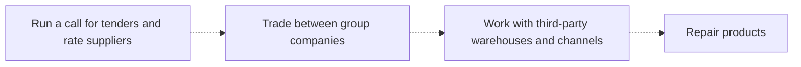

🏠 [Specs](../../../README.md) › 🧩 [Functional capabilities](../../README.md) ›
📦 [F7 Purchasing and stock](../README.md) › 🔀 [Flows](README.md) › 🔀 FL-F7-06 Benchmark additions

# 🔀 FL-F7-06 Benchmark additions

**Status:** ✅ specified

## Summary

The benchmark additions of D305: UC-F7-14, UC-F7-15, UC-F7-16, UC-F7-17. Each step stands on its own.

## Personas

- [U04 Purchasing](../../../01-users/personas/u04-purchasing.md)
- [U05 Accounting](../../../01-users/personas/u05-accounting.md)
- [U09 Customer](../../../01-users/personas/u09-customer.md)
- [U10 Supplier](../../../01-users/personas/u10-supplier.md)
- [U15 Warehouse operator](../../../01-users/personas/u15-warehouse-operator.md)

## Flowchart

## Sequence diagram

See each use case.

## Steps

| Step | Persona | Screen | Use case | What happens |
|---|---|---|---|---|
| 1 | U04, U10 | [S-F7-14](../screens/06-benchmark-additions/s-f07-14-tenders.md) | [UC-F7-14](../use-cases/06-benchmark-additions/uc-f07-14-run-a-call-for-tenders-and-rate-suppliers.md) | Run a call for tenders and rate suppliers |
| 2 | U04, U05 | [S-F7-15](../screens/06-benchmark-additions/s-f07-15-group-trade.md) | [UC-F7-15](../use-cases/06-benchmark-additions/uc-f07-15-trade-between-group-companies.md) | Trade between group companies |
| 3 | U15, U04 | [S-F7-16](../screens/06-benchmark-additions/s-f07-16-third-party-stock.md) | [UC-F7-16](../use-cases/06-benchmark-additions/uc-f07-16-work-with-third-party-warehouses-and-channels.md) | Work with third-party warehouses and channels |
| 4 | U15, U09 | [S-F7-17](../screens/06-benchmark-additions/s-f07-17-repairs.md) | [UC-F7-17](../use-cases/06-benchmark-additions/uc-f07-17-repair-products.md) | Repair products |

### Entities and screens

| Entity | States in this flow | Shown at step and screen | Aggregated view |
|---|---|---|---|
| [E-F7-13 Call for tenders](../data/e-f07-13-call-for-tenders.md) | Recorded | 1 [S-F7-14](../screens/06-benchmark-additions/s-f07-14-tenders.md) | Call for tenders |
| [E-F1-01 Company](../../f01-administration/data/e-f01-01-company.md) | In setup, Active | Shown elsewhere: [S-F1-10 Client companies](../../f01-administration/screens/08-provider-and-client-companies/s-f01-10-client-companies.md) | Companies |
| [E-F11-13 Channel listing](../../f11-online-shop/data/e-f11-13-channel-listing.md) | Active | Shown elsewhere: [S-F11-18 Channels](../../f11-online-shop/screens/06-channels-and-legal/s-f11-18-channels.md) | Channel listings |
| [E-F7-06 Item](../data/e-f07-06-item.md) | Active | Shown elsewhere: [S-F7-21 Stock levels](../screens/03-replenish/s-f07-21-stock-levels.md) | Items |

## Errors

As each use case; E1 shows one of them.

## Images

Every step and error, for each persona taking part, in light and dark mode (D120). Steps are numbered as in the Steps
table; E rows are the error cases.

| Step | Persona | Device | Light | Dark |
|---|---|---|---|---|
| 1 | U04 | desktop | [light](../images/06-benchmark-additions/u04-purchasing/1-tenders-desktop-light.png) | [dark](../images/06-benchmark-additions/u04-purchasing/1-tenders-desktop-dark.png) |
| 1 | U10 | phone | [light](../images/06-benchmark-additions/u10-supplier/1-tenders-phone-light.png) | [dark](../images/06-benchmark-additions/u10-supplier/1-tenders-phone-dark.png) |
| 2 | U04 | desktop | [light](../images/06-benchmark-additions/u04-purchasing/2-group-trade-desktop-light.png) | [dark](../images/06-benchmark-additions/u04-purchasing/2-group-trade-desktop-dark.png) |
| 2 | U05 | desktop | [light](../images/06-benchmark-additions/u05-accounting/2-group-trade-desktop-light.png) | [dark](../images/06-benchmark-additions/u05-accounting/2-group-trade-desktop-dark.png) |
| 3 | U15 | phone | [light](../images/06-benchmark-additions/u15-warehouse-operator/3-third-party-stock-phone-light.png) | [dark](../images/06-benchmark-additions/u15-warehouse-operator/3-third-party-stock-phone-dark.png) |
| 3 | U15 | tablet | [light](../images/06-benchmark-additions/u15-warehouse-operator/3-third-party-stock-tablet-light.png) | [dark](../images/06-benchmark-additions/u15-warehouse-operator/3-third-party-stock-tablet-dark.png) |
| 3 | U04 | desktop | [light](../images/06-benchmark-additions/u04-purchasing/3-third-party-stock-desktop-light.png) | [dark](../images/06-benchmark-additions/u04-purchasing/3-third-party-stock-desktop-dark.png) |
| 4 | U15 | phone | [light](../images/06-benchmark-additions/u15-warehouse-operator/4-repairs-phone-light.png) | [dark](../images/06-benchmark-additions/u15-warehouse-operator/4-repairs-phone-dark.png) |
| 4 | U15 | tablet | [light](../images/06-benchmark-additions/u15-warehouse-operator/4-repairs-tablet-light.png) | [dark](../images/06-benchmark-additions/u15-warehouse-operator/4-repairs-tablet-dark.png) |
| 4 | U09 | phone | [light](../images/06-benchmark-additions/u09-customer/4-repairs-phone-light.png) | [dark](../images/06-benchmark-additions/u09-customer/4-repairs-phone-dark.png) |
| E1 | U15 | phone | [light](../images/06-benchmark-additions/u15-warehouse-operator/e1-variance-phone-light.png) | [dark](../images/06-benchmark-additions/u15-warehouse-operator/e1-variance-phone-dark.png) |
| E1 | U15 | tablet | [light](../images/06-benchmark-additions/u15-warehouse-operator/e1-variance-tablet-light.png) | [dark](../images/06-benchmark-additions/u15-warehouse-operator/e1-variance-tablet-dark.png) |

## Open questions

None.

---

⬅️ [FL-F7-05 Count, trace and analyse](fl-f07-05-count-trace-and-analyse.md) · ⬆️ [Up](README.md) ·
➡️ [FL-F7-07 Supplier agreements and performance](fl-f07-07-supplier-agreements-and-performance.md)
