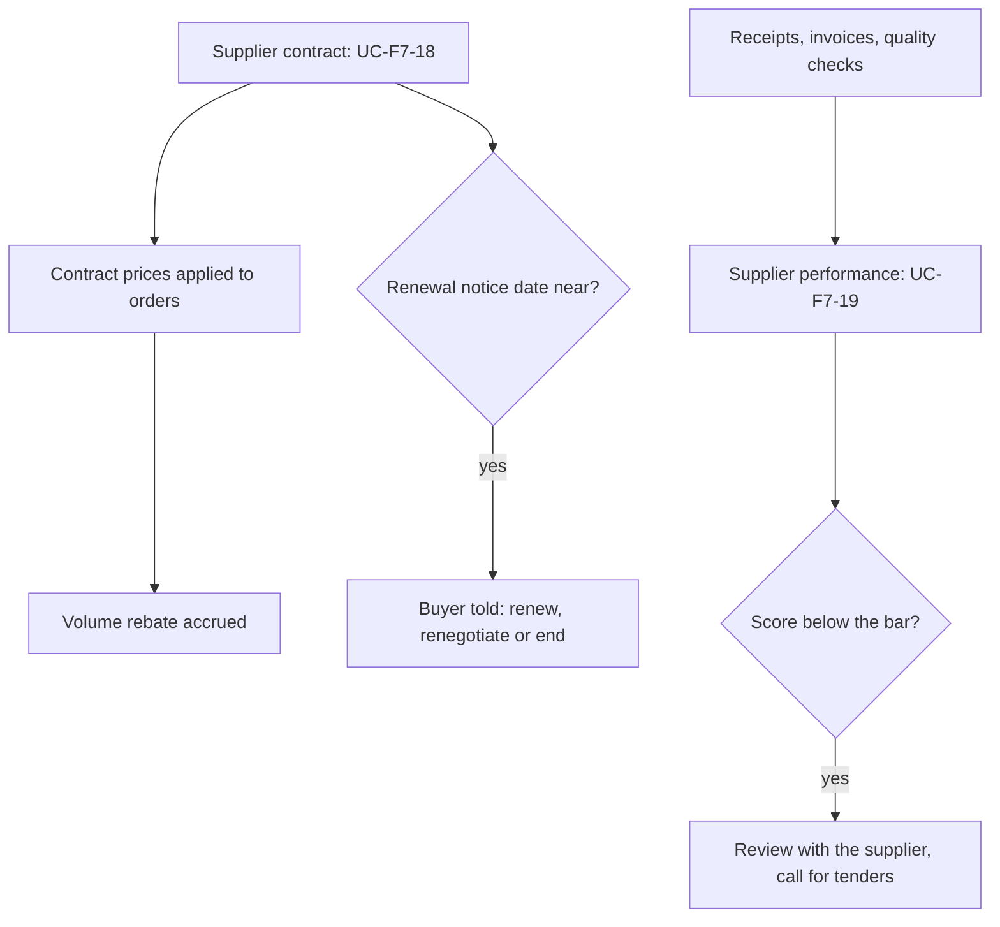

🏠 [Specs](../../../README.md) › 🧩 [Functional capabilities](../../README.md) ›
📦 [F7 Purchasing and stock](../README.md) › 🔀 [Flows](README.md) › 🔀 FL-F7-07 Supplier agreements and performance

# 🔀 FL-F7-07 Supplier agreements and performance

**Status:** ✅ specified

## Summary

Supplier contracts set prices, rebates and renewal dates; supplier performance measures on-time delivery, quality
rejects, price variance and lead-time drift.

## Personas

- [U04 Purchasing and stock](../../../01-users/personas/u04-purchasing.md)
- [U13 Owner](../../../01-users/personas/u13-owner.md)

## Flowchart

## Sequence diagram

- [UC-F7-18 Manage supplier contracts and price agreements](../use-cases/07-supplier-agreements-and-performance/uc-f07-18-manage-supplier-contracts-and-price-agreements.md#sequence-diagram)

## Steps

| Step | Persona | Screen | Use case | What happens |
|---|---|---|---|---|
| 1 | [U04](../../../01-users/personas/u04-purchasing.md) | [S-F7-18](../screens/07-supplier-agreements-and-performance/s-f07-18-supplier-contracts.md) | [UC-F7-18](../use-cases/07-supplier-agreements-and-performance/uc-f07-18-manage-supplier-contracts-and-price-agreements.md) | Record a supplier contract with its prices and rebate |
| 2 | [U04](../../../01-users/personas/u04-purchasing.md) | [S-F7-02](../screens/01-procure/s-f07-02-purchase-order.md) | [UC-F7-18](../use-cases/07-supplier-agreements-and-performance/uc-f07-18-manage-supplier-contracts-and-price-agreements.md) | Orders take the contract price |
| 3 | [U04](../../../01-users/personas/u04-purchasing.md) | [S-F7-19](../screens/07-supplier-agreements-and-performance/s-f07-19-supplier-performance.md) | [UC-F7-19](../use-cases/07-supplier-agreements-and-performance/uc-f07-19-follow-supplier-performance.md) | Read the supplier's performance |
| 4 | [U13](../../../01-users/personas/u13-owner.md) | [S-F7-19](../screens/07-supplier-agreements-and-performance/s-f07-19-supplier-performance.md) | [UC-F7-19](../use-cases/07-supplier-agreements-and-performance/uc-f07-19-follow-supplier-performance.md) | The owner reviews the weakest suppliers |

### Entities and screens

| Entity | States in this flow | Shown at step and screen | Aggregated view |
|---|---|---|---|
| [E-F7-15 Supplier contract](../data/e-f07-15-supplier-contract.md) | Draft, Active, Renewed, Ended | 1 [S-F7-18](../screens/07-supplier-agreements-and-performance/s-f07-18-supplier-contracts.md); 2 [S-F7-02](../screens/01-procure/s-f07-02-purchase-order.md) | Supplier contracts |
| [E-F7-03 Purchase order](../data/e-f07-03-purchase-order.md) | Draft, Sent, Confirmed, Received, Billed | 2 [S-F7-02](../screens/01-procure/s-f07-02-purchase-order.md) | Purchase orders |
| [E-F7-04 Transfer](../data/e-f07-04-transfer.md) | Sent, Received, Lost, Reserved, Flagged | Shown elsewhere: [S-F10-25 Store stock and transfers](../../f10-point-of-sale/screens/10-clienteling-transfers-and-tax-free/s-f10-25-store-stock-and-transfers.md) | Transfers |
| [E-F7-05 Supplier invoice](../data/e-f07-05-supplier-invoice.md) | Received, Matched, Sent to accounting, Held | Shown elsewhere: [S-F7-04 Supplier invoice matching](../screens/01-procure/s-f07-04-supplier-invoice-matching.md) | Supplier invoices |
| [E-F12-07 Quality control point](../../f12-manufacturing/data/e-f12-07-quality-control-point.md) | Active | Shown elsewhere: [S-F12-07 Quality checks](../../f12-manufacturing/screens/04-quality-and-maintenance/s-f12-07-quality-checks.md) | Quality control points |
| [E-F7-16 Supplier score](../data/e-f07-16-supplier-score.md) | Recorded | 3, 4 [S-F7-19](../screens/07-supplier-agreements-and-performance/s-f07-19-supplier-performance.md) | Supplier scores |
| [E-F7-13 Call for tenders](../data/e-f07-13-call-for-tenders.md) | Recorded | Shown elsewhere: [S-F7-14 Tenders](../screens/06-benchmark-additions/s-f07-14-tenders.md) | Call for tenders |

## Errors

An order price outside the contract, a contract past its notice date, a score without enough receipts (BR-F7-11,
BR-F7-12).

## Images

Every step and error, for each persona taking part, in light and dark mode (D120). Steps are numbered as in the Steps
table; E rows are the error cases.

| Step | Persona | Device | Light | Dark |
|---|---|---|---|---|
| 1 | U04 | desktop | [light](../images/07-supplier-agreements-and-performance/u04-purchasing/1-supplier-contracts-desktop-light.png) | [dark](../images/07-supplier-agreements-and-performance/u04-purchasing/1-supplier-contracts-desktop-dark.png) |
| 2 | U04 | desktop | [light](../images/07-supplier-agreements-and-performance/u04-purchasing/2-purchase-order-desktop-light.png) | [dark](../images/07-supplier-agreements-and-performance/u04-purchasing/2-purchase-order-desktop-dark.png) |
| 3 | U04 | desktop | [light](../images/07-supplier-agreements-and-performance/u04-purchasing/3-supplier-performance-desktop-light.png) | [dark](../images/07-supplier-agreements-and-performance/u04-purchasing/3-supplier-performance-desktop-dark.png) |
| 4 | U13 | desktop | [light](../images/07-supplier-agreements-and-performance/u13-owner/4-supplier-performance-desktop-light.png) | [dark](../images/07-supplier-agreements-and-performance/u13-owner/4-supplier-performance-desktop-dark.png) |
| 4 | U13 | phone | [light](../images/07-supplier-agreements-and-performance/u13-owner/4-supplier-performance-phone-light.png) | [dark](../images/07-supplier-agreements-and-performance/u13-owner/4-supplier-performance-phone-dark.png) |
| E1 | U04 | desktop | [light](../images/07-supplier-agreements-and-performance/u04-purchasing/e1-supplier-contracts-refused-desktop-light.png) | [dark](../images/07-supplier-agreements-and-performance/u04-purchasing/e1-supplier-contracts-refused-desktop-dark.png) |

## Open questions

None.

---

⬅️ [FL-F7-06 Benchmark additions](fl-f07-06-benchmark-additions.md) · ⬆️ [Up](README.md) ·
➡️ [FL-F7-08 Catalogues and stock levels](fl-f07-08-catalogues-and-stock-levels.md)
