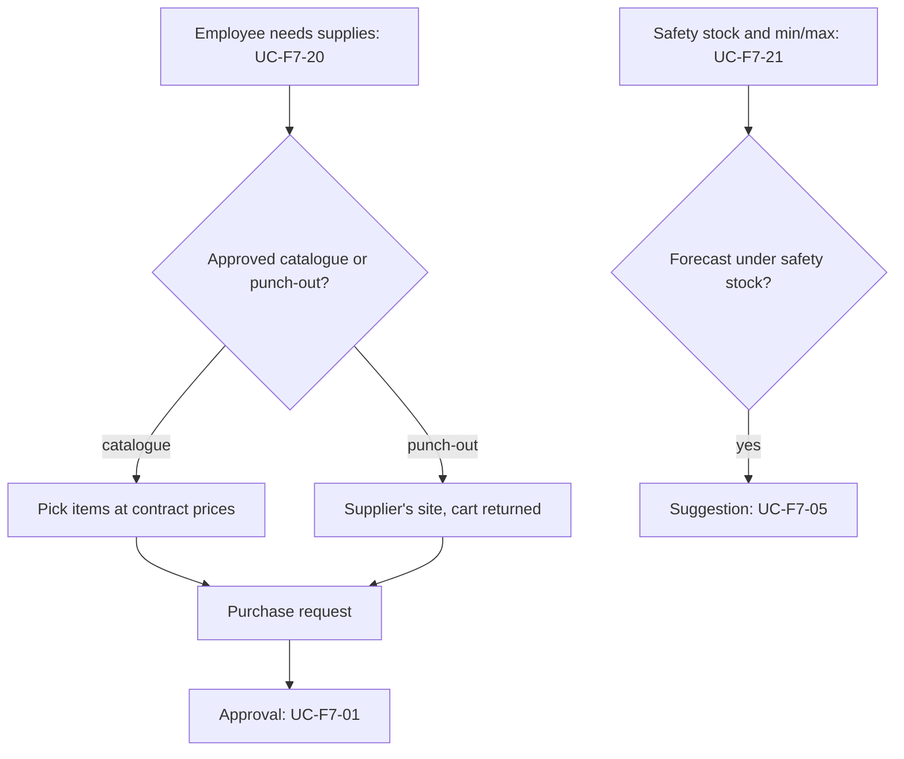

🏠 [Specs](../../../README.md) › 🧩 [Functional capabilities](../../README.md) ›
📦 [F7 Purchasing and stock](../README.md) › 🔀 [Flows](README.md) › 🔀 FL-F7-08 Catalogues and stock levels

# 🔀 FL-F7-08 Catalogues and stock levels

**Status:** ✅ specified

## Summary

Employees order from approved catalogues and suppliers' punch-out sites; buyers set safety stock and min/max per item
and location.

## Personas

- [U01 Employee](../../../01-users/personas/u01-employee.md)
- [U04 Purchasing and stock](../../../01-users/personas/u04-purchasing.md)

## Flowchart

## Sequence diagram

- [UC-F7-20 Order from an approved catalogue or punch-out](../use-cases/08-catalogues-and-stock-levels/uc-f07-20-order-from-an-approved-catalogue-or-punch-out.md#sequence-diagram)

## Steps

| Step | Persona | Screen | Use case | What happens |
|---|---|---|---|---|
| 1 | [U01](../../../01-users/personas/u01-employee.md) | [S-F7-20](../screens/08-catalogues-and-stock-levels/s-f07-20-buy.md) | [UC-F7-20](../use-cases/08-catalogues-and-stock-levels/uc-f07-20-order-from-an-approved-catalogue-or-punch-out.md) | Order office supplies from the approved catalogue |
| 2 | [U01](../../../01-users/personas/u01-employee.md) | [S-F7-20](../screens/08-catalogues-and-stock-levels/s-f07-20-buy.md) | [UC-F7-20](../use-cases/08-catalogues-and-stock-levels/uc-f07-20-order-from-an-approved-catalogue-or-punch-out.md) | Fill a cart on a supplier's punch-out site |
| 3 | [U04](../../../01-users/personas/u04-purchasing.md) | [S-F7-21](../screens/03-replenish/s-f07-21-stock-levels.md) | [UC-F7-21](../use-cases/03-replenish/uc-f07-21-set-safety-stock-and-min-max-per-item.md) | Set safety stock and min/max per item |

### Entities and screens

| Entity | States in this flow | Shown at step and screen | Aggregated view |
|---|---|---|---|
| [E-F7-06 Item](../data/e-f07-06-item.md) | Active | 3 [S-F7-21](../screens/03-replenish/s-f07-21-stock-levels.md) | Items |
| [E-F7-17 Approved catalogue](../data/e-f07-17-approved-catalogue.md) | Active, Closed | 1, 2 [S-F7-20](../screens/08-catalogues-and-stock-levels/s-f07-20-buy.md) | Approved catalogues |
| [E-F7-15 Supplier contract](../data/e-f07-15-supplier-contract.md) | Draft, Active, Renewed, Ended | Shown elsewhere: [S-F7-18 Supplier contracts](../screens/07-supplier-agreements-and-performance/s-f07-18-supplier-contracts.md) | Supplier contracts |
| [E-F7-02 Purchase request](../data/e-f07-02-purchase-request.md) | Draft, To approve, Approved | 1, 2 [S-F7-20](../screens/08-catalogues-and-stock-levels/s-f07-20-buy.md) | Purchase requests |
| [E-F7-09 Reordering rule](../data/e-f07-09-reordering-rule.md) | Active | 3 [S-F7-21](../screens/03-replenish/s-f07-21-stock-levels.md) | Reordering rules |
| [E-F7-21 Demand forecast](../data/e-f07-21-demand-forecast.md) | Active | 3 [S-F7-21](../screens/03-replenish/s-f07-21-stock-levels.md) | Demand forecasts |
| [E-SC15-06 Purchase proposal](../../../08-sectors/sc15-wholesale-and-distribution/data/e-sc15-06-purchase-proposal.md) | Active | Shown elsewhere: [S-SC15-07 Drop-shipping](../../../08-sectors/sc15-wholesale-and-distribution/screens/02-orders/s-sc15-07-drop-shipping.md) | Purchase proposals |

## Errors

A punch-out cart with items off contract, a catalogue item discontinued, a minimum above the maximum (BR-F7-13,
BR-F7-14).

## Images

Every step and error, for each persona taking part, in light and dark mode (D120). Steps are numbered as in the Steps
table; E rows are the error cases.

| Step | Persona | Device | Light | Dark |
|---|---|---|---|---|
| 1 | U01 | desktop | [light](../images/08-catalogues-and-stock-levels/u01-employee/1-buy-desktop-light.png) | [dark](../images/08-catalogues-and-stock-levels/u01-employee/1-buy-desktop-dark.png) |
| 1 | U01 | phone | [light](../images/08-catalogues-and-stock-levels/u01-employee/1-buy-phone-light.png) | [dark](../images/08-catalogues-and-stock-levels/u01-employee/1-buy-phone-dark.png) |
| 2 | U01 | desktop | [light](../images/08-catalogues-and-stock-levels/u01-employee/2-buy-desktop-light.png) | [dark](../images/08-catalogues-and-stock-levels/u01-employee/2-buy-desktop-dark.png) |
| 2 | U01 | phone | [light](../images/08-catalogues-and-stock-levels/u01-employee/2-buy-phone-light.png) | [dark](../images/08-catalogues-and-stock-levels/u01-employee/2-buy-phone-dark.png) |
| 3 | U04 | desktop | [light](../images/08-catalogues-and-stock-levels/u04-purchasing/3-stock-levels-desktop-light.png) | [dark](../images/08-catalogues-and-stock-levels/u04-purchasing/3-stock-levels-desktop-dark.png) |
| E1 | U01 | desktop | [light](../images/08-catalogues-and-stock-levels/u01-employee/e1-buy-refused-desktop-light.png) | [dark](../images/08-catalogues-and-stock-levels/u01-employee/e1-buy-refused-desktop-dark.png) |
| E1 | U01 | phone | [light](../images/08-catalogues-and-stock-levels/u01-employee/e1-buy-refused-phone-light.png) | [dark](../images/08-catalogues-and-stock-levels/u01-employee/e1-buy-refused-phone-dark.png) |

## Open questions

None.

---

⬅️ [FL-F7-07 Supplier agreements and performance](fl-f07-07-supplier-agreements-and-performance.md) ·
⬆️ [Up](README.md) · ➡️ [FL-F7-09 Compliance and carbon](fl-f07-09-compliance-and-carbon.md)
