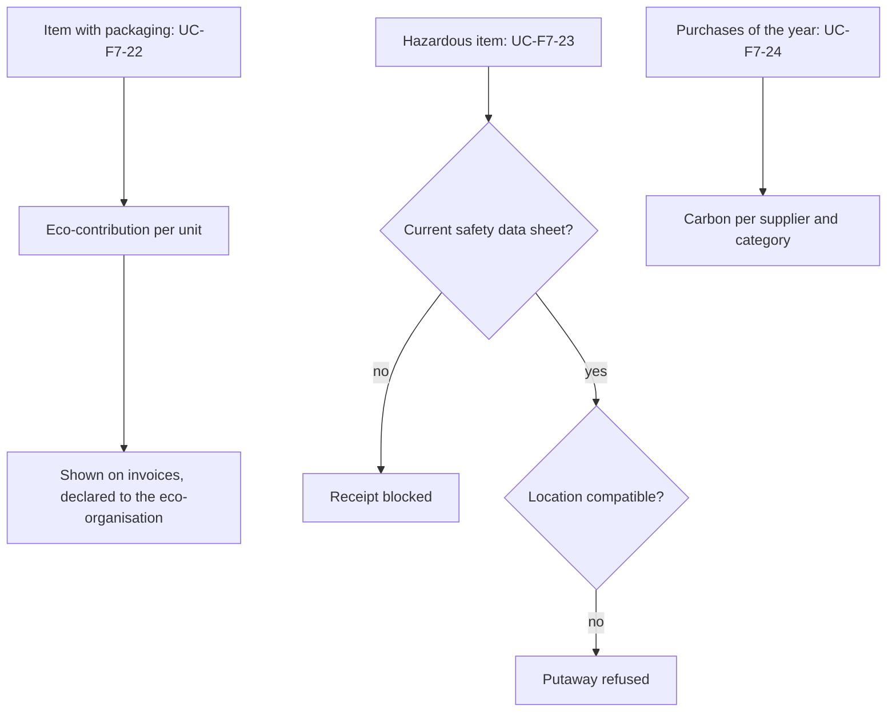

🏠 [Specs](../../../README.md) › 🧩 [Functional capabilities](../../README.md) ›
📦 [F7 Purchasing and stock](../README.md) › 🔀 [Flows](README.md) › 🔀 FL-F7-09 Compliance and carbon

# 🔀 FL-F7-09 Compliance and carbon

**Status:** ✅ specified

## Summary

Packaging eco-contributions charged and declared, dangerous goods stored by their compatibility with current safety data
sheets, and the carbon of purchases estimated per supplier and category.

## Personas

- [U04 Purchasing and stock](../../../01-users/personas/u04-purchasing.md)
- [U13 Owner](../../../01-users/personas/u13-owner.md)
- [U15 Warehouse operator](../../../01-users/personas/u15-warehouse-operator.md)

## Flowchart

## Sequence diagram

- [UC-F7-23 Store dangerous goods with their safety data sheets](../use-cases/02-receive-and-store/uc-f07-23-store-dangerous-goods-with-their-safety-data-sheets.md#sequence-diagram)

## Steps

| Step | Persona | Screen | Use case | What happens |
|---|---|---|---|---|
| 1 | [U04](../../../01-users/personas/u04-purchasing.md) | [S-F7-22](../screens/09-compliance-and-carbon/s-f07-22-eco-contributions.md) | [UC-F7-22](../use-cases/09-compliance-and-carbon/uc-f07-22-charge-and-declare-packaging-eco-contributions.md) | Set and declare packaging eco-contributions |
| 2 | [U15](../../../01-users/personas/u15-warehouse-operator.md) | [S-F7-23](../screens/02-receive-and-store/s-f07-23-dangerous-goods.md) | [UC-F7-23](../use-cases/02-receive-and-store/uc-f07-23-store-dangerous-goods-with-their-safety-data-sheets.md) | Store a dangerous product in a compatible location |
| 3 | [U13](../../../01-users/personas/u13-owner.md) | [S-F7-24](../screens/09-compliance-and-carbon/s-f07-24-purchase-carbon.md) | [UC-F7-24](../use-cases/09-compliance-and-carbon/uc-f07-24-measure-the-carbon-of-purchases.md) | Read the carbon of the year's purchases |

### Entities and screens

| Entity | States in this flow | Shown at step and screen | Aggregated view |
|---|---|---|---|
| [E-F7-06 Item](../data/e-f07-06-item.md) | Active | 1 [S-F7-22](../screens/09-compliance-and-carbon/s-f07-22-eco-contributions.md) | Items |
| [E-F7-18 Eco-contribution scale](../data/e-f07-18-eco-contribution-scale.md) | Active | 1 [S-F7-22](../screens/09-compliance-and-carbon/s-f07-22-eco-contributions.md) | Eco-contribution scales |
| [E-F6-05 Invoice](../../f06-customers-and-sales/data/e-f06-05-invoice.md) | Refused | Shown elsewhere: [S-F6-06 Invoice](../../f06-customers-and-sales/screens/03-invoice-and-get-paid/s-f06-06-invoice.md) | Invoices |
| [E-F7-19 Safety data sheet](../data/e-f07-19-safety-data-sheet.md) | Active, Superseded | 2 [S-F7-23](../screens/02-receive-and-store/s-f07-23-dangerous-goods.md) | Safety data sheets |
| [E-F7-04 Transfer](../data/e-f07-04-transfer.md) | Sent, Received, Lost, Reserved, Flagged | Shown elsewhere: [S-F10-25 Store stock and transfers](../../f10-point-of-sale/screens/10-clienteling-transfers-and-tax-free/s-f10-25-store-stock-and-transfers.md) | Transfers |
| [E-F7-07 Location](../data/e-f07-07-location.md) | Active | 2 [S-F7-23](../screens/02-receive-and-store/s-f07-23-dangerous-goods.md) | Locations |
| [E-F7-03 Purchase order](../data/e-f07-03-purchase-order.md) | Draft, Sent, Confirmed, Received, Billed | Shown elsewhere: [S-F7-02 Purchase order](../screens/01-procure/s-f07-02-purchase-order.md) | Purchase orders |
| [E-F7-20 Emission factor](../data/e-f07-20-emission-factor.md) | Recorded | 3 [S-F7-24](../screens/09-compliance-and-carbon/s-f07-24-purchase-carbon.md) | Emission factors |

## Errors

An item without its EPR scale, a safety data sheet out of date, a supplier without emission data (BR-F7-15 to BR-F7-17).

## Images

Every step and error, for each persona taking part, in light and dark mode (D120). Steps are numbered as in the Steps
table; E rows are the error cases.

| Step | Persona | Device | Light | Dark |
|---|---|---|---|---|
| 1 | U04 | desktop | [light](../images/09-compliance-and-carbon/u04-purchasing/1-eco-contributions-desktop-light.png) | [dark](../images/09-compliance-and-carbon/u04-purchasing/1-eco-contributions-desktop-dark.png) |
| 2 | U15 | phone | [light](../images/09-compliance-and-carbon/u15-warehouse-operator/2-dangerous-goods-phone-light.png) | [dark](../images/09-compliance-and-carbon/u15-warehouse-operator/2-dangerous-goods-phone-dark.png) |
| 2 | U15 | tablet | [light](../images/09-compliance-and-carbon/u15-warehouse-operator/2-dangerous-goods-tablet-light.png) | [dark](../images/09-compliance-and-carbon/u15-warehouse-operator/2-dangerous-goods-tablet-dark.png) |
| 3 | U13 | desktop | [light](../images/09-compliance-and-carbon/u13-owner/3-purchase-carbon-desktop-light.png) | [dark](../images/09-compliance-and-carbon/u13-owner/3-purchase-carbon-desktop-dark.png) |
| 3 | U13 | phone | [light](../images/09-compliance-and-carbon/u13-owner/3-purchase-carbon-phone-light.png) | [dark](../images/09-compliance-and-carbon/u13-owner/3-purchase-carbon-phone-dark.png) |
| E1 | U04 | desktop | [light](../images/09-compliance-and-carbon/u04-purchasing/e1-eco-contributions-refused-desktop-light.png) | [dark](../images/09-compliance-and-carbon/u04-purchasing/e1-eco-contributions-refused-desktop-dark.png) |

## Open questions

None.

---

⬅️ [FL-F7-08 Catalogues and stock levels](fl-f07-08-catalogues-and-stock-levels.md) · ⬆️ [Up](README.md) ·
➡️ [FL-F7-10 Consignment, scanning, packaging and EDI](fl-f07-10-consignment-scanning-and-edi.md)
