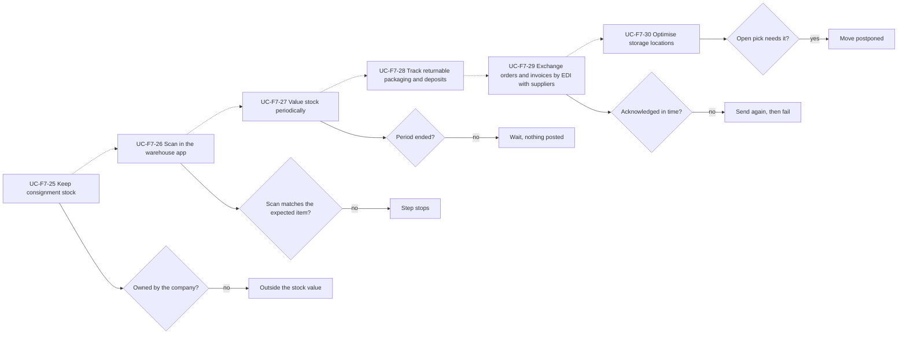
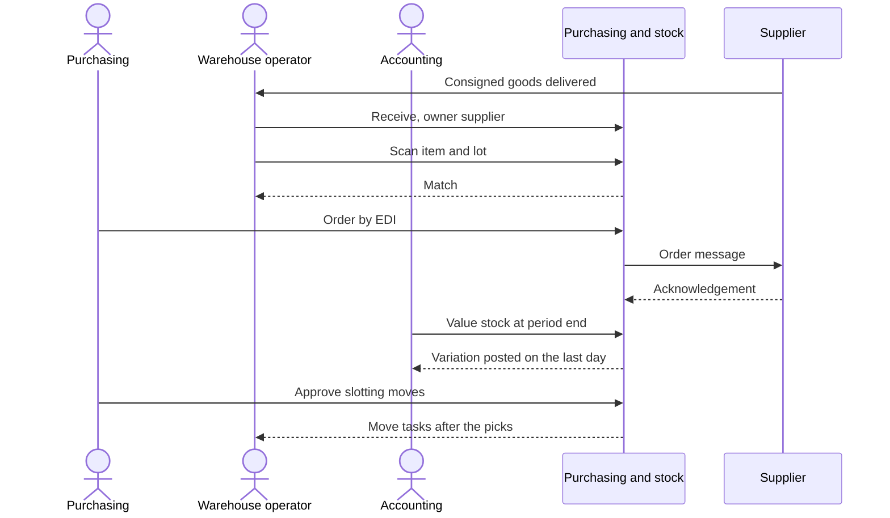

🏠 [Specs](../../../README.md) › 🧩 [Functional capabilities](../../README.md) ›
📦 [F7 Purchasing and stock](../README.md) › 🔀 [Flows](README.md) › 🔀 FL-F7-10 Consignment, scanning, packaging and EDI

# 🔀 FL-F7-10 Consignment, scanning, packaging and EDI

**Status:** ✅ specified

## Summary

Purchasing keeps consignment stock outside its own stock value, the warehouse works on phones with every scan checked
against the expected item, accounting values stock periodically and posts only at period end, returnable packaging and
its deposits are tracked per party, orders and invoices go to suppliers by EDI with acknowledgement or retry, and
slotting proposes better locations without ever blocking a pick
([D526](../../../06-decisions/f07-purchasing-and-stock/d526-benchmark-gaps-f07-purchasing-and-stock.md)).

## Personas

- [U04 Purchasing and stock](../../../01-users/personas/u04-purchasing.md)
- [U15 Warehouse operator](../../../01-users/personas/u15-warehouse-operator.md), who scans, stores and moves goods on a
  phone
- [U05 Accounting](../../../01-users/personas/u05-accounting.md), who values the stock at period end

## Flowchart

## Sequence diagram

## Steps

| Step | Persona | Screen | Use case | What happens |
|---|---|---|---|---|
| 1 | [U04](../../../01-users/personas/u04-purchasing.md) | [S-F7-25](../screens/10-consignment-scanning-and-edi/s-f07-25-consignment-stock.md) | [UC-F7-25](../use-cases/10-consignment-scanning-and-edi/uc-f07-25-keep-consignment-stock.md) | The warehouse receives consigned goods owned by the supplier; they stay outside the stock value and are settled when used |
| 2 | [U15](../../../01-users/personas/u15-warehouse-operator.md) | [S-F7-26](../screens/10-consignment-scanning-and-edi/s-f07-26-barcode-app.md) | [UC-F7-26](../use-cases/10-consignment-scanning-and-edi/uc-f07-26-scan-in-the-warehouse-app.md) | The operator scans in the warehouse app; a scan that does not match the expected item stops the step |
| 3 | [U05](../../../01-users/personas/u05-accounting.md) | [S-F7-27](../screens/10-consignment-scanning-and-edi/s-f07-27-periodic-valuation.md) | [UC-F7-27](../use-cases/10-consignment-scanning-and-edi/uc-f07-27-value-stock-periodically.md) | Accounting values the counted stock at period end and posts one stock variation entry on the last day |
| 4 | [U04](../../../01-users/personas/u04-purchasing.md) | [S-F7-28](../screens/10-consignment-scanning-and-edi/s-f07-28-returnable-packaging.md) | [UC-F7-28](../use-cases/10-consignment-scanning-and-edi/uc-f07-28-track-returnable-packaging-and-deposits.md) | Packaging goes out with a deposit and the deposit is refunded for the packaging that comes back |
| 5 | [U04](../../../01-users/personas/u04-purchasing.md) | [S-F7-29](../screens/10-consignment-scanning-and-edi/s-f07-29-supplier-edi.md) | [UC-F7-29](../use-cases/10-consignment-scanning-and-edi/uc-f07-29-exchange-orders-and-invoices-by-edi-with-suppliers.md) | Purchasing exchanges orders and invoices with a supplier by EDI; each message is acknowledged or sent again |
| 6 | [U04](../../../01-users/personas/u04-purchasing.md) | [S-F7-30](../screens/10-consignment-scanning-and-edi/s-f07-30-slotting.md) | [UC-F7-30](../use-cases/10-consignment-scanning-and-edi/uc-f07-30-optimise-storage-locations.md) | Purchasing approves slotting proposals; the operators move the goods after the picks |

### Entities and screens

| Entity | States in this flow | Shown at step and screen | Aggregated view |
|---|---|---|---|
| [E-F7-23 Stock owner](../data/e-f07-23-stock-owner.md) | Held, Used, Settled, Returned | 1 [S-F7-25](../screens/10-consignment-scanning-and-edi/s-f07-25-consignment-stock.md) | Stock owners |
| [E-F7-24 Periodic count](../data/e-f07-24-periodic-count.md) | Counted, Valued, Approved, Posted, Reversed | 3 [S-F7-27](../screens/10-consignment-scanning-and-edi/s-f07-27-periodic-valuation.md) | Periodic counts |
| [E-F7-25 Packaging deposit](../data/e-f07-25-packaging-deposit.md) | Open, Partly returned, Closed, Written off | 4 [S-F7-28](../screens/10-consignment-scanning-and-edi/s-f07-28-returnable-packaging.md) | Packaging deposits |
| [E-F7-26 EDI message](../data/e-f07-26-edi-message.md) | Queued, Sent, Acknowledged, Retrying, Failed, Rejected, Received, Processed | 5 [S-F7-29](../screens/10-consignment-scanning-and-edi/s-f07-29-supplier-edi.md) | EDI messages |
| [E-F7-27 Slotting proposal](../data/e-f07-27-slotting-proposal.md) | Proposed, Approved, Rejected, Postponed, Done | 6 [S-F7-30](../screens/10-consignment-scanning-and-edi/s-f07-30-slotting.md) | Slotting proposals |

## Errors

- **E1 The wrong item is scanned.** The step stops and the phone shows the expected and the scanned item; the operator
  scans again or asks the supervisor
  ([BR-F7-20](../business-rules/br-f07-20-a-scan-that-does-not-match-the-expected-item-stops-the-step.md), step 2).

## Images

Every step and error, for each persona taking part, in light and dark mode (D120). Steps are numbered as in the Steps
table; E rows are the error cases.

| Step | Persona | Device | Light | Dark |
|---|---|---|---|---|
| 1 | U04 | desktop | [light](../images/10-consignment-scanning-and-edi/u04-purchasing/1-consignment-stock-desktop-light.png) | [dark](../images/10-consignment-scanning-and-edi/u04-purchasing/1-consignment-stock-desktop-dark.png) |
| 1 | U15 | phone | [light](../images/10-consignment-scanning-and-edi/u15-warehouse-operator/1-consignment-stock-phone-light.png) | [dark](../images/10-consignment-scanning-and-edi/u15-warehouse-operator/1-consignment-stock-phone-dark.png) |
| 2 | U15 | phone | [light](../images/10-consignment-scanning-and-edi/u15-warehouse-operator/2-barcode-app-phone-light.png) | [dark](../images/10-consignment-scanning-and-edi/u15-warehouse-operator/2-barcode-app-phone-dark.png) |
| 2 | U15 | tablet | [light](../images/10-consignment-scanning-and-edi/u15-warehouse-operator/2-barcode-app-tablet-light.png) | [dark](../images/10-consignment-scanning-and-edi/u15-warehouse-operator/2-barcode-app-tablet-dark.png) |
| 3 | U05 | desktop | [light](../images/10-consignment-scanning-and-edi/u05-accounting/3-periodic-valuation-desktop-light.png) | [dark](../images/10-consignment-scanning-and-edi/u05-accounting/3-periodic-valuation-desktop-dark.png) |
| 3 | U04 | desktop | [light](../images/10-consignment-scanning-and-edi/u04-purchasing/3-periodic-valuation-desktop-light.png) | [dark](../images/10-consignment-scanning-and-edi/u04-purchasing/3-periodic-valuation-desktop-dark.png) |
| 4 | U04 | desktop | [light](../images/10-consignment-scanning-and-edi/u04-purchasing/4-returnable-packaging-desktop-light.png) | [dark](../images/10-consignment-scanning-and-edi/u04-purchasing/4-returnable-packaging-desktop-dark.png) |
| 4 | U15 | phone | [light](../images/10-consignment-scanning-and-edi/u15-warehouse-operator/4-returnable-packaging-phone-light.png) | [dark](../images/10-consignment-scanning-and-edi/u15-warehouse-operator/4-returnable-packaging-phone-dark.png) |
| 5 | U04 | desktop | [light](../images/10-consignment-scanning-and-edi/u04-purchasing/5-supplier-edi-desktop-light.png) | [dark](../images/10-consignment-scanning-and-edi/u04-purchasing/5-supplier-edi-desktop-dark.png) |
| 6 | U04 | desktop | [light](../images/10-consignment-scanning-and-edi/u04-purchasing/6-slotting-desktop-light.png) | [dark](../images/10-consignment-scanning-and-edi/u04-purchasing/6-slotting-desktop-dark.png) |
| 6 | U15 | phone | [light](../images/10-consignment-scanning-and-edi/u15-warehouse-operator/6-slotting-phone-light.png) | [dark](../images/10-consignment-scanning-and-edi/u15-warehouse-operator/6-slotting-phone-dark.png) |
| E1 | U04 | desktop | [light](../images/10-consignment-scanning-and-edi/u04-purchasing/e1-the-wrong-item-is-scanned-desktop-light.png) | [dark](../images/10-consignment-scanning-and-edi/u04-purchasing/e1-the-wrong-item-is-scanned-desktop-dark.png) |

## Open questions

None.

---

⬅️ [FL-F7-09 Compliance and carbon](fl-f07-09-compliance-and-carbon.md) · ⬆️ [Up](README.md)
