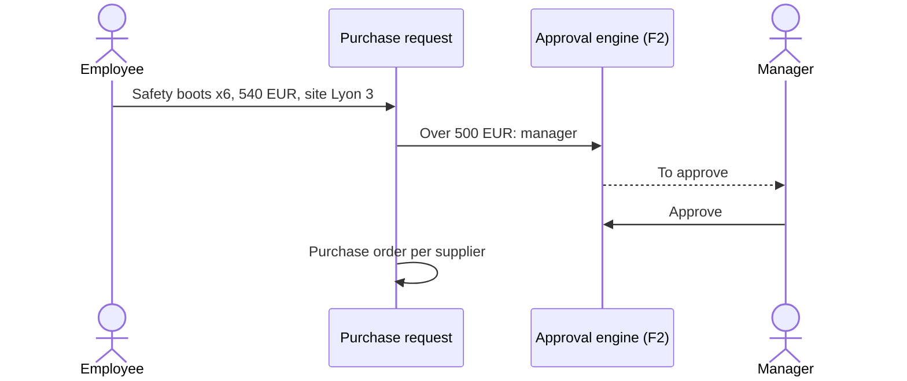

🏠 [Specs](../../../../README.md) › 🧩 [Functional capabilities](../../../README.md) ›
📦 [F7 Purchasing and stock](../../README.md) › 📝 [Use cases](../README.md) ›
📝 [Use cases: FL-F7-01 Procure](README.md) › 📝 UC-F7-01 Request and approve a purchase

# 📝 UC-F7-01 Request and approve a purchase

**Status:** ✅ specified

## Summary

A purchase request is approved by amount and budget, then becomes an order.

## Personas

- [U01 Employee](../../../../01-users/personas/u01-employee.md)
- [U04 Purchasing](../../../../01-users/personas/u04-purchasing.md)
- [U02 Manager](../../../../01-users/personas/u02-manager.md)

## Goal

Buy what is needed, approved at the right level, within budget.

## Trigger

An employee or a buyer needs items or services.

## Frequency

Daily.

## Preconditions

Warehouses and rules set (UC-F7-13).

## Postconditions

- **Succeeded:** the approved request becomes a purchase order grouped per supplier.
- **Failed:** a refused request keeps its reason.

## Main flow

1. The employee opens a purchase request ([S-F7-01](../../screens/01-procure/s-f07-01-purchase-request.md)), or a cart
   from Buy, [UC-F7-20](../08-catalogues-and-stock-levels/uc-f07-20-order-from-an-approved-catalogue-or-punch-out.md),
   with a project or department.
2. Above the amount for their role or over the budget, it goes to the manager, and above a second amount to the owner,
   [BR-F7-01](../../business-rules/br-f07-01-purchases-approved-by-amount-and-budget.md),
   [UC-F2-29](../../../f02-no-code-configuration/use-cases/11-rights-translations-and-approvals/uc-f02-29-set-up-an-approval-chain.md).
3. The approver approves or refuses with a reason; a deputy decides during an absence,
   [UC-F1-16](../../../f01-administration/use-cases/11-team-delegation-and-access-review/uc-f01-16-delegate-approvals-during-an-absence.md).
4. Approved, it becomes a purchase order grouped per supplier ([UC-F7-02](uc-f07-02-order-from-a-supplier.md)).

## Alternative flows

- 2a. A blanket order covers it: no new approval.
- 1a. The buyer requests on behalf of a team.

## Error flows

- 4e. No supplier for the item: the buyer is asked to choose one.
- 2e. No budget line for the project: the request says so.

## Business rules

- [BR-F7-01 Purchases approved by amount and budget](../../business-rules/br-f07-01-purchases-approved-by-amount-and-budget.md)

## Entities

- [E-F7-02 Purchase request](../../data/e-f07-02-purchase-request.md)
- [E-F7-03 Purchase order](../../data/e-f07-03-purchase-order.md)

## Permissions

Purchasing; managers approve; accounting reads; record rules by warehouse or site. Employees request for their
department.

## Notifications

Approvers: request; requester: decision.

## Audit events

Requested, approved, refused, ordered.

## AI involvement

The AI assistant prepares it for confirmation
([BR-F3-07](../../../f03-assistant/business-rules/br-f03-07-no-deletes-no-irreversible-acts.md)); figures come from
queries ([BR-F3-03](../../../f03-assistant/business-rules/br-f03-03-figures-come-from-queries.md)).

## API, MCP and A2A exposure

T5 operations of F7 with the caller's rights; the MCP tool of F7; no A2A skill.

## Screens

- [S-F7-01](../../screens/01-procure/s-f07-01-purchase-request.md)

## Flowchart

See [FL-F7-01 Procure](../../flows/fl-f07-01-procure.md#flowchart).

## Sequence diagram

## Acceptance criteria

1. **Given** Acme Bâtiment's request of 540 EUR and a role limit of 500 EUR **when** it is sent **then** it goes to the
   manager.
2. **Given** a request of 6,200 EUR above 5,000 EUR **when** the manager approves **then** it goes to the owner.
3. **Given** a refusal "use the stock" **when** the manager refuses **then** the requester sees the reason.
4. **Given** two approved requests for the same supplier **when** they are ordered **then** one purchase order holds
   both.

## Non-functional notes

None.

## Regulatory references

None.

## Related use cases

F6 (sales orders), F8 (accounting), F12 (manufacturing).

- [UC-F2-29 Set up an approval chain](../../../f02-no-code-configuration/use-cases/11-rights-translations-and-approvals/uc-f02-29-set-up-an-approval-chain.md)

- [UC-F7-20 Order from an approved catalogue or punch-out](../08-catalogues-and-stock-levels/uc-f07-20-order-from-an-approved-catalogue-or-punch-out.md)

## Open questions

None.

---

⬆️ [Up](README.md) · ➡️ [UC-F7-02 Order from a supplier](uc-f07-02-order-from-a-supplier.md)
