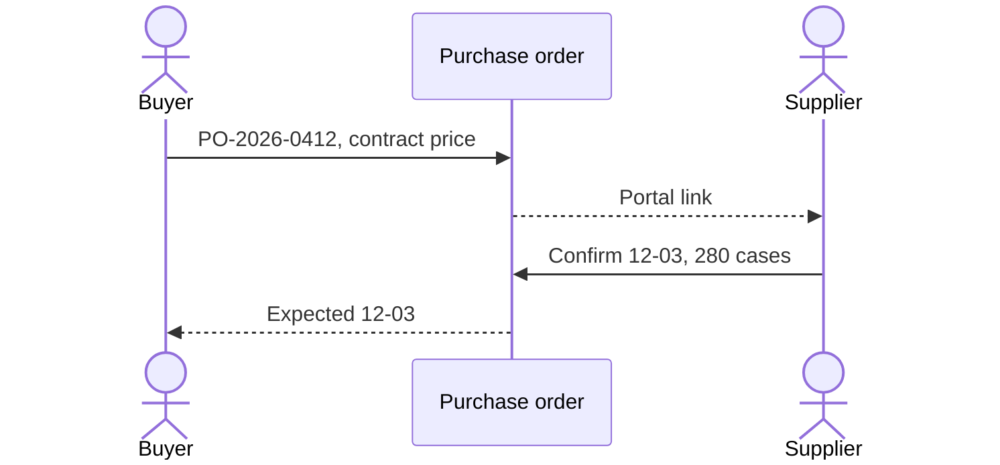

🏠 [Specs](../../../../README.md) › 🧩 [Functional capabilities](../../../README.md) ›
📦 [F7 Purchasing and stock](../../README.md) › 📝 [Use cases](../README.md) ›
📝 [Use cases: FL-F7-01 Procure](README.md) › 📝 UC-F7-02 Order from a supplier

# 📝 UC-F7-02 Order from a supplier

**Status:** 🔄 waiting for the owner

## Summary

A purchase order is sent, confirmed and followed to its receipt.

## Personas

- [U04 Purchasing](../../../../01-users/personas/u04-purchasing.md)

## Goal

Orders sent, confirmed and followed to receipt.

## Trigger

An approved request, a suggestion, or by hand.

## Frequency

Daily.

## Preconditions

Warehouses and rules set (UC-F7-13).

## Postconditions

- **Succeeded:** the order is confirmed and expected.
- **Failed:** late confirmations raise alerts.

## Main flow

1. The buyer sends the purchase order ([S-F7-02](../../screens/01-procure/s-f07-02-purchase-order.md)) with the contract
   price,
   [UC-F7-18](../07-supplier-agreements-and-performance/uc-f07-18-manage-supplier-contracts-and-price-agreements.md), or
   the supplier's price list and lead time.
2. The supplier confirms in the portal or by email: dates and quantities
   ([UC-F7-12](uc-f07-12-use-the-supplier-portal.md)).
3. The expected receipt is planned; late confirmations or deliveries raise alerts.
4. The receipt closes the order ([UC-F7-03](../02-receive-and-store/uc-f07-03-receive-goods.md)).

## Alternative flows

- 1a. Blanket orders with set prices and call-offs.
- 1b. Dropship orders ([UC-F7-05](../03-replenish/uc-f07-05-replenish-stock.md)).

## Error flows

- 2e. The supplier changes a price: flagged before confirmation.
- 3e. No confirmation in 2 days (Proposed): the buyer is told.

## Business rules

- See F7's rules.

## Entities

- [E-F7-01 Supplier record](../../data/e-f07-01-supplier-record.md)
- [E-F7-03 Purchase order](../../data/e-f07-03-purchase-order.md)

## Permissions

Purchasing; managers approve; accounting reads; record rules by warehouse or site.

## Notifications

Supplier: order; buyer: confirmations and delays.

## Audit events

Sent, confirmed, changed.

## AI involvement

The AI assistant prepares it for confirmation
([BR-F3-07](../../../f03-assistant/business-rules/br-f03-07-no-deletes-no-irreversible-acts.md)); figures come from
queries ([BR-F3-03](../../../f03-assistant/business-rules/br-f03-03-figures-come-from-queries.md)).

## API, MCP and A2A exposure

T5 operations of F7 with the caller's rights; the MCP tool of F7; no A2A skill.

## Screens

- [S-F7-02](../../screens/01-procure/s-f07-02-purchase-order.md)

## Flowchart

See [FL-F7-01 Procure](../../flows/fl-f07-01-procure.md#flowchart).

## Sequence diagram

## Acceptance criteria

1. **Given** PO-2026-0412 for 280 cases **when** the supplier confirms 12-03 **then** the receipt is expected on 12-03.
2. **Given** the supplier confirms at a higher price **when** it arrives **then** it is flagged before acceptance.
3. **Given** no confirmation after 2 days **when** the time passes **then** the buyer is told.

## Non-functional notes

None.

## Regulatory references

[CR-FR-018](../../../../10-country-packs/france/invoicing/cr-fr-018-payment-terms-cap.md).

## Related use cases

F6 (sales orders), F8 (accounting), F12 (manufacturing).

- [UC-F7-18 Manage supplier contracts and price agreements](../07-supplier-agreements-and-performance/uc-f07-18-manage-supplier-contracts-and-price-agreements.md)

- [UC-F7-22 Charge and declare packaging eco-contributions](../09-compliance-and-carbon/uc-f07-22-charge-and-declare-packaging-eco-contributions.md)

## Open questions

None.

---

⬅️ [UC-F7-01 Request and approve a purchase](uc-f07-01-request-and-approve-a-purchase.md) · ⬆️ [Up](README.md) ·
➡️ [UC-F7-03 Receive goods](../02-receive-and-store/uc-f07-03-receive-goods.md)
