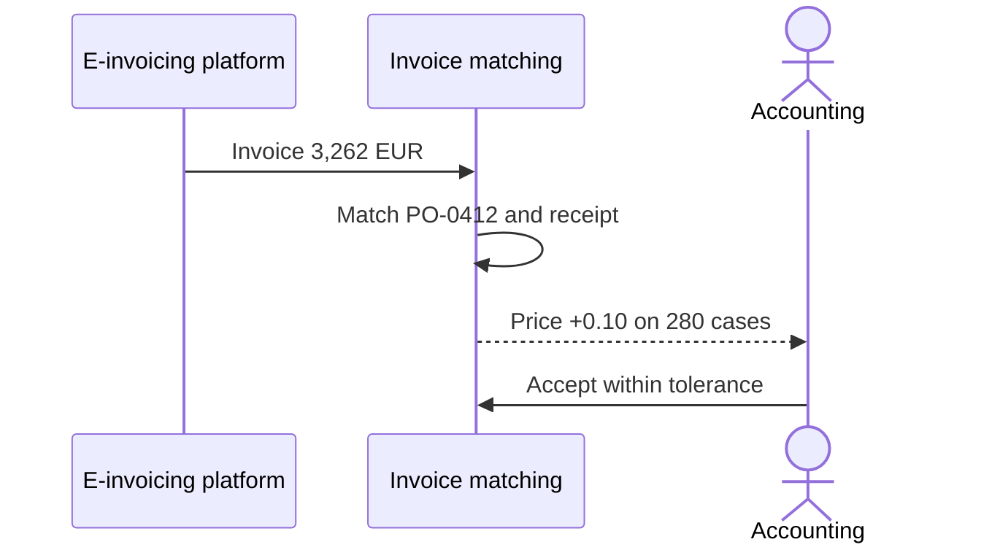

🏠 [Specs](../../../../README.md) › 🧩 [Functional capabilities](../../../README.md) ›
📦 [F7 Purchasing and stock](../../README.md) › 📝 [Use cases](../README.md) ›
📝 [Use cases: FL-F7-01 Procure](README.md) › 📝 UC-F7-04 Capture and match supplier invoices

# 📝 UC-F7-04 Capture and match supplier invoices

**Status:** ✅ specified

## Summary

Supplier invoices arrive as e-invoices or are read by the AI, and are matched to orders and receipts.

## Personas

- [U05 Accounting](../../../../01-users/personas/u05-accounting.md)

## Goal

Pay only for what was ordered and received.

## Trigger

A supplier invoice arrives.

## Frequency

Daily.

## Preconditions

Warehouses and rules set (UC-F7-13).

## Postconditions

- **Succeeded:** matched invoices go to accounting.
- **Failed:** differences wait for a person.

## Main flow

1. E-invoices arrive from the platform; PDFs and scans are read by the AI
   ([S-F7-04](../../screens/01-procure/s-f07-04-supplier-invoice-matching.md)).
2. Each invoice is matched to its order and receipt
   ([BR-F7-03](../../business-rules/br-f07-03-supplier-invoices-are-matched.md)).
3. Within tolerance, it goes to accounting (F8).
4. Beyond, the differences (price, quantity) are listed for the buyer to settle.

## Alternative flows

- 2a. Landed costs on an invoice go to [UC-F7-09](../02-receive-and-store/uc-f07-09-value-stock-and-landed-costs.md).

## Error flows

- 2e. An invoice for goods not received: held.
- 1e. A scan unreadable: sent back to a person.

## Business rules

- [BR-F7-03 Supplier invoices are matched](../../business-rules/br-f07-03-supplier-invoices-are-matched.md)

## Entities

- [E-F7-05 Supplier invoice](../../data/e-f07-05-supplier-invoice.md)
- [E-F7-03 Purchase order](../../data/e-f07-03-purchase-order.md)

## Permissions

Accounting; purchasing settles differences.

## Notifications

The buyer: differences.

## Audit events

Captured, matched, held.

## AI involvement

Reads PDFs and scans; a person confirms what it is unsure of.

## API, MCP and A2A exposure

T5 operations of F7 with the caller's rights; the MCP tool of F7; no A2A skill.

## Screens

- [S-F7-04](../../screens/01-procure/s-f07-04-supplier-invoice-matching.md)

## Flowchart

See [FL-F7-01 Procure](../../flows/fl-f07-01-procure.md#flowchart).

## Sequence diagram

## Acceptance criteria

1. **Given** an invoice matching order and receipt **when** it arrives **then** it goes to accounting.
2. **Given** an invoice for 280 cases with 260 received **when** it is matched **then** the 20-case difference is
   listed.
3. **Given** an invoice for an order never received **when** it arrives **then** it is held.

## Non-functional notes

None.

## Regulatory references

[CR-FR-016](../../../../10-country-packs/france/invoicing/cr-fr-016-electronic-invoicing.md).

## Related use cases

F6 (sales orders), F8 (accounting), F12 (manufacturing).

## Open questions

None.

---

⬅️ [UC-F7-03 Receive goods](../02-receive-and-store/uc-f07-03-receive-goods.md) · ⬆️ [Up](README.md) ·
➡️ [UC-F7-05 Replenish stock](../03-replenish/uc-f07-05-replenish-stock.md)
