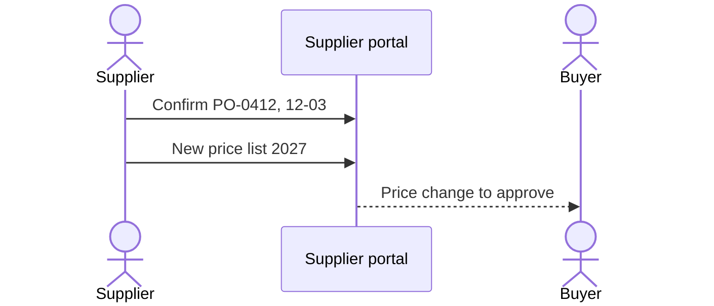

🏠 [Specs](../../../../README.md) › 🧩 [Functional capabilities](../../../README.md) ›
📦 [F7 Purchasing and stock](../../README.md) › 📝 [Use cases](../README.md) ›
📝 [Use cases: FL-F7-01 Procure](README.md) › 📝 UC-F7-12 Use the supplier portal

# 📝 UC-F7-12 Use the supplier portal

**Status:** ✅ specified

## Summary

Suppliers confirm orders, send delivery notes and invoices, and update prices.

## Personas

- [U10 Supplier](../../../../01-users/personas/u10-supplier.md)

## Goal

Suppliers keep orders, deliveries, invoices and prices current themselves.

## Trigger

A supplier receives an order or a request.

## Frequency

Daily for main suppliers.

## Preconditions

Warehouses and rules set (UC-F7-13).

## Postconditions

- **Succeeded:** confirmations, delivery notes, invoices and prices received.
- **Failed:** changes wait for the buyer.

## Main flow

1. The supplier opens the order by its link or account,
   [UC-F1-19](../../../f01-administration/use-cases/12-portal-accounts-and-integrations/uc-f01-19-manage-portal-accounts.md),
   on the supplier portal ([S-F7-12](../../screens/01-procure/s-f07-12-supplier-portal.md)).
2. They confirm dates and quantities and attach the delivery note.
3. They send the invoice, their catalogue and prices, and their emission data
   ([UC-F7-24](../09-compliance-and-carbon/uc-f07-24-measure-the-carbon-of-purchases.md)).
4. Changes wait for the buyer's approval.

## Alternative flows

- 1a. Suppliers see only their own orders,
  [BR-F1-26](../../../f01-administration/business-rules/br-f01-26-portal-accounts-see-only-their-own-records.md).

## Error flows

- 3e. A price outside the contract's period: held for the buyer.

## Business rules

- [BR-F7-03 Supplier invoices are matched](../../business-rules/br-f07-03-supplier-invoices-are-matched.md)

## Entities

- [E-F7-01 Supplier record](../../data/e-f07-01-supplier-record.md)
- [E-F7-03 Purchase order](../../data/e-f07-03-purchase-order.md)

## Permissions

Supplier portal accounts.

## Notifications

The buyer: confirmations and changes.

## Audit events

Every portal action.

## AI involvement

None on the portal.

## API, MCP and A2A exposure

The portal uses the T5 operations of its supplier.

## Screens

- [S-F7-12](../../screens/01-procure/s-f07-12-supplier-portal.md)

## Flowchart

See [FL-F7-01 Procure](../../flows/fl-f07-01-procure.md#flowchart).

## Sequence diagram

## Acceptance criteria

1. **Given** PO-2026-0412 **when** the supplier confirms 12-03 **then** the receipt is expected on 12-03.
2. **Given** a new price list **when** it is sent **then** it waits for the buyer.
3. **Given** a supplier account **when** it opens the portal **then** it sees only its own orders.

## Non-functional notes

Works on a phone.

## Regulatory references

[CR-FR-171](../../../../10-country-packs/france/trade/cr-fr-171-supplier-distributor-agreement.md).

## Related use cases

F6 (sales orders), F8 (accounting), F12 (manufacturing).

- [UC-F1-19 Manage portal accounts](../../../f01-administration/use-cases/12-portal-accounts-and-integrations/uc-f01-19-manage-portal-accounts.md)

- [UC-F7-24 Measure the carbon of purchases](../09-compliance-and-carbon/uc-f07-24-measure-the-carbon-of-purchases.md)

- [UC-F9-32 Work with subcontractors and freelancers on projects](../../../f09-hr-and-projects/use-cases/11-capacity-rounds-and-partners/uc-f09-32-work-with-subcontractors-and-freelancers-on-projects.md)

## Open questions

None.

---

⬅️ [UC-F7-11 Analyse stock](../05-count-trace-and-analyse/uc-f07-11-analyse-stock.md) · ⬆️ [Up](README.md) ·
➡️ [UC-F7-13 Set up warehouses, routes and rules](../03-replenish/uc-f07-13-set-up-warehouses-routes-and-rules.md)
