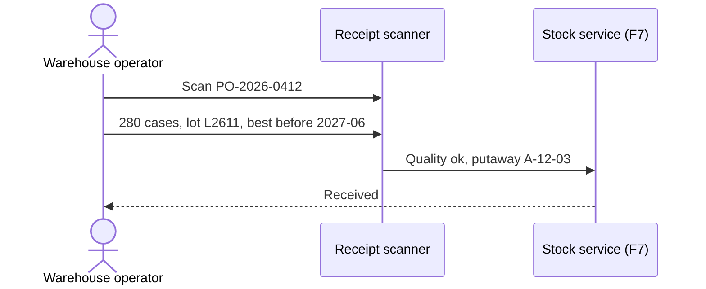

🏠 [Specs](../../../../README.md) › 🧩 [Functional capabilities](../../../README.md) ›
📦 [F7 Purchasing and stock](../../README.md) › 📝 [Use cases](../README.md) ›
📝 [Use cases: FL-F7-02 Receive and store](README.md) › 📝 UC-F7-03 Receive goods

# 📝 UC-F7-03 Receive goods

**Status:** ✅ specified

## Summary

Goods are received in 1, 2 or 3 steps, checked, put away and traced.

## Personas

- [U15 Warehouse operator](../../../../01-users/personas/u15-warehouse-operator.md)

## Goal

Received goods are right, traced and stored where they belong.

## Trigger

A delivery arrives.

## Frequency

Daily.

## Preconditions

Warehouses and rules set (UC-F7-13).

## Postconditions

- **Succeeded:** stock is received, traced and put away.
- **Failed:** failed checks go to quarantine.

## Main flow

1. The warehouse operator scans the delivery note or the order on the receipt screen
   ([S-F7-03](../../screens/02-receive-and-store/s-f07-03-receipt.md)).
2. They record quantities, lots, serials and expiry dates
   ([BR-F7-05](../../business-rules/br-f07-05-every-move-is-traced.md)).
3. Quality checks run where set (pass or fail, photos); hazardous items need a current sheet,
   [UC-F7-23](uc-f07-23-store-dangerous-goods-with-their-safety-data-sheets.md).
4. Putaway rules and capacities give the location; the operator scans it.

## Alternative flows

- 1a. 2 or 3 steps: input, quality, stock.
- 2a. Partial receipt: the rest stays expected.
- 4a. Cross-docking: straight to delivery.

## Error flows

- 3e. A quality check fails: goods to quarantine, the buyer told.
- 4e. No location has capacity: the operator is told where overflow goes.

## Business rules

- [BR-F7-05 Every move is traced](../../business-rules/br-f07-05-every-move-is-traced.md)
- [BR-F7-08 No negative stock](../../business-rules/br-f07-08-no-negative-stock.md)

## Entities

- [E-F7-04 Transfer](../../data/e-f07-04-transfer.md)
- [E-F7-06 Item](../../data/e-f07-06-item.md)
- [E-F7-07 Location](../../data/e-f07-07-location.md)
- [E-F7-10 Lot or serial](../../data/e-f07-10-lot-or-serial.md)
- [E-F7-22 Delivery note](../../data/e-f07-22-delivery-note.md)

## Permissions

Warehouse operators for their warehouse; purchasing and managers read.

## Notifications

The buyer: partial receipts and failed checks.

## Audit events

Received, checked, put away.

## AI involvement

The AI assistant reads a paper delivery note into lines for confirmation.

## API, MCP and A2A exposure

T5 operations of F7 with the caller's rights; the MCP tool of F7; no A2A skill.

## Screens

- [S-F7-03](../../screens/02-receive-and-store/s-f07-03-receipt.md)

## Flowchart

See [FL-F7-02 Receive and store](../../flows/fl-f07-02-receive-and-store.md#flowchart).

## Sequence diagram

## Acceptance criteria

1. **Given** PO-2026-0412 for 280 cases **when** 260 are received **then** 20 stay expected as a backorder.
2. **Given** lot L2611 best before 2027-06-30 **when** it is recorded **then** the lot is traced on the stock.
3. **Given** a failed check with a photo **when** it is saved **then** the goods go to quarantine and the buyer is told.
4. **Given** no network in the cold room **when** the operator scans **then** the scans wait in the queue and sync
   later.

## Non-functional notes

Scans answer within 300 ms on a phone, offline included
([D271](../../../../06-decisions/f07-purchasing-and-stock/d271-warehouse-operations.md)).

## Regulatory references

[CR-FR-061](../../../../10-country-packs/france/products/cr-fr-061-food-traceability.md).

## Related use cases

F6 (sales orders), F8 (accounting), F12 (manufacturing).

- [UC-F7-23 Store dangerous goods with their safety data sheets](uc-f07-23-store-dangerous-goods-with-their-safety-data-sheets.md)

## Open questions

None.

---

⬅️ [UC-F7-02 Order from a supplier](../01-procure/uc-f07-02-order-from-a-supplier.md) · ⬆️ [Up](README.md) ·
➡️ [UC-F7-04 Capture and match supplier invoices](../01-procure/uc-f07-04-capture-and-match-supplier-invoices.md)
