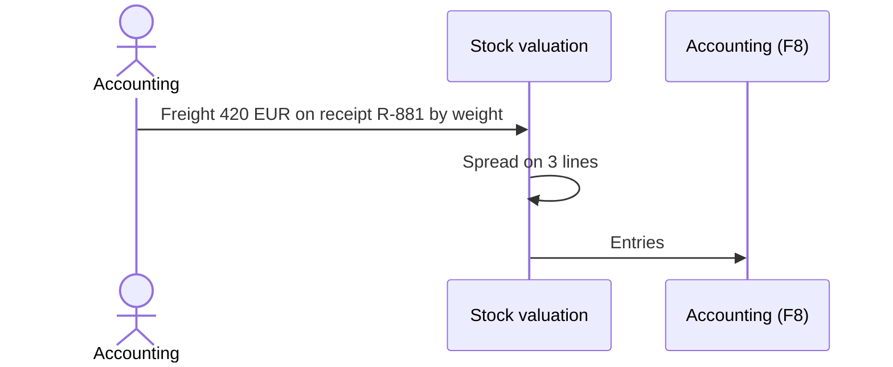

🏠 [Specs](../../../../README.md) › 🧩 [Functional capabilities](../../../README.md) ›
📦 [F7 Purchasing and stock](../../README.md) › 📝 [Use cases](../README.md) ›
📝 [Use cases: FL-F7-02 Receive and store](README.md) › 📝 UC-F7-09 Value stock and landed costs

# 📝 UC-F7-09 Value stock and landed costs

**Status:** ✅ specified

## Summary

Stock is valued by its category's costing method; landed costs are spread on receipts.

## Personas

- [U05 Accounting](../../../../01-users/personas/u05-accounting.md)

## Goal

Stock valued right, with every cost of bringing it in.

## Trigger

Receipts and invoices with freight.

## Frequency

Daily; monthly closing.

## Preconditions

Warehouses and rules set (UC-F7-13).

## Postconditions

- **Succeeded:** stock valued and posted.
- **Failed:** costs on sold items adjust the cost of goods sold.

## Main flow

1. Each category has its costing method: standard, average or FIFO
   ([BR-F7-07](../../business-rules/br-f07-07-costing-method-per-category.md)); valuation is perpetual or periodic.
2. Accounting spreads freight, duties and insurance on receipts by quantity, value, weight or volume on stock valuation
   ([S-F7-09](../../screens/02-receive-and-store/s-f07-09-stock-valuation.md)).
3. Entries go to F8.
4. The valuation report shows value by warehouse and category.

## Alternative flows

- 2a. Revalue after a price error, logged.

## Error flows

- 2e. Landed costs on items already sold: the cost of goods sold is adjusted.

## Business rules

- [BR-F7-07 Costing method per category](../../business-rules/br-f07-07-costing-method-per-category.md)

## Entities

- [E-F7-12 Landed cost](../../data/e-f07-12-landed-cost.md)
- [E-F7-06 Item](../../data/e-f07-06-item.md)

## Permissions

Accounting.

## Notifications

None.

## Audit events

Valuations and landed costs.

## AI involvement

The AI assistant prepares it for confirmation
([BR-F3-07](../../../f03-assistant/business-rules/br-f03-07-no-deletes-no-irreversible-acts.md)); figures come from
queries ([BR-F3-03](../../../f03-assistant/business-rules/br-f03-03-figures-come-from-queries.md)).

## API, MCP and A2A exposure

T5 operations of F7 with the caller's rights; the MCP tool of F7; no A2A skill.

## Screens

- [S-F7-09](../../screens/02-receive-and-store/s-f07-09-stock-valuation.md)

## Flowchart

See [FL-F7-02 Receive and store](../../flows/fl-f07-02-receive-and-store.md#flowchart).

## Sequence diagram

## Acceptance criteria

1. **Given** freight of 420 EUR on a receipt of 3 lines weighing 600, 300 and 100 kg **when** it is spread by weight
   **then** the lines get 252, 126 and 42 EUR.
2. **Given** half the goods already sold **when** landed costs arrive **then** half adjusts the cost of goods sold.
3. **Given** FIFO for drinks **when** the valuation runs **then** drinks are valued FIFO.

## Non-functional notes

None.

## Regulatory references

[CR-FR-081](../../../../10-country-packs/france/accounting/cr-fr-081-production-cost-of-inventories.md).

## Related use cases

F6 (sales orders), F8 (accounting), F12 (manufacturing).

## Open questions

None.

---

⬅️ [UC-F7-08 Trace lots and serials, recall](../05-count-trace-and-analyse/uc-f07-08-trace-lots-and-serials-recall.md) ·
⬆️ [Up](README.md) ·
➡️ [UC-F7-10 Handle returns and scrap](../04-pick-pack-and-ship/uc-f07-10-handle-returns-and-scrap.md)
