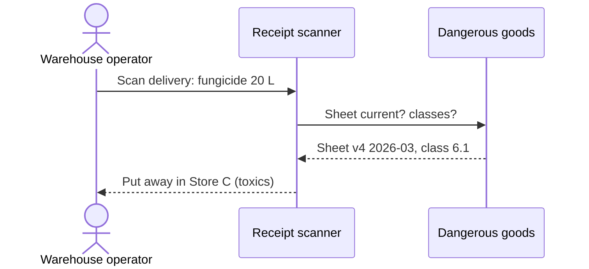

🏠 [Specs](../../../../README.md) › 🧩 [Functional capabilities](../../../README.md) ›
📦 [F7 Purchasing and stock](../../README.md) › 📝 [Use cases](../README.md) ›
📝 [Use cases: FL-F7-02 Receive and store](README.md) › 📝 UC-F7-23 Store dangerous goods with their safety data sheets

# 📝 UC-F7-23 Store dangerous goods with their safety data sheets

**Status:** ✅ specified

## Summary

Hazardous items carry their hazard classes and current safety data sheet; receipts without a current sheet are blocked
and putaway respects storage compatibility.

## Personas

- [U15 Warehouse operator](../../../../01-users/personas/u15-warehouse-operator.md)
- [U04 Purchasing and stock](../../../../01-users/personas/u04-purchasing.md)
- [U27 Quality manager](../../../../01-users/personas/u27-quality-manager.md)

## Goal

Store chemicals and plant-protection products safely and legally.

## Trigger

A hazardous item is bought, received or moved.

## Frequency

Daily where such goods are kept.

## Preconditions

- Hazardous items are marked with their classes ([E-F7-19](../../data/e-f07-19-safety-data-sheet.md)).

## Postconditions

- **Succeeded:** goods stored in compatible locations with a current sheet.
- **Failed:** the receipt or move is refused with the reason.

## Main flow

1. The buyer attaches the supplier's safety data sheet to the item on Dangerous goods
   ([S-F7-23](../../screens/02-receive-and-store/s-f07-23-dangerous-goods.md)); its version and date are kept.
2. At receipt ([UC-F7-03](uc-f07-03-receive-goods.md)), the scanner checks the sheet is current
   ([BR-F7-16](../../business-rules/br-f07-16-no-current-safety-data-sheet-no-receipt.md)).
3. Putaway proposes only locations whose storage class is compatible and under its quantity limit.
4. The warehouse register lists hazardous stock per location for the safety officer and the firefighters.

## Alternative flows

- 4a. Transport: the delivery note carries the ADR mentions
  ([CR-FR-121](../../../../10-country-packs/france/transport/cr-fr-121-dangerous-goods.md)).

## Error flows

- 2e. Sheet older than the supplier's latest: receipt blocked, the buyer asked.
- 3e. No compatible location: putaway refused; the operator is told where the quarantine is.

## Business rules

- [BR-F7-16 No current safety data sheet, no receipt](../../business-rules/br-f07-16-no-current-safety-data-sheet-no-receipt.md)

## Entities

- [E-F7-19 Safety data sheet](../../data/e-f07-19-safety-data-sheet.md)
- [E-F7-07 Location](../../data/e-f07-07-location.md)

## Permissions

Warehouse operators for their warehouse; purchasing and managers read. The quality manager keeps the sheets.

## Notifications

The buyer: a sheet out of date.

## Audit events

Sheets added; refusals; the register.

## AI involvement

The AI assistant reads a sheet and fills the hazard classes for confirmation.

## API, MCP and A2A exposure

T5 operations of F7 with the caller's rights; the MCP tool of F7; no A2A skill.

## Screens

- [S-F7-23 Dangerous goods](../../screens/02-receive-and-store/s-f07-23-dangerous-goods.md)
- [S-F7-03 Receipt](../../screens/02-receive-and-store/s-f07-03-receipt.md)

## Flowchart

See [FL-F7-09 Compliance and carbon](../../flows/fl-f07-09-compliance-and-carbon.md#flowchart).

## Sequence diagram

## Acceptance criteria

1. **Given** Ferme des Trois Chênes receiving a plant-protection product of class 6.1 **when** it is scanned **then**
   only the toxics store is proposed.
2. **Given** the sheet on file v3 while the supplier published v4 **when** the receipt is scanned **then** it is blocked
   and the buyer asked.
3. **Given** the toxics store at its quantity limit **when** putaway is asked **then** it is refused with the quarantine
   location.

## Non-functional notes

Scans answer within 300 ms on a phone, offline included
([D271](../../../../06-decisions/f07-purchasing-and-stock/d271-warehouse-operations.md)).

## Regulatory references

[CR-FR-121](../../../../10-country-packs/france/transport/cr-fr-121-dangerous-goods.md);
[CR-FR-077](../../../../10-country-packs/france/products/cr-fr-077-reach-svhc-information.md);
[CR-FR-161](../../../../10-country-packs/france/agriculture/cr-fr-161-plant-protection-register.md).

## Related use cases

- [UC-F7-03 Receive goods](uc-f07-03-receive-goods.md)
- [UC-F12-17 Keep the risk assessment and safety registers](../../../f12-manufacturing/use-cases/07-compliance-and-safety/uc-f12-17-keep-the-risk-assessment-and-safety-registers.md)

## Open questions

None.

---

⬅️ [UC-F7-22](../09-compliance-and-carbon/uc-f07-22-charge-and-declare-packaging-eco-contributions.md) ·
⬆️ [Up](README.md) · ➡️ [UC-F7-24](../09-compliance-and-carbon/uc-f07-24-measure-the-carbon-of-purchases.md)
