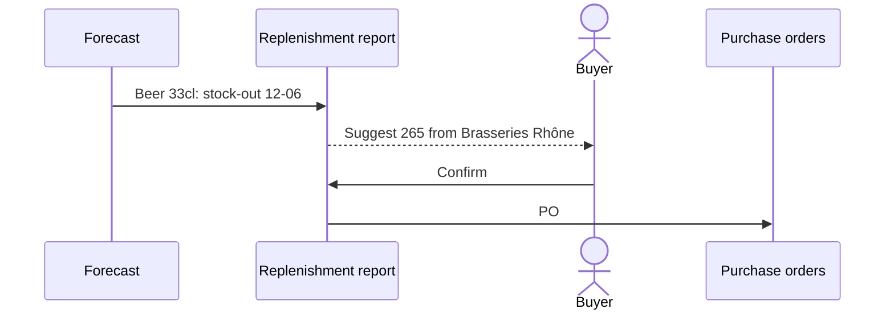

🏠 [Specs](../../../../README.md) › 🧩 [Functional capabilities](../../../README.md) ›
📦 [F7 Purchasing and stock](../../README.md) › 📝 [Use cases](../README.md) ›
📝 [Use cases: FL-F7-03 Replenish](README.md) › 📝 UC-F7-05 Replenish stock

# 📝 UC-F7-05 Replenish stock

**Status:** ✅ specified

## Summary

Suggested orders from reordering rules, lead times and an AI forecast, confirmed by a buyer.

## Personas

- [U04 Purchasing](../../../../01-users/personas/u04-purchasing.md)

## Goal

Order the right quantity at the right time.

## Trigger

The daily replenishment report.

## Frequency

Daily.

## Preconditions

Warehouses and rules set (UC-F7-13).

## Postconditions

- **Succeeded:** suggestions confirmed become orders or transfers.
- **Failed:** snoozed ones come back.

## Main flow

1. Reordering rules, the safety stock
   ([UC-F7-21](uc-f07-21-set-safety-stock-and-min-max-per-item.md)) and the AI
   forecast give the forecast stock by date with stock-out dates.
2. The replenishment report ([S-F7-05](../../screens/03-replenish/s-f07-05-replenishment.md)) lists suggested orders per
   supplier at contract prices and lead times.
3. The buyer confirms, orders to max, or snoozes
   ([BR-F7-02](../../business-rules/br-f07-02-reorders-are-suggested-then-confirmed.md)).
4. Confirmed suggestions become purchase orders ([UC-F7-02](../01-procure/uc-f07-02-order-from-a-supplier.md)); chosen
   items reorder automatically.

## Alternative flows

- 2a. Make-to-order: a supply order per sales order.
- 2b. Dropshipping: the supplier ships to the customer.
- 2c. Resupply from another warehouse.

## Error flows

- 1e. Too little history: rules only, said so.
- 2e. No supplier price: the line asks one.

## Business rules

- [BR-F7-02 Reorders are suggested, then confirmed](../../business-rules/br-f07-02-reorders-are-suggested-then-confirmed.md)

## Entities

- [E-F7-09 Reordering rule](../../data/e-f07-09-reordering-rule.md)
- [E-F7-06 Item](../../data/e-f07-06-item.md)
- [E-F7-03 Purchase order](../../data/e-f07-03-purchase-order.md)

## Permissions

Purchasing; managers approve; accounting reads; record rules by warehouse or site.

## Notifications

The buyer: stock-outs ahead.

## Audit events

Suggestions confirmed, snoozed.

## AI involvement

Forecast by the model, explained.

## API, MCP and A2A exposure

T5 operations of F7 with the caller's rights; the MCP tool of F7; no A2A skill.

## Screens

- [S-F7-05](../../screens/03-replenish/s-f07-05-replenishment.md)

## Flowchart

See [FL-F7-03 Replenish](../../flows/fl-f07-03-replenish.md#flowchart).

## Sequence diagram

## Acceptance criteria

1. **Given** a stock-out forecast on 2026-12-06 and a lead time of 5 days **when** the report runs on 11-28 **then** a
   suggestion appears for that supplier.
2. **Given** the buyer snoozes it 3 days **when** 3 days pass **then** it comes back.
3. **Given** an item with 2 weeks of history **when** the forecast runs **then** the rules are used and it says so.

## Non-functional notes

Report within 30 seconds for 6,000 items.

## Regulatory references

None.

## Related use cases

F6 (sales orders), F8 (accounting), F12 (manufacturing).

- [UC-F7-21 Set safety stock and min/max per item](uc-f07-21-set-safety-stock-and-min-max-per-item.md)

## Open questions

None.

---

⬅️ [UC-F7-04 Capture and match supplier invoices](../01-procure/uc-f07-04-capture-and-match-supplier-invoices.md) ·
⬆️ [Up](README.md) · ➡️ [UC-F7-06 Pick, pack and ship](../04-pick-pack-and-ship/uc-f07-06-pick-pack-and-ship.md)
