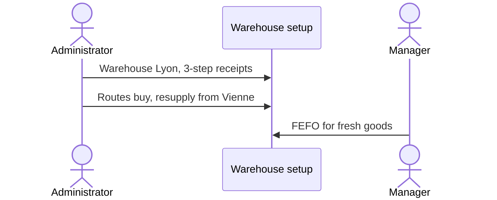

🏠 [Specs](../../../../README.md) › 🧩 [Functional capabilities](../../../README.md) ›
📦 [F7 Purchasing and stock](../../README.md) › 📝 [Use cases](../README.md) ›
📝 [Use cases: FL-F7-03 Replenish](README.md) › 📝 UC-F7-13 Set up warehouses, routes and rules

# 📝 UC-F7-13 Set up warehouses, routes and rules

**Status:** ✅ specified

## Summary

Warehouses, locations, routes, steps, putaway, removal, reservation and reordering rules are set.

## Personas

- [U07 Administrator](../../../../01-users/personas/u07-administrator.md)
- [U02 Manager](../../../../01-users/personas/u02-manager.md)

## Goal

A warehouse set up the way goods really move.

## Trigger

Setting up F7 or a new warehouse.

## Frequency

At setup; then a few times a year.

## Preconditions

Warehouses and rules set (UC-F7-13).

## Postconditions

- **Succeeded:** warehouses, routes and rules are in force.
- **Failed:** a route loop is refused.

## Main flow

1. The administrator creates warehouses, locations and storage categories with capacities on warehouse setup
   ([S-F7-13](../../screens/03-replenish/s-f07-13-warehouse-setup.md)).
2. They choose receipt and delivery steps and routes (buy, make-to-order, dropship, cross-dock, resupply).
3. Managers set putaway, removal and reservation strategies.
4. Managers set reordering rules and levels ([UC-F7-21](uc-f07-21-set-safety-stock-and-min-max-per-item.md)).

## Alternative flows

- 1a. Sector packs bring ready settings.

## Error flows

- 2e. A route loop: refused with the reason.

## Business rules

- See F7's rules.

## Entities

- [E-F7-07 Location](../../data/e-f07-07-location.md)
- [E-F7-08 Route](../../data/e-f07-08-route.md)
- [E-F7-09 Reordering rule](../../data/e-f07-09-reordering-rule.md)

## Permissions

Administrators; managers for strategies.

## Notifications

None.

## Audit events

Settings changed.

## AI involvement

The AI assistant prepares it for confirmation
([BR-F3-07](../../../f03-assistant/business-rules/br-f03-07-no-deletes-no-irreversible-acts.md)); figures come from
queries ([BR-F3-03](../../../f03-assistant/business-rules/br-f03-03-figures-come-from-queries.md)).

## API, MCP and A2A exposure

T5 operations of F7 with the caller's rights; the MCP tool of F7; no A2A skill.

## Screens

- [S-F7-13](../../screens/03-replenish/s-f07-13-warehouse-setup.md)

## Flowchart

See [FL-F7-03 Replenish](../../flows/fl-f07-03-replenish.md#flowchart).

## Sequence diagram

## Acceptance criteria

1. **Given** a warehouse with 3-step receipts **when** a receipt is made **then** it goes input, quality, stock.
2. **Given** a route from A to B and B to A **when** it is saved **then** it is refused as a loop.
3. **Given** FEFO on fresh goods **when** a picking runs **then** the first expiring lot is picked.

## Non-functional notes

None.

## Regulatory references

None.

## Related use cases

F6 (sales orders), F8 (accounting), F12 (manufacturing).

## Open questions

None.

---

⬅️ [UC-F7-12 Use the supplier portal](../01-procure/uc-f07-12-use-the-supplier-portal.md) · ⬆️ [Up](README.md) ·
➡️ [UC-F7-14](../06-benchmark-additions/uc-f07-14-run-a-call-for-tenders-and-rate-suppliers.md)
