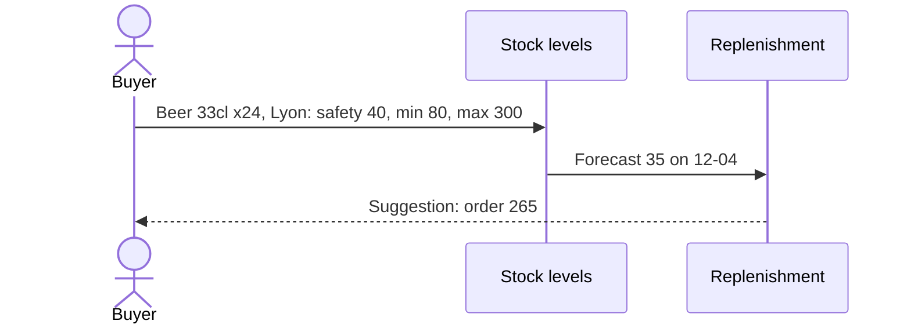

🏠 [Specs](../../../../README.md) › 🧩 [Functional capabilities](../../../README.md) ›
📦 [F7 Purchasing and stock](../../README.md) › 📝 [Use cases](../README.md) ›
📝 [Use cases: FL-F7-03 Replenish](README.md) › 📝 UC-F7-21 Set safety stock and min/max per item

# 📝 UC-F7-21 Set safety stock and min/max per item

**Status:** ✅ specified

## Summary

The buyer sets, per item and location, the safety stock and the minimum and maximum that drive replenishment, and sees
when stock falls under them.

## Personas

- [U04 Purchasing and stock](../../../../01-users/personas/u04-purchasing.md)
- [U02 Manager](../../../../01-users/personas/u02-manager.md)

## Goal

Never run out of what sells, never overstock what does not.

## Trigger

A new item, a season change, or a stock-out.

## Frequency

Monthly reviews.

## Preconditions

- Items and locations exist ([UC-F7-13](uc-f07-13-set-up-warehouses-routes-and-rules.md)).

## Postconditions

- **Succeeded:** each item has its levels; suggestions follow them
  ([BR-F7-14](../../business-rules/br-f07-14-safety-stock-triggers-a-suggestion.md)).
- **Failed:** levels unchanged.

## Main flow

1. The buyer opens Stock levels ([S-F7-21](../../screens/03-replenish/s-f07-21-stock-levels.md))
   filtered on a category and a warehouse.
2. Per item: current stock, forecast, lead time, and the safety stock, minimum and maximum.
3. They set the safety stock (or let SimpleERP propose it from demand and lead-time variation), the minimum and the
   maximum.
4. When the forecast stock goes under the safety stock, a replenishment suggestion appears
   ([UC-F7-05](uc-f07-05-replenish-stock.md)).

## Alternative flows

- 3a. Levels by season: a higher minimum from November to January.

## Error flows

- 3e. A minimum above the maximum: refused.

## Business rules

- [BR-F7-14 Safety stock triggers a suggestion](../../business-rules/br-f07-14-safety-stock-triggers-a-suggestion.md)
- [BR-F7-02 Reorders are suggested, then confirmed](../../business-rules/br-f07-02-reorders-are-suggested-then-confirmed.md)

## Entities

- [E-F7-09 Reordering rule](../../data/e-f07-09-reordering-rule.md)
- [E-F7-06 Item](../../data/e-f07-06-item.md)
- [E-F7-21 Demand forecast](../../data/e-f07-21-demand-forecast.md)

## Permissions

Purchasing; managers approve; accounting reads; record rules by warehouse or site.

## Notifications

The buyer: items under safety stock.

## Audit events

Levels changed.

## AI involvement

The AI assistant prepares it for confirmation
([BR-F3-07](../../../f03-assistant/business-rules/br-f03-07-no-deletes-no-irreversible-acts.md)); figures come from
queries ([BR-F3-03](../../../f03-assistant/business-rules/br-f03-03-figures-come-from-queries.md)).

## API, MCP and A2A exposure

T5 operations of F7 with the caller's rights; the MCP tool of F7; no A2A skill.

## Screens

- [S-F7-21 Stock levels](../../screens/03-replenish/s-f07-21-stock-levels.md)
- [S-F7-05 Replenishment](../../screens/03-replenish/s-f07-05-replenishment.md)

## Flowchart

See [FL-F7-08 Catalogues and stock levels](../../flows/fl-f07-08-catalogues-and-stock-levels.md#flowchart).

## Sequence diagram

## Acceptance criteria

1. **Given** safety 40, min 80, max 300 for beer 33cl at Lyon **when** the forecast shows 35 on 2026-12-04 **then** a
   suggestion to order up to 300 appears.
2. **Given** a minimum of 300 and a maximum of 200 **when** they are saved **then** it is refused.
3. **Given** a proposed safety stock **when** the buyer accepts it **then** it is saved with "proposed by SimpleERP".

## Non-functional notes

None.

## Regulatory references

None.

## Related use cases

- [UC-F7-05 Replenish stock](uc-f07-05-replenish-stock.md)
- [UC-F7-11 Analyse stock](../05-count-trace-and-analyse/uc-f07-11-analyse-stock.md)

## Open questions

None.

---

⬅️ [UC-F7-20](../08-catalogues-and-stock-levels/uc-f07-20-order-from-an-approved-catalogue-or-punch-out.md) ·
⬆️ [Up](README.md) ·
➡️ [UC-F7-22](../09-compliance-and-carbon/uc-f07-22-charge-and-declare-packaging-eco-contributions.md)
