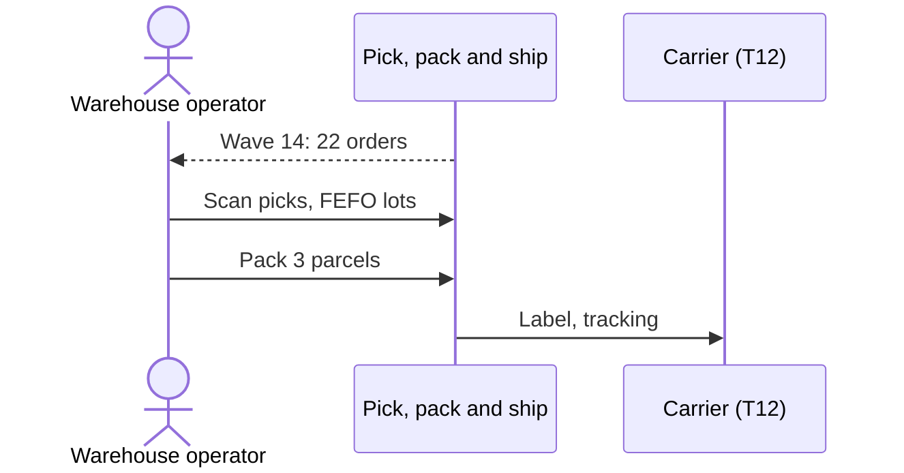

🏠 [Specs](../../../../README.md) › 🧩 [Functional capabilities](../../../README.md) ›
📦 [F7 Purchasing and stock](../../README.md) › 📝 [Use cases](../README.md) ›
📝 [Use cases: FL-F7-04 Pick, pack and ship](README.md) › 📝 UC-F7-06 Pick, pack and ship

# 📝 UC-F7-06 Pick, pack and ship

**Status:** ✅ specified

## Summary

Orders are reserved, picked by batch, wave or cluster, packed and shipped with carriers.

## Personas

- [U15 Warehouse operator](../../../../01-users/personas/u15-warehouse-operator.md)

## Goal

Ship the right goods, on time, with the right carrier.

## Trigger

A confirmed order to deliver.

## Frequency

Daily.

## Preconditions

Warehouses and rules set (UC-F7-13).

## Postconditions

- **Succeeded:** shipped with tracking.
- **Failed:** backorder or substitute when short.

## Main flow

1. Stock is reserved at confirmation, by hand, or N days before.
2. Removal strategies choose what leaves (FEFO for expiring items,
   [BR-F7-04](../../business-rules/br-f07-04-expiring-items-leave-first-expired-first.md)).
3. Pickings are grouped in batches, waves or clusters; the operator scans on the pick screen
   ([S-F7-06](../../screens/04-pick-pack-and-ship/s-f07-06-pick-pack-and-ship.md)).
4. Packed and shipped with a carrier: rate, label, tracking (T12).

## Alternative flows

- 3a. 1, 2 or 3 steps: pick, pack, deliver.
- 4a. Kits and packages.

## Error flows

- 3e. Stock short at picking: backorder or substitute, the sales person told.
- 4e. A carrier refuses the label: the reason shown.

## Business rules

- [BR-F7-04 Expiring items leave first-expired-first](../../business-rules/br-f07-04-expiring-items-leave-first-expired-first.md)
- [BR-F7-05 Every move is traced](../../business-rules/br-f07-05-every-move-is-traced.md)
- [BR-F7-08 No negative stock](../../business-rules/br-f07-08-no-negative-stock.md)

## Entities

- [E-F7-04 Transfer](../../data/e-f07-04-transfer.md)
- [E-F7-06 Item](../../data/e-f07-06-item.md)
- [E-F7-07 Location](../../data/e-f07-07-location.md)
- [E-F7-10 Lot or serial](../../data/e-f07-10-lot-or-serial.md)

## Permissions

Warehouse operators for their warehouse; purchasing and managers read.

## Notifications

Customer: tracking; sales: shortages.

## Audit events

Reserved, picked, packed, shipped.

## AI involvement

None.

## API, MCP and A2A exposure

T5 operations of F7 with the caller's rights; the MCP tool of F7; no A2A skill.

## Screens

- [S-F7-06](../../screens/04-pick-pack-and-ship/s-f07-06-pick-pack-and-ship.md)

## Flowchart

See [FL-F7-04 Pick, pack and ship](../../flows/fl-f07-04-pick-pack-and-ship.md#flowchart).

## Sequence diagram

## Acceptance criteria

1. **Given** two lots best before 2027-03 and 2027-06 **when** an order is picked **then** the 2027-03 lot is picked
   first.
2. **Given** 4 short at picking **when** the operator confirms **then** a backorder of 4 is kept and sales is told.
3. **Given** a carrier refusing the address **when** the label is asked **then** the reason shows.

## Non-functional notes

Scans answer within 300 ms on a phone, offline included
([D271](../../../../06-decisions/f07-purchasing-and-stock/d271-warehouse-operations.md)).

## Regulatory references

[CR-FR-118](../../../../10-country-packs/france/transport/cr-fr-118-documents-on-board.md) for transport documents.

## Related use cases

F6 (sales orders), F8 (accounting), F12 (manufacturing).

- [UC-F10-26 Look up and transfer stock between stores](../../../f10-point-of-sale/use-cases/10-clienteling-transfers-and-tax-free/uc-f10-26-look-up-and-transfer-stock-between-stores.md)

## Open questions

None.

---

⬅️ [UC-F7-05 Replenish stock](../03-replenish/uc-f07-05-replenish-stock.md) · ⬆️ [Up](README.md) ·
➡️ [UC-F7-07 Count stock](../05-count-trace-and-analyse/uc-f07-07-count-stock.md)
