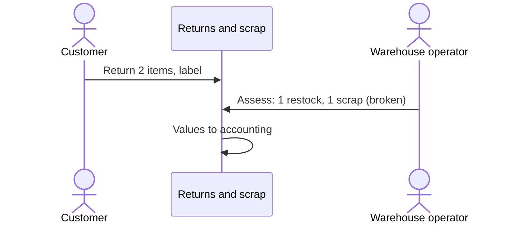

🏠 [Specs](../../../../README.md) › 🧩 [Functional capabilities](../../../README.md) ›
📦 [F7 Purchasing and stock](../../README.md) › 📝 [Use cases](../README.md) ›
📝 [Use cases: FL-F7-04 Pick, pack and ship](README.md) › 📝 UC-F7-10 Handle returns and scrap

# 📝 UC-F7-10 Handle returns and scrap

**Status:** ✅ specified

## Summary

Returns follow routes (assess, refurbish, restock, scrap); scrap is recorded with reasons and costs.

## Personas

- [U15 Warehouse operator](../../../../01-users/personas/u15-warehouse-operator.md)

## Goal

Returns and scrap handled with their value and reason.

## Trigger

A customer return or damaged goods.

## Frequency

Weekly.

## Preconditions

Warehouses and rules set (UC-F7-13).

## Postconditions

- **Succeeded:** goods restocked, refurbished or scrapped, values posted.
- **Failed:** returns outside the period refused.

## Main flow

1. A customer starts a return in the portal with a label, or the operator records it on returns and scrap
   ([S-F7-10](../../screens/04-pick-pack-and-ship/s-f07-10-returns-and-scrap.md)).
2. The goods are assessed: refurbish, restock or scrap.
3. Values flow to accounting; a refund or credit note follows,
   [UC-F6-09](../../../f06-customers-and-sales/use-cases/03-invoice-and-get-paid/uc-f06-09-credit-note-and-refund.md).
4. Scrap is recorded with its reason and cost
   ([CR-FR-079](../../../../10-country-packs/france/environment/cr-fr-079-waste-register.md)).

## Alternative flows

- 1a. Supplier returns.

## Error flows

- 1e. Outside the return period: refused with the policy.

## Business rules

- [BR-F7-05 Every move is traced](../../business-rules/br-f07-05-every-move-is-traced.md)

## Entities

- [E-F7-04 Transfer](../../data/e-f07-04-transfer.md)

## Permissions

Warehouse operators for their warehouse; purchasing and managers read.

## Notifications

Customer: return received.

## Audit events

Returned, assessed, scrapped.

## AI involvement

None.

## API, MCP and A2A exposure

T5 operations of F7 with the caller's rights; the MCP tool of F7; no A2A skill.

## Screens

- [S-F7-10](../../screens/04-pick-pack-and-ship/s-f07-10-returns-and-scrap.md)

## Flowchart

See [FL-F7-04 Pick, pack and ship](../../flows/fl-f07-04-pick-pack-and-ship.md#flowchart).

## Sequence diagram

## Acceptance criteria

1. **Given** a return of 2 items within 30 days **when** one is restocked and one scrapped **then** stock rises by 1 and
   the scrap is recorded with its reason.
2. **Given** a return after the period **when** it is asked **then** it is refused with the policy.
3. **Given** a scrap of 64 EUR **when** it is recorded **then** its cost goes to accounting.

## Non-functional notes

Scans answer within 300 ms on a phone, offline included
([D271](../../../../06-decisions/f07-purchasing-and-stock/d271-warehouse-operations.md)).

## Regulatory references

[CR-FR-094](../../../../10-country-packs/france/environment/cr-fr-094-unsold-non-food-goods.md);
[CR-FR-079](../../../../10-country-packs/france/environment/cr-fr-079-waste-register.md).

## Related use cases

F6 (sales orders), F8 (accounting), F12 (manufacturing).

## Open questions

None.

---

⬅️ [UC-F7-09 Value stock and landed costs](../02-receive-and-store/uc-f07-09-value-stock-and-landed-costs.md) ·
⬆️ [Up](README.md) · ➡️ [UC-F7-11 Analyse stock](../05-count-trace-and-analyse/uc-f07-11-analyse-stock.md)
