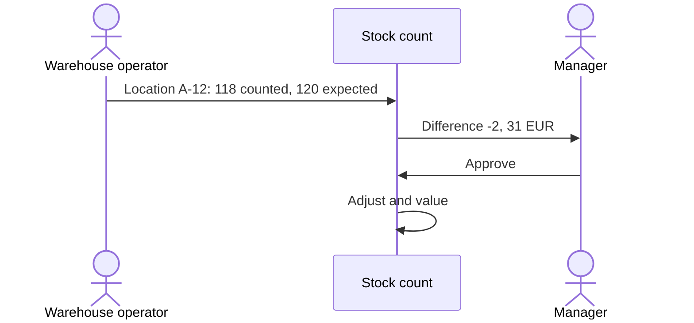

🏠 [Specs](../../../../README.md) › 🧩 [Functional capabilities](../../../README.md) ›
📦 [F7 Purchasing and stock](../../README.md) › 📝 [Use cases](../README.md) ›
📝 [Use cases: FL-F7-05 Count, trace and analyse](README.md) › 📝 UC-F7-07 Count stock

# 📝 UC-F7-07 Count stock

**Status:** ✅ specified

## Summary

Cycle counts per location and a yearly full count, on phones, with approvals for differences.

## Personas

- [U15 Warehouse operator](../../../../01-users/personas/u15-warehouse-operator.md)
- [U02 Manager](../../../../01-users/personas/u02-manager.md)

## Goal

Stock figures that match the shelves, with differences approved.

## Trigger

A count due by location frequency, or the yearly count.

## Frequency

Weekly cycle counts; yearly.

## Preconditions

Warehouses and rules set (UC-F7-13).

## Postconditions

- **Succeeded:** stock adjusted and valued.
- **Failed:** a recount asked.

## Main flow

1. Counts are due by location frequency (more often for A items, [UC-F7-11](uc-f07-11-analyse-stock.md)) and once a year
   in full ([CR-FR-007](../../../../10-country-packs/france/accounting/cr-fr-007-annual-stock-count.md)).
2. Operators count with their phones on the count screen
   ([S-F7-07](../../screens/05-count-trace-and-analyse/s-f07-07-stock-count.md)), offline if needed.
3. Differences above a threshold need a manager's approval
   ([BR-F7-06](../../business-rules/br-f07-06-count-differences-need-approval.md)).
4. The stock is adjusted and valued.

## Alternative flows

- 1a. Count by product or lot.

## Error flows

- 3e. Two counts disagree: a recount is asked.

## Business rules

- [BR-F7-06 Count differences need approval](../../business-rules/br-f07-06-count-differences-need-approval.md)

## Entities

- [E-F7-11 Stock count](../../data/e-f07-11-stock-count.md)
- [E-F7-07 Location](../../data/e-f07-07-location.md)

## Permissions

Warehouse operators for their warehouse; purchasing and managers read. Managers approve differences.

## Notifications

Manager: differences to approve.

## Audit events

Counted, approved, adjusted.

## AI involvement

None.

## API, MCP and A2A exposure

T5 operations of F7 with the caller's rights; the MCP tool of F7; no A2A skill.

## Screens

- [S-F7-07](../../screens/05-count-trace-and-analyse/s-f07-07-stock-count.md)

## Flowchart

See [FL-F7-05 Count, trace and analyse](../../flows/fl-f07-05-count-trace-and-analyse.md#flowchart).

## Sequence diagram

## Acceptance criteria

1. **Given** location A-12 expecting 120 **when** 118 are counted **then** a difference of -2 is shown.
2. **Given** a threshold of 50 EUR and a difference of 31 EUR **when** it is counted **then** it is adjusted without
   approval.
3. **Given** two operators counting 118 and 112 **when** both count **then** a recount is asked.

## Non-functional notes

Scans answer within 300 ms on a phone, offline included
([D271](../../../../06-decisions/f07-purchasing-and-stock/d271-warehouse-operations.md)).

## Regulatory references

[CR-FR-007](../../../../10-country-packs/france/accounting/cr-fr-007-annual-stock-count.md).

## Related use cases

F6 (sales orders), F8 (accounting), F12 (manufacturing).

## Open questions

None.

---

⬅️ [UC-F7-06 Pick, pack and ship](../04-pick-pack-and-ship/uc-f07-06-pick-pack-and-ship.md) · ⬆️ [Up](README.md) ·
➡️ [UC-F7-08 Trace lots and serials, recall](uc-f07-08-trace-lots-and-serials-recall.md)
