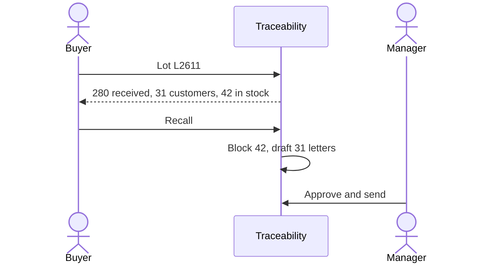

🏠 [Specs](../../../../README.md) › 🧩 [Functional capabilities](../../../README.md) ›
📦 [F7 Purchasing and stock](../../README.md) › 📝 [Use cases](../README.md) ›
📝 [Use cases: FL-F7-05 Count, trace and analyse](README.md) › 📝 UC-F7-08 Trace lots and serials, recall

# 📝 UC-F7-08 Trace lots and serials, recall

**Status:** ✅ specified

## Summary

Every lot and serial traced from supplier to customer, and recalled when needed.

## Personas

- [U04 Purchasing](../../../../01-users/personas/u04-purchasing.md)
- [U02 Manager](../../../../01-users/personas/u02-manager.md)

## Goal

Find where every lot went, and recall fast.

## Trigger

A question, an expiry, a recall.

## Frequency

Weekly searches; recalls rare.

## Preconditions

Warehouses and rules set (UC-F7-13).

## Postconditions

- **Succeeded:** the lot's path is known; a recall blocks and informs.
- **Failed:** an untracked item shows the period's deliveries.

## Main flow

1. The buyer searches a lot or serial on traceability
   ([S-F7-08](../../screens/05-count-trace-and-analyse/s-f07-08-traceability.md)): upstream (supplier, receipt) and
   downstream (customers, deliveries).
2. Expiry alerts warn before best-before and removal dates.
3. A recall lists every customer and stock holding the lot, blocks remaining stock and drafts the letters
   ([CR-FR-062](../../../../10-country-packs/france/products/cr-fr-062-product-recall.md)).
4. The manager approves and sends the letters.

## Alternative flows

- 3a. Recall from a supplier's notice.

## Error flows

- 1e. An item not tracked: said, with the deliveries of the period.

## Business rules

- [BR-F7-05 Every move is traced](../../business-rules/br-f07-05-every-move-is-traced.md)
- [BR-F7-04 Expiring items leave first-expired-first](../../business-rules/br-f07-04-expiring-items-leave-first-expired-first.md)

## Entities

- [E-F7-10 Lot or serial](../../data/e-f07-10-lot-or-serial.md)
- [E-F7-04 Transfer](../../data/e-f07-04-transfer.md)

## Permissions

Purchasing; managers approve; accounting reads; record rules by warehouse or site. Managers approve recalls.

## Notifications

Customers: recall letters.

## Audit events

Searches, recalls.

## AI involvement

The AI assistant prepares it for confirmation
([BR-F3-07](../../../f03-assistant/business-rules/br-f03-07-no-deletes-no-irreversible-acts.md)); figures come from
queries ([BR-F3-03](../../../f03-assistant/business-rules/br-f03-03-figures-come-from-queries.md)).

## API, MCP and A2A exposure

T5 operations of F7 with the caller's rights; the MCP tool of F7; no A2A skill.

## Screens

- [S-F7-08](../../screens/05-count-trace-and-analyse/s-f07-08-traceability.md)

## Flowchart

See [FL-F7-05 Count, trace and analyse](../../flows/fl-f07-05-count-trace-and-analyse.md#flowchart).

## Sequence diagram

## Acceptance criteria

1. **Given** lot L2611 delivered to 31 customers **when** a recall starts **then** the 31 customers are listed and 42 in
   stock are blocked.
2. **Given** best before in 10 days **when** the daily check runs **then** an expiry alert shows.
3. **Given** an untracked item **when** it is searched **then** the deliveries of the period show.

## Non-functional notes

None.

## Regulatory references

[CR-FR-061](../../../../10-country-packs/france/products/cr-fr-061-food-traceability.md);
[CR-FR-062](../../../../10-country-packs/france/products/cr-fr-062-product-recall.md).

## Related use cases

F6 (sales orders), F8 (accounting), F12 (manufacturing).

- [UC-F11-25 Show product safety information](../../../f11-online-shop/use-cases/08-product-content-and-listings/uc-f11-25-show-product-safety-information.md)

## Open questions

None.

---

⬅️ [UC-F7-07 Count stock](uc-f07-07-count-stock.md) · ⬆️ [Up](README.md) ·
➡️ [UC-F7-09 Value stock and landed costs](../02-receive-and-store/uc-f07-09-value-stock-and-landed-costs.md)
