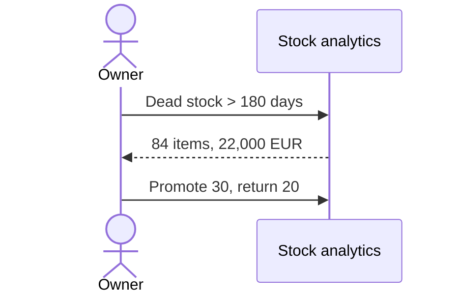

🏠 [Specs](../../../../README.md) › 🧩 [Functional capabilities](../../../README.md) ›
📦 [F7 Purchasing and stock](../../README.md) › 📝 [Use cases](../README.md) ›
📝 [Use cases: FL-F7-05 Count, trace and analyse](README.md) › 📝 UC-F7-11 Analyse stock

# 📝 UC-F7-11 Analyse stock

**Status:** ✅ specified

## Summary

Stock aging, dead stock, turnover and ABC analysis, to act on stock.

## Personas

- [U13 Owner](../../../../01-users/personas/u13-owner.md)
- [U02 Manager](../../../../01-users/personas/u02-manager.md)
- [U04 Purchasing](../../../../01-users/personas/u04-purchasing.md)

## Goal

Act on stock that does not move and on what matters most.

## Trigger

A monthly stock review.

## Frequency

Monthly.

## Preconditions

Warehouses and rules set (UC-F7-13).

## Postconditions

- **Succeeded:** actions decided on dead stock and A items.
- **Failed:** nothing changes.

## Main flow

1. The owner opens stock analytics ([S-F7-11](../../screens/05-count-trace-and-analyse/s-f07-11-stock-analytics.md)):
   aging, dead stock, turnover and ABC by value.
2. A items get more frequent counts and tighter levels
   ([UC-F7-21](../03-replenish/uc-f07-21-set-safety-stock-and-min-max-per-item.md)).
3. Dead stock gets an action: promote, return to the supplier, or scrap.
4. They export the analysis.

## Alternative flows

- 1a. Per warehouse or category.

## Error flows

- 1e. Less than a year of moves: aging shows the available period.

## Business rules

- See F7's rules.

## Entities

- [E-F7-06 Item](../../data/e-f07-06-item.md)
- [E-F7-11 Stock count](../../data/e-f07-11-stock-count.md)

## Permissions

The owner, managers and purchasing.

## Notifications

Monthly digest.

## Audit events

Actions decided.

## AI involvement

The AI assistant prepares it for confirmation
([BR-F3-07](../../../f03-assistant/business-rules/br-f03-07-no-deletes-no-irreversible-acts.md)); figures come from
queries ([BR-F3-03](../../../f03-assistant/business-rules/br-f03-03-figures-come-from-queries.md)).

## API, MCP and A2A exposure

T5 operations of F7 with the caller's rights; the MCP tool of F7; no A2A skill.

## Screens

- [S-F7-11](../../screens/05-count-trace-and-analyse/s-f07-11-stock-analytics.md)

## Flowchart

See [FL-F7-05 Count, trace and analyse](../../flows/fl-f07-05-count-trace-and-analyse.md#flowchart).

## Sequence diagram

## Acceptance criteria

1. **Given** 84 items without a move for 180 days worth 22,000 EUR **when** the analysis opens **then** they are listed
   as dead stock.
2. **Given** ABC by value **when** it is computed **then** the items making 80 % of value are A.
3. **Given** 30 items set to promote **when** it is saved **then** marketing gets the list.

## Non-functional notes

None.

## Regulatory references

None.

## Related use cases

F6 (sales orders), F8 (accounting), F12 (manufacturing).

- [UC-F7-21 Set safety stock and min/max per item](../03-replenish/uc-f07-21-set-safety-stock-and-min-max-per-item.md)

## Open questions

None.

---

⬅️ [UC-F7-10 Handle returns and scrap](../04-pick-pack-and-ship/uc-f07-10-handle-returns-and-scrap.md) ·
⬆️ [Up](README.md) · ➡️ [UC-F7-12 Use the supplier portal](../01-procure/uc-f07-12-use-the-supplier-portal.md)
