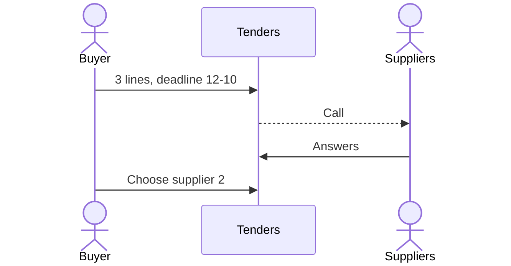

🏠 [Specs](../../../../README.md) › 🧩 [Functional capabilities](../../../README.md) ›
📦 [F7 Purchasing and stock](../../README.md) › 📝 [Use cases](../README.md) ›
📝 [Use cases: FL-F7-06 Benchmark additions](README.md) › 📝 UC-F7-14 Run a call for tenders and rate suppliers

# 📝 UC-F7-14 Run a call for tenders and rate suppliers

**Status:** ✅ specified

## Summary

The buyer sends a call for tenders to several suppliers, compares their answers line by line, chooses, and rates the
suppliers.

## Personas

- [U04 Purchasing](../../../../01-users/personas/u04-purchasing.md)
- [U10 Supplier](../../../../01-users/personas/u10-supplier.md)

## Goal

The best offer, chosen on comparable answers.

## Trigger

A large or new purchase.

## Frequency

Monthly.

## Preconditions

- Suppliers with portal access, or email.

## Postconditions

- **Succeeded:** the winner's answer becomes an order; others are closed.
- **Failed:** no answer: the call is extended or cancelled.

## Main flow

1. The buyer creates a call for tenders ([S-F7-14](../../screens/06-benchmark-additions/s-f07-14-tenders.md)) with
   lines, quantities and a deadline, and sends it to the chosen suppliers.
2. Suppliers answer in the portal ([UC-F7-12](../01-procure/uc-f07-12-use-the-supplier-portal.md)) with prices, lead
   times and conditions.
3. After the deadline, answers show side by side, with each supplier's performance
   ([UC-F7-19](../07-supplier-agreements-and-performance/uc-f07-19-follow-supplier-performance.md)).
4. The buyer chooses per line; the winner's answer becomes an order, others are told.

## Alternative flows

- 4a. Split lines between suppliers.

## Error flows

- 2e. Deadline passed: answers closed.
- 3e. Only one answer: the buyer may extend the deadline.

## Business rules

- See F7's rules.

## Entities

- [E-F7-13 Call for tenders](../../data/e-f07-13-call-for-tenders.md)

## Permissions

Purchasing; managers approve; accounting reads; record rules by warehouse or site.

## Notifications

Suppliers: call and result.

## Audit events

Call sent, answers, choice.

## AI involvement

The AI assistant prepares it for confirmation
([BR-F3-07](../../../f03-assistant/business-rules/br-f03-07-no-deletes-no-irreversible-acts.md)); figures come from
queries ([BR-F3-03](../../../f03-assistant/business-rules/br-f03-03-figures-come-from-queries.md)).

## API, MCP and A2A exposure

T5 operations of F7 with the caller's rights; the MCP tool of F7; no A2A skill.

## Screens

- [S-F7-14](../../screens/06-benchmark-additions/s-f07-14-tenders.md)

## Flowchart

See [FL-F7-06 Benchmark additions](../../flows/fl-f07-06-benchmark-additions.md#flowchart).

## Sequence diagram

## Acceptance criteria

1. **Given** a call to 3 suppliers with a deadline of 2026-12-10 **when** 2 answer in time **then** the 2 answers show
   side by side.
2. **Given** an answer on 12-11 **when** it is sent **then** it is refused as late.
3. **Given** supplier 2 chosen **when** the choice is confirmed **then** a purchase order is created and the others
   told.

## Non-functional notes

None.

## Regulatory references

None.

## Related use cases

See [FL-F7-06](../../flows/fl-f07-06-benchmark-additions.md).

- [UC-F7-18 Manage supplier contracts and price agreements](../07-supplier-agreements-and-performance/uc-f07-18-manage-supplier-contracts-and-price-agreements.md)

- [UC-F7-19 Follow supplier performance](../07-supplier-agreements-and-performance/uc-f07-19-follow-supplier-performance.md)

## Open questions

None.

---

⬅️ [UC-F7-13 Set up warehouses, routes and rules](../03-replenish/uc-f07-13-set-up-warehouses-routes-and-rules.md) ·
⬆️ [Up](README.md) · ➡️ [UC-F7-15 Trade between group companies](uc-f07-15-trade-between-group-companies.md)
