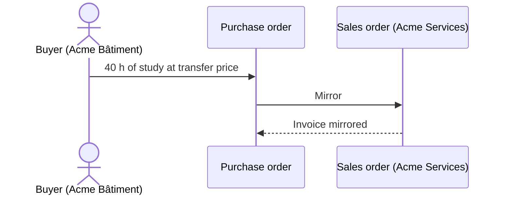

🏠 [Specs](../../../../README.md) › 🧩 [Functional capabilities](../../../README.md) ›
📦 [F7 Purchasing and stock](../../README.md) › 📝 [Use cases](../README.md) ›
📝 [Use cases: FL-F7-06 Benchmark additions](README.md) › 📝 UC-F7-15 Trade between group companies

# 📝 UC-F7-15 Trade between group companies

**Status:** ✅ specified

## Summary

A purchase from a sister company creates its sales order at the transfer price, with deliveries and invoices mirrored
and ready for eliminations.

## Personas

- [U04 Purchasing](../../../../01-users/personas/u04-purchasing.md)
- [U05 Accounting](../../../../01-users/personas/u05-accounting.md)

## Goal

Trade inside the group without entering everything twice.

## Trigger

A group company buys from another.

## Frequency

Weekly in groups.

## Preconditions

- Group companies set up in the same install.

## Postconditions

- **Succeeded:** both sides hold mirrored orders, deliveries and invoices
  ([BR-F7-09](../../business-rules/br-f07-09-group-orders-mirror.md)).
- **Failed:** a missing transfer price stops it.

## Main flow

1. The buyer orders from the sister company ([S-F7-15](../../screens/06-benchmark-additions/s-f07-15-group-trade.md)).
2. Its sales order is created at the transfer price.
3. Delivery and invoices mirror on both sides.
4. Accounting eliminates them in consolidation,
   [UC-F8-13](../../../f08-accounting/use-cases/05-close-report-and-consolidate/uc-f08-13-consolidate-the-group.md).

## Alternative flows

- 2a. Several currencies at the group's rate.

## Error flows

- 2e. Transfer price missing: asked before the sales order is created.

## Business rules

- [BR-F7-09 Orders between group companies mirror each other](../../business-rules/br-f07-09-group-orders-mirror.md)

## Entities

- Existing entities of the capability.

## Permissions

Purchasing; managers approve; accounting reads; record rules by warehouse or site. in each company.

## Notifications

The sister company: new order.

## Audit events

Mirrored documents.

## AI involvement

None.

## API, MCP and A2A exposure

T5 operations of F7 with the caller's rights; the MCP tool of F7; no A2A skill.

## Screens

- [S-F7-15](../../screens/06-benchmark-additions/s-f07-15-group-trade.md)

## Flowchart

See [FL-F7-06 Benchmark additions](../../flows/fl-f07-06-benchmark-additions.md#flowchart).

## Sequence diagram

## Acceptance criteria

1. **Given** Acme Bâtiment buying 40 hours from Acme Services at 80 EUR **when** the order is sent **then** a sales
   order of 3,200 EUR exists in Acme Services.
2. **Given** no transfer price **when** the order is sent **then** it asks the transfer price first.
3. **Given** the invoice issued by Acme Services **when** it is posted **then** the supplier invoice exists in Acme
   Bâtiment.

## Non-functional notes

None.

## Regulatory references

None.

## Related use cases

See [FL-F7-06](../../flows/fl-f07-06-benchmark-additions.md).

## Open questions

None.

---

⬅️ [UC-F7-14 Run a call for tenders and rate suppliers](uc-f07-14-run-a-call-for-tenders-and-rate-suppliers.md) ·
⬆️ [Up](README.md) · ➡️ [UC-F7-16](uc-f07-16-work-with-third-party-warehouses-and-channels.md)
