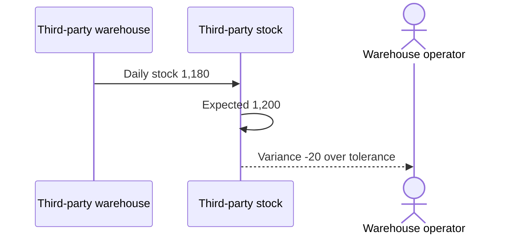

🏠 [Specs](../../../../README.md) › 🧩 [Functional capabilities](../../../README.md) ›
📦 [F7 Purchasing and stock](../../README.md) › 📝 [Use cases](../README.md) ›
📝 [Use cases: FL-F7-06 Benchmark additions](README.md) › 📝 UC-F7-16 Work with third-party warehouses and channels

# 📝 UC-F7-16 Work with third-party warehouses and channels

**Status:** ✅ specified

## Summary

One stock across own and third-party warehouses and sales channels: allocation per channel, transfers in transit and
daily reconciliation.

## Personas

- [U15 Warehouse operator](../../../../01-users/personas/u15-warehouse-operator.md)
- [U04 Purchasing](../../../../01-users/personas/u04-purchasing.md)

## Goal

Know and sell the whole stock wherever it sits.

## Trigger

Connecting a third-party warehouse or a channel.

## Frequency

Daily reconciliation.

## Preconditions

- The warehouse or channel connector (T12).

## Postconditions

- **Succeeded:** stock allocated and reconciled daily.
- **Failed:** a variance beyond tolerance waits for a person.

## Main flow

1. The operator connects the third-party warehouse or channel
   ([S-F7-16](../../screens/06-benchmark-additions/s-f07-16-third-party-stock.md)).
2. They allocate stock per channel.
3. Transfers to the third party are tracked in transit.
4. Each day, stock is reconciled with the third party's figures
   ([BR-F7-10](../../business-rules/br-f07-10-third-party-stock-is-reconciled-daily.md)).

## Alternative flows

- 3a. A transfer received short: the difference is claimed.

## Error flows

- 4e. Variance over tolerance: listed for a person.

## Business rules

- [BR-F7-10 Third-party stock is reconciled daily](../../business-rules/br-f07-10-third-party-stock-is-reconciled-daily.md)

## Entities

- Existing entities of the capability.

## Permissions

Warehouse operators for their warehouse; purchasing and managers read. Purchasing allocates.

## Notifications

Variances.

## Audit events

Allocations, transfers, reconciliations.

## AI involvement

None.

## API, MCP and A2A exposure

T5 operations of F7 with the caller's rights; the MCP tool of F7; no A2A skill.

## Screens

- [S-F7-16](../../screens/06-benchmark-additions/s-f07-16-third-party-stock.md)

## Flowchart

See [FL-F7-06 Benchmark additions](../../flows/fl-f07-06-benchmark-additions.md#flowchart).

## Sequence diagram

## Acceptance criteria

1. **Given** 1,200 expected and 1,180 reported **when** the reconciliation runs **then** a variance of -20 is listed.
2. **Given** a transfer of 300 in transit **when** it is received 295 **then** a claim of 5 is created.
3. **Given** stock allocated 60 % to the marketplace **when** orders arrive **then** the marketplace sees 60 %.

## Non-functional notes

None.

## Regulatory references

None.

## Related use cases

See [FL-F7-06](../../flows/fl-f07-06-benchmark-additions.md).

## Open questions

None.

---

⬅️ [UC-F7-15 Trade between group companies](uc-f07-15-trade-between-group-companies.md) · ⬆️ [Up](README.md) ·
➡️ [UC-F7-17 Repair products](uc-f07-17-repair-products.md)
