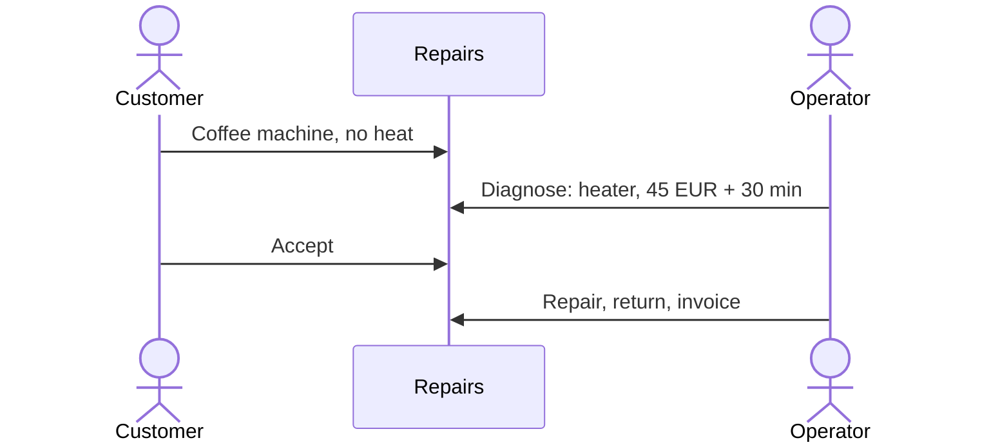

🏠 [Specs](../../../../README.md) › 🧩 [Functional capabilities](../../../README.md) ›
📦 [F7 Purchasing and stock](../../README.md) › 📝 [Use cases](../README.md) ›
📝 [Use cases: FL-F7-06 Benchmark additions](README.md) › 📝 UC-F7-17 Repair products

# 📝 UC-F7-17 Repair products

**Status:** ✅ specified

## Summary

Repair orders with diagnosis, parts, labour, warranty and invoicing.

## Personas

- [U15 Warehouse operator](../../../../01-users/personas/u15-warehouse-operator.md)
- [U09 Customer](../../../../01-users/personas/u09-customer.md)

## Goal

Repair customers' products and bill what is due.

## Trigger

A product brought for repair.

## Frequency

Daily for repair shops.

## Preconditions

F7 set up for the company.

## Postconditions

- **Succeeded:** repaired, returned and invoiced (or free under warranty).
- **Failed:** waits for parts.

## Main flow

1. The operator receives the product ([S-F7-17](../../screens/06-benchmark-additions/s-f07-17-repairs.md)) with the
   customer and the fault.
2. They diagnose and quote parts and labour; the customer accepts.
3. They repair, consuming parts from stock.
4. The product is returned and invoiced; under warranty, nothing is charged.

## Alternative flows

- 4a. Under warranty: no charge, parts claimed from the supplier.

## Error flows

- 3e. Part out of stock: ordered, the customer told the date.

## Business rules

- See F7's rules.

## Entities

- [E-F7-14 Repair order](../../data/e-f07-14-repair-order.md)

## Permissions

Warehouse operators for their warehouse; purchasing and managers read. Sales invoice.

## Notifications

Customer: quote, ready.

## Audit events

Received, quoted, repaired, returned.

## AI involvement

The AI assistant prepares it for confirmation
([BR-F3-07](../../../f03-assistant/business-rules/br-f03-07-no-deletes-no-irreversible-acts.md)); figures come from
queries ([BR-F3-03](../../../f03-assistant/business-rules/br-f03-03-figures-come-from-queries.md)).

## API, MCP and A2A exposure

T5 operations of F7 with the caller's rights; the MCP tool of F7; no A2A skill.

## Screens

- [S-F7-17](../../screens/06-benchmark-additions/s-f07-17-repairs.md)

## Flowchart

See [FL-F7-06 Benchmark additions](../../flows/fl-f07-06-benchmark-additions.md#flowchart).

## Sequence diagram

## Acceptance criteria

1. **Given** a machine under warranty until 2027-02 **when** it is repaired in 2026-12 **then** nothing is charged.
2. **Given** a heater out of stock **when** the repair is planned **then** it is ordered and the customer told the date.
3. **Given** a quote of 45 EUR plus 30 minutes **when** the customer accepts **then** the repair starts.

## Non-functional notes

None.

## Regulatory references

[CR-FR-067](../../../../10-country-packs/france/consumer/cr-fr-067-legal-guarantee-of-conformity.md).

## Related use cases

See [FL-F7-06](../../flows/fl-f07-06-benchmark-additions.md).

## Open questions

None.

---

⬅️ [UC-F7-16](uc-f07-16-work-with-third-party-warehouses-and-channels.md) · ⬆️ [Up](README.md) ·
➡️ [UC-F7-18](../07-supplier-agreements-and-performance/uc-f07-18-manage-supplier-contracts-and-price-agreements.md)
