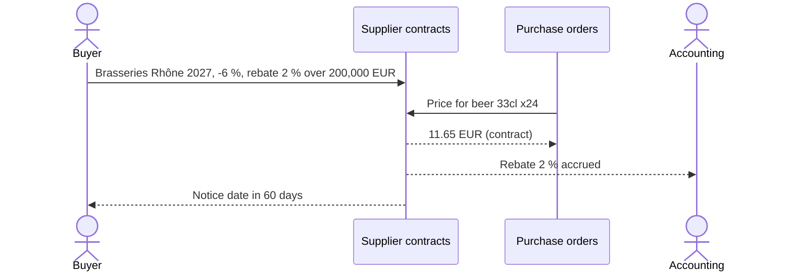

🏠 [Specs](../../../../README.md) › 🧩 [Functional capabilities](../../../README.md) ›
📦 [F7 Purchasing and stock](../../README.md) › 📝 [Use cases](../README.md) ›
📝 [Use cases: FL-F7-07 Supplier agreements and performance](README.md) ›
📝 UC-F7-18 Manage supplier contracts and price agreements

# 📝 UC-F7-18 Manage supplier contracts and price agreements

**Status:** ✅ specified

## Summary

The buyer records a supplier contract: its validity, agreed prices, volume rebates and renewal notice; orders take its
prices and the buyer is told before the notice date.

## Personas

- [U04 Purchasing and stock](../../../../01-users/personas/u04-purchasing.md)
- [U05 Accounting](../../../../01-users/personas/u05-accounting.md)

## Goal

Pay the agreed price, collect the rebates and never miss a renewal date.

## Trigger

A new supplier agreement or the yearly negotiation.

## Frequency

Yearly per main supplier.

## Preconditions

- The supplier exists ([E-F7-01](../../data/e-f07-01-supplier-record.md)).

## Postconditions

- **Succeeded:** the contract applies to orders and accrues rebates
  ([BR-F7-11](../../business-rules/br-f07-11-contract-prices-apply-within-their-validity.md)).
- **Failed:** orders use the supplier's price list.

## Main flow

1. The buyer opens Supplier contracts
   ([S-F7-18](../../screens/07-supplier-agreements-and-performance/s-f07-18-supplier-contracts.md)) and creates one:
   supplier, validity dates, notice period, the signed file.
2. They enter the agreed prices or discounts per item or category, and the volume rebate tiers.
3. Purchase orders take the contract price ([UC-F7-02](../01-procure/uc-f07-02-order-from-a-supplier.md)); a different
   price is flagged.
4. Purchases accrue the rebate; at the period's end, accounting invoices or deducts it
   ([CR-FR-174](../../../../10-country-packs/france/invoicing/cr-fr-174-discounts-on-invoices.md)).
5. Before the notice date, the buyer is told to renew, renegotiate or end it
   ([BR-F7-12](../../business-rules/br-f07-12-the-buyer-is-told-before-a-contracts-notice-date.md)).

## Alternative flows

- 1a. A yearly written agreement with a distributor's supplier
  ([CR-FR-171](../../../../10-country-packs/france/trade/cr-fr-171-supplier-distributor-agreement.md)).
- 2a. Blanket order quantities linked to the contract ([UC-F7-02](../01-procure/uc-f07-02-order-from-a-supplier.md)).

## Error flows

- 3e. An order at a price above the contract: flagged before sending.
- 5e. The notice date passed: the contract renews as written and the buyer is told.

## Business rules

- [BR-F7-11 Contract prices apply within their validity](../../business-rules/br-f07-11-contract-prices-apply-within-their-validity.md)
- [BR-F7-12 The buyer is told before a contract's notice date](../../business-rules/br-f07-12-the-buyer-is-told-before-a-contracts-notice-date.md)

## Entities

- [E-F7-15 Supplier contract](../../data/e-f07-15-supplier-contract.md)
- [E-F7-01 Supplier record](../../data/e-f07-01-supplier-record.md)

## Permissions

Purchasing; managers approve; accounting reads; record rules by warehouse or site.

## Notifications

The buyer: notice dates; accounting: rebates to claim.

## Audit events

Contract created, changed, renewed, ended.

## AI involvement

The AI assistant prepares it for confirmation
([BR-F3-07](../../../f03-assistant/business-rules/br-f03-07-no-deletes-no-irreversible-acts.md)); figures come from
queries ([BR-F3-03](../../../f03-assistant/business-rules/br-f03-03-figures-come-from-queries.md)).

## API, MCP and A2A exposure

T5 operations of F7 with the caller's rights; the MCP tool of F7; no A2A skill.

## Screens

- [S-F7-18 Supplier contracts](../../screens/07-supplier-agreements-and-performance/s-f07-18-supplier-contracts.md)
- [S-F7-02 Purchase order](../../screens/01-procure/s-f07-02-purchase-order.md)

## Flowchart

See
[FL-F7-07 Supplier agreements and performance](../../flows/fl-f07-07-supplier-agreements-and-performance.md#flowchart).

## Sequence diagram

## Acceptance criteria

1. **Given** Distribution Lemoine's 2027 contract with a supplier at -6 % **when** a purchase order is made **then** the
   contract price 11.65 EUR is used.
2. **Given** purchases of 210,000 EUR and a 2 % rebate above 200,000 EUR **when** the year closes **then** accounting
   gets a rebate of 4,200 EUR to claim.
3. **Given** a notice period of 3 months before 2027-12-31 **when** 2027-08-31 comes **then** the buyer is told 30 days
   before the notice date.
4. **Given** an order at 12.40 EUR **when** it is sent **then** it is flagged as above the contract.

## Non-functional notes

None.

## Regulatory references

[CR-FR-171](../../../../10-country-packs/france/trade/cr-fr-171-supplier-distributor-agreement.md);
[CR-FR-174](../../../../10-country-packs/france/invoicing/cr-fr-174-discounts-on-invoices.md);
[CR-FR-175](../../../../10-country-packs/france/trade/cr-fr-175-unfair-b2b-practices.md).

## Related use cases

- [UC-F7-02 Order from a supplier](../01-procure/uc-f07-02-order-from-a-supplier.md)
- [UC-F7-14 Run a call for tenders and rate suppliers](../06-benchmark-additions/uc-f07-14-run-a-call-for-tenders-and-rate-suppliers.md)

## Open questions

None.

---

⬅️ [UC-F7-17 Repair products](../06-benchmark-additions/uc-f07-17-repair-products.md) · ⬆️ [Up](README.md) ·
➡️ [UC-F7-19 Follow supplier performance](uc-f07-19-follow-supplier-performance.md)
