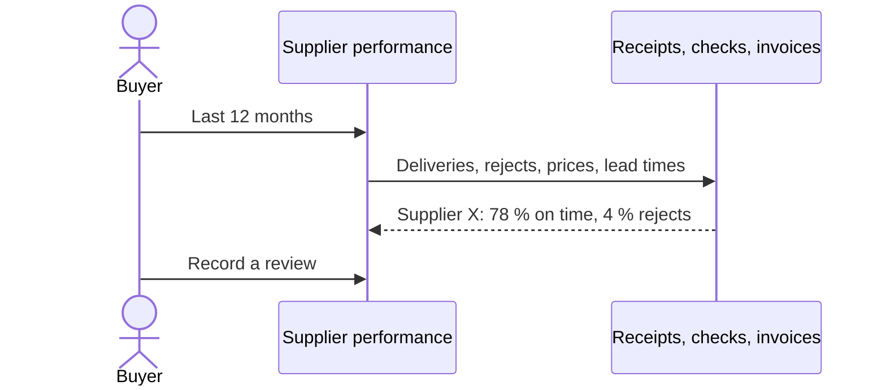

🏠 [Specs](../../../../README.md) › 🧩 [Functional capabilities](../../../README.md) ›
📦 [F7 Purchasing and stock](../../README.md) › 📝 [Use cases](../README.md) ›
📝 [Use cases: FL-F7-07 Supplier agreements and performance](README.md) › 📝 UC-F7-19 Follow supplier performance

# 📝 UC-F7-19 Follow supplier performance

**Status:** ✅ specified

## Summary

Purchasing and the owner read each supplier's on-time delivery, quality rejects, price variance and lead-time drift, and
act on the weakest.

## Personas

- [U04 Purchasing and stock](../../../../01-users/personas/u04-purchasing.md)
- [U13 Owner](../../../../01-users/personas/u13-owner.md)
- [U27 Quality manager](../../../../01-users/personas/u27-quality-manager.md)

## Goal

Keep good suppliers and fix or replace the others.

## Trigger

A monthly review, or a quality incident.

## Frequency

Monthly.

## Preconditions

- Receipts, quality checks and invoices recorded.

## Postconditions

- **Succeeded:** each supplier has its score and trend.
- **Failed:** with too few receipts, no score.

## Main flow

1. The buyer opens Supplier performance
   ([S-F7-19](../../screens/07-supplier-agreements-and-performance/s-f07-19-supplier-performance.md)) for the last 12
   months.
2. Per supplier: on-time and in-full deliveries, quality rejects, invoice price variance against the order and the
   contract, and the lead time against the agreed one.
3. The score combines them with the company's weights
   ([BR-F7-18](../../business-rules/br-f07-18-the-supplier-score-uses-the-companys-weights.md)).
4. For a weak supplier, the buyer opens the details, records a review with the supplier, or starts a call for tenders
   ([UC-F7-14](../06-benchmark-additions/uc-f07-14-run-a-call-for-tenders-and-rate-suppliers.md)).

## Alternative flows

- 2a. The quality manager reads quality rejects by product.

## Error flows

- 2e. Fewer than 5 receipts in the period: no score, the counts only.

## Business rules

- [BR-F7-18 The supplier score uses the company's weights](../../business-rules/br-f07-18-the-supplier-score-uses-the-companys-weights.md)

## Entities

- [E-F7-16 Supplier score](../../data/e-f07-16-supplier-score.md)
- [E-F7-01 Supplier record](../../data/e-f07-01-supplier-record.md)

## Permissions

Purchasing; managers approve; accounting reads; record rules by warehouse or site. The owner and the quality manager
read.

## Notifications

Purchasing: a supplier under the bar.

## Audit events

Weights changed; reviews recorded.

## AI involvement

The AI assistant prepares it for confirmation
([BR-F3-07](../../../f03-assistant/business-rules/br-f03-07-no-deletes-no-irreversible-acts.md)); figures come from
queries ([BR-F3-03](../../../f03-assistant/business-rules/br-f03-03-figures-come-from-queries.md)).

## API, MCP and A2A exposure

T5 operations of F7 with the caller's rights; the MCP tool of F7; no A2A skill.

## Screens

- [S-F7-19 Supplier performance](../../screens/07-supplier-agreements-and-performance/s-f07-19-supplier-performance.md)

## Flowchart

See
[FL-F7-07 Supplier agreements and performance](../../flows/fl-f07-07-supplier-agreements-and-performance.md#flowchart).

## Sequence diagram

## Acceptance criteria

1. **Given** a supplier with 50 receipts, 39 on time and in full **when** the screen opens **then** it shows 78 % on
   time.
2. **Given** 2 rejected receipts of 50 **when** the score is computed **then** rejects show 4 %.
3. **Given** invoices 3 % above the contract on average **when** the screen opens **then** price variance shows +3 %.
4. **Given** a supplier with 3 receipts **when** the screen opens **then** no score shows, only the counts.

## Non-functional notes

None.

## Regulatory references

None.

## Related use cases

- [UC-F7-14 Run a call for tenders and rate suppliers](../06-benchmark-additions/uc-f07-14-run-a-call-for-tenders-and-rate-suppliers.md)
- [UC-F7-18 Manage supplier contracts and price agreements](uc-f07-18-manage-supplier-contracts-and-price-agreements.md)

## Open questions

None.

---

⬅️ [UC-F7-18](uc-f07-18-manage-supplier-contracts-and-price-agreements.md) · ⬆️ [Up](README.md) ·
➡️ [UC-F7-20](../08-catalogues-and-stock-levels/uc-f07-20-order-from-an-approved-catalogue-or-punch-out.md)
