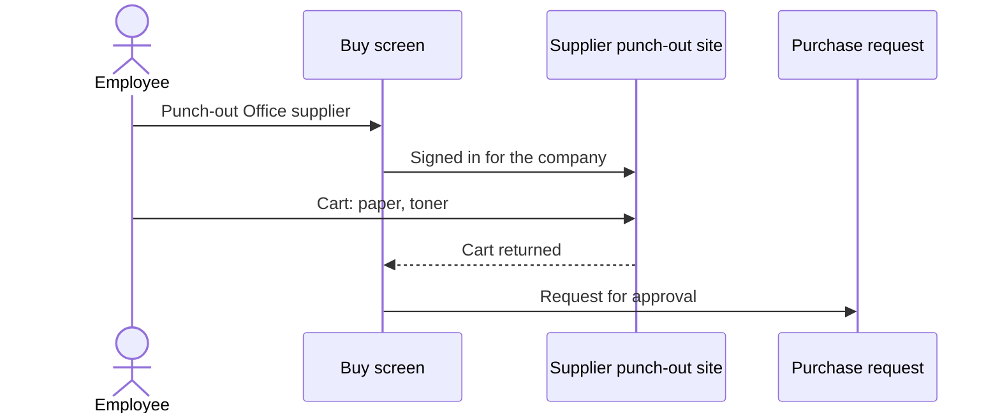

🏠 [Specs](../../../../README.md) › 🧩 [Functional capabilities](../../../README.md) ›
📦 [F7 Purchasing and stock](../../README.md) › 📝 [Use cases](../README.md) ›
📝 [Use cases: FL-F7-08 Catalogues and stock levels](README.md) ›
📝 UC-F7-20 Order from an approved catalogue or punch-out

# 📝 UC-F7-20 Order from an approved catalogue or punch-out

**Status:** ✅ specified

## Summary

An employee orders supplies from the company's approved catalogue or from a supplier's punch-out site; the cart becomes
a purchase request that follows its approval.

## Personas

- [U01 Employee](../../../../01-users/personas/u01-employee.md)
- [U04 Purchasing and stock](../../../../01-users/personas/u04-purchasing.md)
- [U02 Manager](../../../../01-users/personas/u02-manager.md)

## Goal

Employees buy what they need at contract prices, without asking the buyer each time.

## Trigger

An employee needs supplies or a service.

## Frequency

Weekly per team.

## Preconditions

- Catalogues or punch-out connections set by purchasing ([E-F7-17](../../data/e-f07-17-approved-catalogue.md)).

## Postconditions

- **Succeeded:** a purchase request with the cart's lines waits for approval
  ([UC-F7-01](../01-procure/uc-f07-01-request-and-approve-a-purchase.md)).
- **Failed:** nothing is requested.

## Main flow

1. The employee opens Buy ([S-F7-20](../../screens/08-catalogues-and-stock-levels/s-f07-20-buy.md)) and searches the
   approved catalogue; items show at contract prices.
2. Or they choose a supplier's punch-out: the supplier's site opens signed in for the company, and they fill a cart
   there.
3. The cart comes back to SimpleERP as request lines
   ([BR-F7-13](../../business-rules/br-f07-13-catalogue-and-punch-out-carts-become-requests.md)).
4. They add the project or department and send; the request follows the approval chain
   ([UC-F7-01](../01-procure/uc-f07-01-request-and-approve-a-purchase.md)).

## Alternative flows

- 1a. An item not in the catalogue: a free request to the buyer.

## Error flows

- 3e. A punch-out cart with an item off contract: flagged for the buyer.
- 2e. The punch-out site is unreachable: the employee is told to use the catalogue.

## Business rules

- [BR-F7-13 Catalogue and punch-out carts become requests](../../business-rules/br-f07-13-catalogue-and-punch-out-carts-become-requests.md)
- [BR-F7-01 Purchases approved by amount and budget](../../business-rules/br-f07-01-purchases-approved-by-amount-and-budget.md)

## Entities

- [E-F7-17 Approved catalogue](../../data/e-f07-17-approved-catalogue.md)
- [E-F7-02 Purchase request](../../data/e-f07-02-purchase-request.md)

## Permissions

Employees for their department's catalogues; purchasing manages catalogues.

## Notifications

The approver: request to approve.

## Audit events

Cart returned, request sent.

## AI involvement

The AI assistant prepares it for confirmation
([BR-F3-07](../../../f03-assistant/business-rules/br-f03-07-no-deletes-no-irreversible-acts.md)); figures come from
queries ([BR-F3-03](../../../f03-assistant/business-rules/br-f03-03-figures-come-from-queries.md)).

## API, MCP and A2A exposure

T5 operations of F7 with the caller's rights; the MCP tool of F7; no A2A skill.

## Screens

- [S-F7-20 Buy](../../screens/08-catalogues-and-stock-levels/s-f07-20-buy.md)
- [S-F7-01 Purchase request](../../screens/01-procure/s-f07-01-purchase-request.md)

## Flowchart

See [FL-F7-08 Catalogues and stock levels](../../flows/fl-f07-08-catalogues-and-stock-levels.md#flowchart).

## Sequence diagram

## Acceptance criteria

1. **Given** the approved catalogue with paper at the contract price 3.20 EUR **when** an employee adds 10 reams
   **then** the request shows 32.00 EUR.
2. **Given** a punch-out cart of 4 lines **when** it returns **then** 4 request lines exist with the supplier's
   references.
3. **Given** an item not on the contract in the cart **when** it returns **then** it is flagged for the buyer.
4. **Given** a request of 140 EUR **when** it is sent **then** it follows the approval chain.

## Non-functional notes

None.

## Regulatory references

None.

## Related use cases

- [UC-F7-01 Request and approve a purchase](../01-procure/uc-f07-01-request-and-approve-a-purchase.md)
- [UC-F7-18 Manage supplier contracts and price agreements](../07-supplier-agreements-and-performance/uc-f07-18-manage-supplier-contracts-and-price-agreements.md)

## Open questions

None.

---

⬅️ [UC-F7-19](../07-supplier-agreements-and-performance/uc-f07-19-follow-supplier-performance.md) · ⬆️ [Up](README.md) ·
➡️ [UC-F7-21](../03-replenish/uc-f07-21-set-safety-stock-and-min-max-per-item.md)
