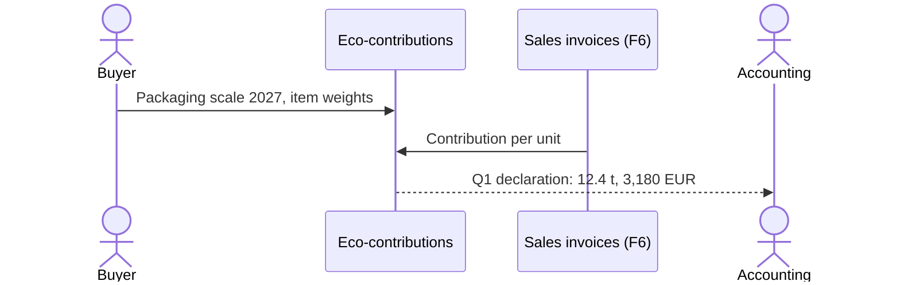

🏠 [Specs](../../../../README.md) › 🧩 [Functional capabilities](../../../README.md) ›
📦 [F7 Purchasing and stock](../../README.md) › 📝 [Use cases](../README.md) ›
📝 [Use cases: FL-F7-09 Compliance and carbon](README.md) › 📝 UC-F7-22 Charge and declare packaging eco-contributions

# 📝 UC-F7-22 Charge and declare packaging eco-contributions

**Status:** ✅ specified

## Summary

Purchasing sets each item's packaging and eco-contribution under extended producer responsibility; the contribution
shows on invoices and is declared to the eco-organisation.

## Personas

- [U04 Purchasing and stock](../../../../01-users/personas/u04-purchasing.md)
- [U05 Accounting](../../../../01-users/personas/u05-accounting.md)

## Goal

Pay and pass on the right eco-contributions, and declare them on time.

## Trigger

A new item placed on the French market; the declaration date.

## Frequency

Per new item; declaration per period.

## Preconditions

- The company's EPR identifier is set
  ([CR-FR-073](../../../../10-country-packs/france/products/cr-fr-073-epr-unique-identifier.md)).

## Postconditions

- **Succeeded:** each item carries its contribution; the declaration is ready.
- **Failed:** items without a scale are listed.

## Main flow

1. The buyer opens Eco-contributions ([S-F7-22](../../screens/09-compliance-and-carbon/s-f07-22-eco-contributions.md))
   and sets the eco-organisation's scales per sector (packaging, electrical equipment, furniture).
2. Each item gets its packaging weights and materials, or its scale category.
3. Sales invoices show the eco-contribution apart where the law requires
   ([BR-F7-15](../../business-rules/br-f07-15-eco-contributions-are-shown-apart-and-declared.md)).
4. At the period's end, the declaration lists quantities placed on the market per category; accounting pays it.

## Alternative flows

- 2a. Bought from a supplier who already paid: marked, not declared again.

## Error flows

- 2e. An item without a scale: listed, and its sale shows a warning.

## Business rules

- [BR-F7-15 Eco-contributions are shown apart and declared](../../business-rules/br-f07-15-eco-contributions-are-shown-apart-and-declared.md)

## Entities

- [E-F7-18 Eco-contribution scale](../../data/e-f07-18-eco-contribution-scale.md)
- [E-F7-06 Item](../../data/e-f07-06-item.md)

## Permissions

Purchasing; managers approve; accounting reads; record rules by warehouse or site. Accounting pays.

## Notifications

Purchasing: items without a scale; declaration due.

## Audit events

Scales and item weights changed; declarations.

## AI involvement

The AI assistant prepares it for confirmation
([BR-F3-07](../../../f03-assistant/business-rules/br-f03-07-no-deletes-no-irreversible-acts.md)); figures come from
queries ([BR-F3-03](../../../f03-assistant/business-rules/br-f03-03-figures-come-from-queries.md)).

## API, MCP and A2A exposure

T5 operations of F7 with the caller's rights; the MCP tool of F7; no A2A skill.

## Screens

- [S-F7-22 Eco-contributions](../../screens/09-compliance-and-carbon/s-f07-22-eco-contributions.md)

## Flowchart

See [FL-F7-09 Compliance and carbon](../../flows/fl-f07-09-compliance-and-carbon.md#flowchart).

## Sequence diagram

## Acceptance criteria

1. **Given** an item with 120 g of cardboard and 30 g of plastic **when** the scale is applied **then** its
   eco-contribution per unit is computed.
2. **Given** Q1 sales of 82,000 units **when** the declaration is prepared **then** it lists tonnage and amount per
   material.
3. **Given** an item without a scale **when** it is sold **then** the invoice shows a warning and the item is listed.

## Non-functional notes

None.

## Regulatory references

[CR-FR-073](../../../../10-country-packs/france/products/cr-fr-073-epr-unique-identifier.md);
[CR-FR-094](../../../../10-country-packs/france/environment/cr-fr-094-unsold-non-food-goods.md).

## Related use cases

- [UC-F7-02 Order from a supplier](../01-procure/uc-f07-02-order-from-a-supplier.md)
- [UC-F6-06 Invoice: deposits, progress and final](../../../f06-customers-and-sales/use-cases/03-invoice-and-get-paid/uc-f06-06-invoice-deposits-progress-and-final.md)

## Open questions

None.

---

⬅️ [UC-F7-21](../03-replenish/uc-f07-21-set-safety-stock-and-min-max-per-item.md) · ⬆️ [Up](README.md) ·
➡️ [UC-F7-23](../02-receive-and-store/uc-f07-23-store-dangerous-goods-with-their-safety-data-sheets.md)
